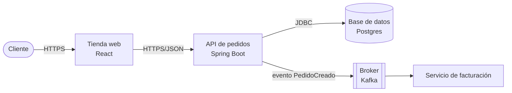

# Guía de estudio y entrevista — los 26 retos del assessment Pragma

Una sola guía para **explicar cada concepto y cada reto en detalle**. Reúne lo que antes estaba repartido en tres archivos: la guía de entrevista (cómo abrir cada reto), el repaso Master (conceptos y respuestas de los retos 20 al 26) y la hoja de retos (enunciados, entregas y ejemplos). Los archivos anteriores quedaron en `_anteriores/`.

## Cómo usar esta guía

Cada reto tiene siempre las mismas seis partes, en el mismo orden:

| Parte | Para qué sirve |
|---|---|
| 1. Cómo abrirlo | La frase de apertura, qué archivos mostrar y qué contar. Úsala antes de abrir el código. |
| 2. El concepto | Lo que tienes que poder explicar sin mirar nada, con un ejemplo fácil. |
| 3. El reto en detalle | Enunciado, qué entregar y "demuestra dominio si". Incluye un ejemplo en otro dominio, plegado. |
| 4. Cómo lo resolví | Tu implementación y el error que corregiste (retos 1 al 19). En los retos 20 al 26, el paso a paso para resolverlos. |
| 5. Evidencia en Entitlement | Qué existe en el código real de los micros y qué no. No afirmes como experiencia lo que figura como "no encontrado". |
| 6. Preguntas para practicar | Las que más te pueden hacer. En Master traen respuestas modelo plegadas. |

**Antes de una entrevista:** lee el mapa rápido, escoge el reto y di la frase de apertura (parte 1). **Para estudiar:** parte 2, luego intenta explicar el reto en voz alta con la parte 3 tapada. **Para autoevaluarte:** responde las preguntas en menos de 2 minutos; si te cuesta más que escribir el código, el hueco está en el concepto.

<a id="mapa-rapido"></a>

## Mapa rápido

| # | Tema | Nivel | De qué trata | Estado |
|---|---|---|---|---|
| 1 | [POO](#reto-1) | Trainer | Nómina con herencia, polimorfismo y genéricos | ✅ Cerrado — verificado el 2026-09-23 |
| 2 | [Código limpio (SOLID/KISS/YAGNI/DRY)](#reto-2) | Trainer | Refactor de un validador de créditos (SRP, OCP, Strategy) | ✅ Cerrado — verificado el 2026-09-23 |
| 3 | [Excepciones y depuración](#reto-3) | Trainer | Procesador de pagos con excepciones checked y try-with-resources | ✅ Cerrado — verificado el 2026-09-29 |
| 4 | [Estructuras de datos](#reto-4) | Trainer | Totales por cliente con `Map`, a mano, sin Collectors | ✅ Cerrado — verificado el 2026-09-29 |
| 5 | [Arquitectura de capas](#reto-5) | Trainer | Citas en 3 capas: Controller / Service / Repository | ✅ Cerrado — verificado el 2026-09-29 |
| 6 | [Patrones GRASP](#reto-6) | Trainer | Quién tiene cada responsabilidad: Experto y Creador | ✅ Cerrado — verificado el 2026-09-29 |
| 7 | [Normalización de BD / modelo E-R](#reto-7) | Trainer | Normalizar una tabla de matrículas hasta 3FN | ✅ Cerrado — verificado el 2026-09-29 |
| 8 | [Uso de asistente de IA](#reto-8) | Junior | Dónde sí y dónde no usé IA (sin código) | ✅ Cerrado — verificado el 2026-09-23 |
| 9 | [Protocolo adicional a REST (WebSocket)](#reto-9) | Advanced | Notificaciones en tiempo real: broadcast y mensaje privado | ✅ Cerrado — verificado el 2026-09-29 |
| 10 | [Caché (Redis y estrategias)](#reto-10) | Advanced | Cache-Aside con TTL (+ comparación con Write-Through) | ✅ Cerrado — verificado el 2026-10-02 |
| 11 | [Clean Architecture (hexagonal)](#reto-11) | Senior | Citas en hexagonal: puertos y adaptadores intercambiables | ✅ Cerrado — verificado el 2026-10-02 |
| 12 | [Patrones GoF](#reto-12) | Senior | Builder + Strategy + Observer en un generador de reportes | ✅ Cerrado — verificado el 2026-10-03 |
| 13 | [Resiliencia](#reto-13) | Senior | Pasarela de pagos que falla: Retry, CircuitBreaker, Bulkhead, Fallback | ✅ Cerrado — verificado el 2026-10-03 |
| 14 | [Pruebas BDD](#reto-14) | Senior | Pruebas Cucumber para reservar una cita | ✅ Cerrado — verificado el 2026-10-03 |
| 15 | [Reactivo / funcional](#reto-15) | Senior | El use case de citas en Mono/Flux con timeout y fallback | ✅ Cerrado — verificado el 2026-10-03 |
| 16 | [EDA (eventos)](#reto-16) | Senior | Evento `CitaReservada` en Kafka con consumidor idempotente | ✅ Cerrado — verificado el 2026-10-03 |
| 17 | [IaC + escaneo de seguridad](#reto-17) | Senior | Terraform con IAM de mínimo privilegio + pipeline de escaneo | ✅ Cerrado — verificado el 2026-10-03 |
| 18 | [Seguridad: OWASP / CWE](#reto-18) | Senior | Encontrar y corregir un control de acceso roto | ✅ Cerrado — verificado el 2026-10-03 |
| 19 | [DDD](#reto-19) | Senior | Cuenta bancaria: Aggregate Root, Value Object y evento de dominio | ✅ Cerrado — verificado el 2026-10-03 |
| 20 | [Documentación de arquitectura](#reto-20) | Master | Documentación de arquitectura: C4, ADR y diagramas de secuencia, clases y ER | 🔲 TODO |
| 21 | [Cloud: infraestructura mínima](#reto-21) | Master | Infraestructura mínima en AWS como código: enrutamiento, cómputo y almacenamiento | 🔲 TODO |
| 22 | [DevOps / IaC / zero trust / IA](#reto-22) | Master | IaC con dos herramientas, zero trust, pruebas de rendimiento e IA en DevSecOps | 🔲 TODO |
| 23 | [Seguridad en la arquitectura](#reto-23) | Master | Tácticas de seguridad (resistir y detectar) contra la enumeración de ids | 🔲 TODO |
| 24 | [Diseño de arquitectura](#reto-24) | Master | Atributos de calidad, escenarios, comparación de arquitecturas y ADR | 🔲 TODO |
| 25 | [Observabilidad](#reto-25) | Master | Métricas, logs y trazas de la pasarela, con alerta y runbook | 🔲 TODO |
| 26 | [Arquitectura de datos](#reto-26) | Master | Ciclo de vida de los datos de citas: captura a disposición | 🔲 TODO |

**Hilo conductor para contarlo:** los retos 5, 6, 11, 14, 15 y 16 son el MISMO sistema de citas médicas visto desde ángulos distintos: primero en capas (5), luego asignando responsabilidades (6), luego en hexagonal (11), después probado con BDD (14), reactivo (15) y publicando eventos (16). Si el entrevistador pregunta "¿cómo se conectan?", ahí está la respuesta.

**Agrupados por tema:** fundamentos (1, 2, 3, 4) · arquitectura y diseño (5, 6, 11, 19, 12) · datos y caché (7, 10) · comunicación (9, 16) · resiliencia y calidad (13, 14) · paradigma reactivo (15) · seguridad e infraestructura (17, 18) · IA (8) · nivel Master (20 al 26): documentación (20), cloud e IaC (21, 22), seguridad (23), diseño de arquitectura (24), observabilidad (25), datos (26).

## Tu evaluador real: Rudyard Fuji Vásquez Izquierdo

8 años como Technical Leader / Back End Developer (Mercania y Chazki, Perú), antes Analista de Soluciones y Back End en core bancario. Esto importa porque un evaluador pregunta más profundo en los temas donde **él mismo tiene cicatrices reales** — ahí es donde te va a repreguntar "¿y si...?" hasta encontrar el límite de tu entendimiento. En los temas donde no tiene experiencia directa, suele quedarse en la pregunta de concepto.

| Probabilidad | Temas | Por qué (evidencia en su CV) |
|---|---|---|
| 🔴 Alta | 15-Reactivo, 10-Cache, 11-Clean-Architecture, 2-SOLID, 12-GoF, 9-Protocolo, 18-OWASP | Lideró la **migración de POO a programación funcional con Spring WebFlux** (Mercania) — es la coincidencia más directa de todo el CV. Además: Redis explícito, arquitectura de microservicios en dos empresas, "SOLID, Patrones de Diseño, Clean Code" listado en AMBOS trabajos, SOAP en core bancario + APIs REST para B2B, JWT en ambos roles. |
| 🟡 Media | 5-Arquitectura-Capas, 6-GRASP, 7-Normalización-BD, 13-Resiliencia, 16-EDA, 8-Uso-IA | Trabajó con SQL Server/MySQL/Postgres (modelado de datos) y lideró "middleware para comunicación entre plataformas" (concepto cercano a EDA, aunque no nombra Kafka/RabbitMQ puntual). Resiliencia no aparece explícita, pero microservicios en producción la implica. |
| 🟢 Baja | 3-Excepciones, 4-Estructuras-Datos, 14-BDD, 17-IaC, 19-DDD | No hay evidencia directa en su CV (no menciona Cucumber/Karate, ni Terraform/CloudFormation, ni DDD como tal). Probablemente los pregunte a nivel de concepto general, no de "cuéntame un caso real que viviste". |

**Cómo usar esto:** no te saltes ningún reto — igual todos están en tu assessment — pero si el tiempo aprieta, resuelve primero los 🔴 Alta con el nivel de profundidad más alto posible (no solo que compile, que puedas defender cada decisión). En los 🔴 vas a ver un aparte "🎯 Con Rudyard" con la pregunta específica que es más probable que te haga, basada en su experiencia real.

---

<a id="reto-1"></a>

## Reto 1 — POO

| Nivel | Carpeta | Módulos | Estado | Probabilidad con tu evaluador |
|---|---|---|---|---|
| Trainer | `1-POO` | model + app-service | ✅ Cerrado — verificado el 2026-09-23 | — |

### 1. Cómo abrirlo (30 segundos)

**Antes de abrir el código, di:** "Este proyecto modela una nómina con herencia y polimorfismo: un `Empleado` abstracto con dos tipos, fijo y por horas, y cada uno calcula su salario a su manera. Hay una clase genérica `Nomina` que suma el total sin saber de qué tipo es cada empleado. La idea es mostrar polimorfismo y genéricos en vez de `instanceof` o casts."

**Archivos a mostrar:** `Empleado` (abstracta), `EmpleadoFijo`, `EmpleadoPorHoras`, `Bonificable` (solo la implementa el fijo), `Nomina<T extends Empleado>`.

**Para contar:** tuve un bug real, `EmpleadoFijo.calcularSalario()` devolvía `salarioBase * 2`; era un error de lógica, no de diseño.

**En Entitlement:** Abre con `RoleCode`: "la validación vive en el tipo, no regada por los casos de uso". Luego `CommandHandler<T>` para genéricos y polimorfismo.

**Pregunta probable:** ¿por qué `Nomina<T>` no necesita saber el tipo concreto, y qué diferencia hay con `List<Object>` y casts?

### 2. El concepto: lo que tienes que poder explicar

El polimorfismo permite que una clase abstracta (`Empleado`) delegue en cada subtipo (`EmpleadoFijo`, `EmpleadoPorHoras`) la implementación de un método común (`calcularSalario()`). El código que usa `Empleado` no necesita conocer el tipo concreto ni usar `instanceof`: cada objeto resuelve su propio comportamiento. Este es el mismo principio que sostiene Clean Architecture y varios patrones GoF, aplicado ahí a nivel de arquitectura en vez de a nivel de clase.

**Para qué te sirve este reto:** Cierra el concepto de polimorfismo y herencia: que cada subtipo resuelva su propio comportamiento sin que el código que los usa necesite preguntar "qué tipo sos" (`instanceof`). En tus servicios Spring de Entitlement es lo mismo que evitar un `if (tipo.equals(...))` cada vez que aparece un nuevo tipo de rol o solicitante.

#### Ejemplo fácil de explicar

Piensa en canales de notificación. La clase abstracta define *qué* se hace; cada subclase define *cómo*:

```java
abstract class Canal { abstract String enviar(String mensaje); }
class Correo extends Canal { String enviar(String m) { return "correo: " + m; } }
class Sms    extends Canal { String enviar(String m) { return "sms: " + m; } }

List<Canal> canales = List.of(new Correo(), new Sms());
canales.forEach(c -> c.enviar("tu flujo fue aprobado"));   // polimorfismo: quien llama no sabe cuál es cuál
```
Cuándo NO: si las "subclases" solo cambian un dato, no necesitas herencia; basta un campo o un enum.

### 3. El reto en detalle

**Reto:** Modela un sistema de nómina con `Empleado` (clase abstracta) y dos tipos, `EmpleadoFijo` (salario fijo) y `EmpleadoPorHoras` (salario = horas × tarifa), cada uno con su propia lógica de `calcularSalario()`. Agrega una interfaz `Bonificable { double calcularBono(); }` que solo implementa `EmpleadoFijo`. Crea una clase genérica `Nomina<T extends Empleado>` que reciba una lista de empleados y calcule el total a pagar sin usar `instanceof` en ningún punto.

**Entrega:** código + un párrafo explicando qué pasaría si agregas un tercer tipo `EmpleadoComisionista` — qué archivos tocas y cuáles no.

**Demuestra dominio si:** puedes explicar por qué `Nomina<T>` no necesita saber qué tipo concreto de empleado está sumando, y qué diferencia hay entre eso y usar `List<Object>` con casts.

<details>
<summary><b>Ejemplo de la técnica en otro dominio</b> (úsalo para entender, no para copiar)</summary>

**Ejemplo (dominio: zoológico):**
```java
abstract class Animal {
    String nombre;
    abstract String hacerSonido();
}
class Perro extends Animal {
    String hacerSonido() { return "Guau"; }
}
class Gato extends Animal implements Entrenable {
    String hacerSonido() { return "Miau"; }
    public void entrenar() { System.out.println(nombre + " aprendió un truco"); }
}
interface Entrenable { void entrenar(); }

class Zoologico<T extends Animal> {
    List<T> animales = new ArrayList<>();
    void agregar(T a) { animales.add(a); }
    void hacerRuido() {
        for (T a : animales) System.out.println(a.hacerSonido()); // sin instanceof
    }
}
```
**Cómo se traduce:** `Animal` → `Empleado`, `hacerSonido()` → `calcularSalario()`, `Entrenable` → `Bonificable` (solo `EmpleadoFijo` la implementa), `Zoologico<T>` → `Nomina<T>`.

</details>

### 4. Cómo lo resolví (para contarlo)

Ya implementé el modelo completo. `Empleado` es abstracta y deja `calcularSalario()` sin implementar; `EmpleadoFijo` devuelve `salarioBase` directo —sin depender de horas trabajadas— y además implementa `Bonificable` con `calcularBono()` al 10% del salario base; `EmpleadoPorHoras` calcula `horasTrabajadas * tarifaPorHora` y a propósito no implementa `Bonificable`, porque ese tipo de empleado no tiene bono. `Nomina<T extends Empleado>` recibe cualquier subtipo de `Empleado` y solo llama a `calcularSalario()` dentro del loop de `totalAPagar()` — en ningún punto usa `instanceof` ni necesita saber si el empleado es fijo o por horas.

Eso es lo que cierra la brecha de POO: el polimorfismo vive en `calcularSalario()`, cada subtipo resuelve el suyo, y `Nomina<T>` queda genérica y cerrada a cambios. Si mañana agrego `EmpleadoComisionista`, solo creo esa clase —que extienda `Empleado` e implemente `calcularSalario()`— y ni `Nomina` ni el resto del código existente se tocan. Esa es la diferencia real con `List<Object>` y casts: con casts, el código que usa la lista necesita conocer el tipo concreto para poder operar sobre él; con polimorfismo, nunca lo necesita.

### 5. Evidencia en Entitlement

<details>
<summary><b>Qué hay en el código real de los micros</b> (y qué no encontrado)</summary>

Evidencia del código real de los micros (rutas relativas a `Bancolombia/Micros/`). Es lo que hace el equipo; cuenta qué parte hiciste tú y cuál es del equipo.

- **Abstracción + herencia + validación:** `AbstractString` (clase abstracta con constructor protegido que valida) y `RoleCode extends AbstractString`, que solo acepta `TIT, TRE, REP, TAD, TAR`. Micro `Entitlement_Service_MR/ms_actors`, paquete `model/.../value`.
- **Genéricos:** `Command<P, C>(payload, context)` (record) y `DomainEvent<T>` en `ms_actors`; `CommandHandler<T extends CommandBusData>` y `CommandBus.dispatch(T command)` en `Monetary_Limits_MR/ms_limit_create`.
- **Anotaciones propias:** `@UseCase`, `@DomainService`, `@EventHandlerService` (masam_core_ms, ms_authorization_flows) y `@CommandHandlerService` (`ms_limit_create`) — marcadores `@Retention(RUNTIME)` que el registro descubre por reflexión.
- **Polimorfismo:** `ValidateSchemeChannelHandler implements SyncEventHandler<ValidateSchemeChannelInitiatedEvent>` en `Entitlement_MASAM_MR/masam_core_ms`: el bus resuelve el handler por tipo de evento.

**No encontrado en los micros (no lo afirmes como experiencia del proyecto):**

- No hay jerarquías profundas de herencia de negocio: el proyecto favorece composición + interfaces (gateways).

**Cómo contarlo en la entrevista:** Abre con `RoleCode`: "la validación vive en el tipo, no regada por los casos de uso". Luego `CommandHandler<T>` para genéricos y polimorfismo.

</details>

### 6. Preguntas para practicar

1. ¿Por qué `Nomina<T>` no necesita saber el tipo concreto, y qué diferencia hay con `List<Object>` y casts?
2. Criterio de dominio: te sientes listo si puedes explicar por qué `Nomina<T>` no necesita saber qué tipo concreto de empleado está sumando, y qué diferencia hay entre eso y usar `List<Object>` con casts.
3. ¿Qué pasaría si no hubieras aplicado esto? Responde en menos de 2 minutos, sin mirar el código.

[⬆ Volver al mapa](#mapa-rapido)

---

<a id="reto-2"></a>

## Reto 2 — Código limpio (SOLID/KISS/YAGNI/DRY)

| Nivel | Carpeta | Módulos | Estado | Probabilidad con tu evaluador |
|---|---|---|---|---|
| Trainer | `2-SOLID` | model + app-service | ✅ Cerrado — verificado el 2026-09-23 | 🔴 Alta |

### 1. Cómo abrirlo (30 segundos)

**Antes de abrir el código, di:** "Parte de un validador de solicitudes de crédito que lo hacía todo en un método con `if` anidados. Lo refactoricé con SRP y OCP: cada regla (edad, ingresos, historial) es su propia clase detrás de una interfaz, y el validador solo recorre la lista. Agregar una regla nueva es crear una clase, sin tocar las demás."

**Archivos a mostrar:** `ValidadorSolicitud`, `ReglaValidacion`, `ReglaEdad`, `ReglaIngresos`, `ReglaHistorial`.

**Para contar:** cometí dos bugs yo solo (`ReglaHistorial` no leía el campo real y `ReglaEdad` usaba `>` en vez de `>=`) y los corregí.

**En Entitlement:** Muestra el contraste: `DestinationStrategy` (OCP cumplido) vs `MonetaryLimitCreator` (el `if/else` que refactorizarías). Reconocer el defecto vale más que fingir que todo es perfecto.

**Pregunta probable:** ¿puedes agregar una regla nueva creando solo una clase, sin tocar ninguna existente?

### 2. El concepto: lo que tienes que poder explicar

SRP establece que una clase debe tener una sola razón para cambiar. Un método que valida, loguea y notifica en un solo bloque tiene tres razones para cambiar, no una — por eso se separa en una regla por responsabilidad (`ReglaEdad`, `ReglaIngresos`, `ReglaHistorial`). OCP se cumple porque el punto de extensión es la lista de reglas: agregar una regla nueva es agregar una clase, no modificar `ValidadorSolicitud`. El riesgo típico en la entrevista es quedarse en la definición del principio sin poder señalar, en código real, cuál se rompió y por qué el rediseño lo corrige.

**Para qué te sirve este reto:** Cierra el concepto de SRP y OCP: una clase con una sola razón para cambiar, y abierta a extensión sin modificar lo que ya funciona. Es la misma pregunta que te hacés cuando un método de un servicio Spring Boot termina validando, llamando al repositorio y armando la respuesta HTTP todo junto — eso es una violación de SRP en tu propio código, no solo en el reto.

#### Ejemplo fácil de explicar

Un `if/else` por tipo de descuento crece cada vez que el negocio inventa uno nuevo (viola OCP). Con Strategy cada regla es una clase y el código que decide no cambia:

```java
interface Descuento { boolean aplica(Pedido p); double calcular(Pedido p); }
// Spring inyecta List<Descuento>; para agregar uno nuevo solo creas otra clase
descuentos.stream().filter(d -> d.aplica(pedido)).findFirst().map(d -> d.calcular(pedido)).orElse(0.0);
```
Cuándo NO: con 2 casos estables un `if` es más simple (KISS/YAGNI).

### 3. El reto en detalle

**Reto:** Te dan (o escribes) una clase `ValidadorSolicitud` con un método de 40 líneas que valida un formulario de crédito: revisa edad, ingresos, historial, y según el resultado arma un mensaje, lo loguea, y lo envía por email — todo ahí mismo, con `if/else` anidados. Refactorízala en al menos 3 clases nuevas aplicando SRP y OCP (usa una lista de `ReglaValidacion` como Strategy en vez de `if/else`).

**Entrega:** código antes/después (aunque sea el "antes" resumido) + tabla de 3 columnas: principio aplicado, qué cambiaste, qué se rompería si no lo hubieras hecho.

**Demuestra dominio si:** puedes agregar una regla de validación nueva creando solo una clase, sin tocar ninguna de las existentes.

**🎯 Con Rudyard:** SOLID + Patrones de Diseño está en el stack técnico de sus dos roles como Technical Leader — no lo va a dejar en "sabe qué significa la S de SRP". Prepárate para que te pida nombrar, EN TU CÓDIGO, cuál principio rompiste primero (antes de refactorizar) y por qué el Strategy es mejor que solo dividir el método en 3 sin cambiar el diseño.

<details>
<summary><b>Ejemplo de la técnica en otro dominio</b> (úsalo para entender, no para copiar)</summary>

**Ejemplo (dominio: descuentos de una tienda):**
```java
interface ReglaDescuento {
    boolean aplica(Cliente c);
    double calcular(double total);
}
class DescuentoEstudiante implements ReglaDescuento {
    public boolean aplica(Cliente c) { return c.esEstudiante(); }
    public double calcular(double total) { return total * 0.9; }
}
class MotorDescuentos {
    List<ReglaDescuento> reglas;
    MotorDescuentos(List<ReglaDescuento> reglas) { this.reglas = reglas; }
    double aplicarDescuento(Cliente c, double total) {
        for (ReglaDescuento r : reglas)
            if (r.aplica(c)) return r.calcular(total);
        return total;
    }
}
```
**Cómo se traduce:** cada rama de tu `if/else` en `ValidadorSolicitud` (edad, ingresos, historial) se vuelve una clase `ReglaValidacion` con `aplica()`/`validar()`; `ValidadorSolicitud` queda como el `MotorDescuentos`: recibe la lista por constructor y solo orquesta.

</details>

### 4. Cómo lo resolví (para contarlo)

Ya implementé el patrón completo. Mi `ValidadorSolicitud.validar()` recorre la lista de `ReglaValidacion` que recibe por constructor, corta apenas encuentra una regla que no aprueba (`if (!resultado.isAprobada()) return resultado;`) y solo si todas pasan devuelve el resultado aprobado. La regla de negocio nunca vive en el orquestador — cada `ReglaXxx` valida un solo dato de `Solicitud` (edad, ingresos o historial) y no sabe nada de las otras dos.

Con esto cerré los dos principios que pedía el reto, en mi propio código:

- **SRP**: `ReglaEdad`, `ReglaIngresos` y `ReglaHistorial` tienen cada una una sola razón para cambiar. Si mañana el umbral de ingresos sube a 2.000.000, toco solo `ReglaIngresos` — nada más se ve afectado. `ValidadorSolicitud` tiene su propia única razón para cambiar: cómo se orquesta el recorrido (por ejemplo, si algún día necesito acumular todos los errores en vez de cortar en el primero), no qué reglas existen.
- **OCP**: para agregar una regla nueva —por ejemplo `ReglaMontoMaximo`— creo una clase que implemente `ReglaValidacion` y la agrego a la lista que le paso al constructor. No toco `ValidadorSolicitud` ni ninguna regla existente. El punto de extensión es exactamente ese `List<ReglaValidacion> reglas` recibido por constructor.

Vale la pena que recuerde los dos bugs que tuve en la primera versión, porque son el mismo tipo de error y probablemente me los vuelva a encontrar: `ReglaHistorial` devolvía `true` sin leer `isHistorialCrediticioOk()` — una regla que "aprobaba" sin validar nada — y `ReglaEdad` usaba `>` en vez de `>=`, rechazando a alguien de exactamente 18 años que el enunciado sí aprueba. La interfaz `ReglaValidacion` me obliga a implementar los métodos, pero no garantiza que la lógica de adentro sea correcta — eso solo lo valida una prueba con el caso borde real, no que el código compile.

### 5. Evidencia en Entitlement

<details>
<summary><b>Qué hay en el código real de los micros</b> (y qué no encontrado)</summary>

Evidencia del código real de los micros (rutas relativas a `Bancolombia/Micros/`). Es lo que hace el equipo; cuenta qué parte hiciste tú y cuál es del equipo.

- **SRP:** un caso de uso por clase con un método público. `CreateRuleExceptionUseCase` (`ms_actors`) solo orquesta (cambia estado → grupo granular → crea la excepción); el rollback es un método privado aparte (`onErrorResume(error -> rollbackGranularProduct(...))`).
- **DIP:** el dominio define el puerto `CreateRuleExceptionGateway`; la implementación `CreateRuleExceptionAdapter` (`@Repository`, `@Transactional("coreTransactionManager")`) vive en `driven-adapters/r2dbc-postgresql`. El caso de uso nunca ve R2DBC.
- **OCP bien aplicado:** `DestinationStrategy`/`OriginStrategy` con `supports(...)` y las implementaciones `DestinationRoleStrategy`, `DestinationThirdPartyStrategy`, `DestinationCustomerStrategy`, `DestinationDelegateStrategy` (`Monetary_Limits_MR/ms_limit_clone_processor`). Lo mismo con `CommandHandlersRegistry` en `ms_limit_create`.
- **OCP mal aplicado (úsalo como autocrítica):** `MonetaryLimitCreator.performActionValidationAndPersistence` (`ms_limit_create`) decide con `if/else if` sobre `ActionToPerform`. Es el candidato natural a Strategy.
- **DRY/KISS:** `ValidateActorRoleCapabilitiesUseCase` (`ms_admin_authorization`) indexa los productos en un `Set` de claves `id|tipo` en vez de recorrer la lista por cada producto solicitado (de O(n·m) a O(n+m)).

**No encontrado en los micros (no lo afirmes como experiencia del proyecto):**

- Strategy como `Map<String, XStrategy>` no aparece; el proyecto usa `List<Strategy>` + `supports()`.

**Cómo contarlo en la entrevista:** Muestra el contraste: `DestinationStrategy` (OCP cumplido) vs `MonetaryLimitCreator` (el `if/else` que refactorizarías). Reconocer el defecto vale más que fingir que todo es perfecto.

</details>

### 6. Preguntas para practicar

1. ¿Puedes agregar una regla nueva creando solo una clase, sin tocar ninguna existente?
2. Criterio de dominio: te sientes listo si puedes agregar una regla de validación nueva creando solo una clase, sin tocar ninguna de las existentes.
3. ¿Qué pasaría si no hubieras aplicado esto? Responde en menos de 2 minutos, sin mirar el código.

[⬆ Volver al mapa](#mapa-rapido)

---

<a id="reto-3"></a>

## Reto 3 — Excepciones y depuración

| Nivel | Carpeta | Módulos | Estado | Probabilidad con tu evaluador |
|---|---|---|---|---|
| Trainer | `3-Excepciones` | model + app-service | ✅ Cerrado — verificado el 2026-09-29 | 🟢 Baja |

### 1. Cómo abrirlo (30 segundos)

**Antes de abrir el código, di:** "Un procesador de pagos con dos excepciones checked propias, saldo insuficiente y pago inválido, que encadenan la causa. Usa un recurso simulado que se cierra con try-with-resources aunque el pago falle. Lo probé con tres tests."

**Archivos a mostrar:** `ProcesadorPagos`, `Pago`, `RegistroTransaccion` (`AutoCloseable`), `SaldoInsuficienteException`, `PagoInvalidoException`, `ProcesadorPagosTest`.

**En Entitlement:** Enum de errores centralizado + handler global que convierte excepción → HTTP. Cierra con la mejora del `cause`.

**Pregunta probable:** si `procesar()` lanza una excepción dentro del `try-with-resources`, ¿en qué orden pasan las cosas y se cierra el recurso?

### 2. El concepto: lo que tienes que poder explicar

Una excepción checked obliga a quien llama a manejar explícitamente una falla esperable del negocio (saldo insuficiente, monto inválido); una unchecked representa un error de programación que no tiene sentido forzar a capturar en cada punto de llamada. Encadenar la causa original en el constructor conserva el stacktrace real para depuración. `try-with-resources` garantiza el cierre del recurso incluso si el bloque lanza una excepción, porque el cierre ocurre en un `finally` implícito generado por el compilador.

**Para qué te sirve este reto:** Cierra el concepto de manejo de excepciones: distinguir cuándo una falla es esperable (checked) de cuándo es un error de programación (unchecked), y no perder el recurso ni la causa original al propagarla. Es el mismo concepto detrás del `@ControllerAdvice`/`@ExceptionHandler` que mapea excepciones de dominio a códigos HTTP en tus APIs.

#### Ejemplo fácil de explicar

```java
// unchecked: error de negocio, el llamador no puede "arreglarlo" en el momento
if (saldo < monto) throw new SaldoInsuficienteException(saldo, monto);

// checked: I/O que SÍ puede fallar y el llamador debe decidir
try (var in = Files.newInputStream(ruta)) { ... }          // try-with-resources cierra solo
catch (IOException e) { throw new ReporteException("no pude leer " + ruta, e); }   // chaining: conserva la causa (e)
```
Regla: una excepción por **qué falló en el negocio**, no por quién la lanzó; y siempre pasa la causa original.

### 3. El reto en detalle

**Reto:** Implementa `ProcesadorPagos.procesar(Pago pago)` que lance `SaldoInsuficienteException` (checked) si el monto excede el saldo disponible, y `PagoInvalidoException` (checked) si el monto es ≤ 0 — ambas con constructor que acepte causa encadenada. El método debe usar `try-with-resources` para "cerrar" un recurso simulado (`RegistroTransaccion implements AutoCloseable`). Escribe 3 pruebas: pago válido, saldo insuficiente, monto inválido.

**Entrega:** código + pruebas JUnit pasando.

**Demuestra dominio si:** puedes explicar, sin ver el código, en qué orden se ejecutan las cosas si `procesar()` lanza una excepción dentro del bloque `try-with-resources` — ¿se cierra igual el recurso?

<details>
<summary><b>Ejemplo de la técnica en otro dominio</b> (úsalo para entender, no para copiar)</summary>

**Ejemplo (dominio: inventario):**
```java
class StockInsuficienteException extends Exception {
    StockInsuficienteException(String msg, Throwable causa) { super(msg, causa); }
}
class ConexionAlmacen implements AutoCloseable {
    public void close() { System.out.println("Conexión cerrada"); }
}
class GestorInventario {
    void despachar(int cantidad, int stockDisponible) throws StockInsuficienteException {
        try (ConexionAlmacen conexion = new ConexionAlmacen()) {
            if (cantidad > stockDisponible) {
                throw new StockInsuficienteException("Pidieron " + cantidad + ", hay " + stockDisponible, null);
            }
            System.out.println("Despachado");
        }
    }
}
```
**Cómo se traduce:** `StockInsuficienteException` → `SaldoInsuficienteException`; `ConexionAlmacen` → tu `RegistroTransaccion`. Prueba en JUnit: `assertThrows(SaldoInsuficienteException.class, () -> procesador.procesar(pagoConMontoAlto))`.

</details>

### 4. Cómo lo resolví (para contarlo)

Implementé `ProcesadorPagos.procesar()` con `try-with-resources` sobre `RegistroTransaccion` (que implementa `AutoCloseable`), y las dos excepciones checked —`PagoInvalidoException` y `SaldoInsuficienteException`— con constructor que acepta causa encadenada. Cubrí los tres casos con JUnit: pago válido, saldo insuficiente y monto inválido, los tres pasan.

El `try-with-resources` garantiza que `RegistroTransaccion.close()` se ejecuta aunque `procesar()` lance una excepción dentro del bloque: el cierre del recurso ocurre antes de que la excepción se propague hacia quien llamó, no después. Eso es justo lo que evita que un recurso quede abierto cuando algo falla a mitad de camino.

### 5. Evidencia en Entitlement

<details>
<summary><b>Qué hay en el código real de los micros</b> (y qué no encontrado)</summary>

Evidencia del código real de los micros (rutas relativas a `Bancolombia/Micros/`). Es lo que hace el equipo; cuenta qué parte hiciste tú y cuál es del equipo.

- **Jerarquía propia:** `BusinessException` y `AppException`, ambas `extends BusinessExceptionECS` (librería ECS), y el enum `ConstantBusinessException` que trae HTTP status, mensaje, código de negocio, mensaje interno y código de log por cada error (`ms_actors/domain/model/.../exception`). Solo en `ms_actors` hay ~137 `new BusinessException(...)`.
- **Manejo global WebFlux:** `ExceptionResponse` (`@Order(-2)`, `extends AbstractErrorWebExceptionHandler`) en `ms_actors`: traduce `BusinessException` → `AppException` → error desconocido 500, y manda log a SQS. Equivalente: `GlobalWebExceptionHandler implements WebExceptionHandler` en `ms_limit_clone_processor`.
- **Manejo global MVC:** `CustomExceptionHandler` con `@ControllerAdvice` en `ms_masam` (el único micro MVC).
- **Traducción/wrapping:** en `ExecTrxCreateDelegateUseCase`, `.onErrorMap(t -> t instanceof AppException || t instanceof BusinessException ? t : new AppException(UNKNOWN_FINISH_CREATE_DELEGATE, messageId))`.
- **Compensación:** `onErrorResume(error -> rollback(...).then(Mono.error(error)))` en `CreateRuleExceptionUseCase`.
- **try-with-resources:** solo 2 usos reales, en `GetConsumerServiceAdapter` y `GenerateAndSendOtpAdapter` (`ms_masam`), sobre la respuesta HTTP.

**No encontrado en los micros (no lo afirmes como experiencia del proyecto):**

- Debilidad real: `BusinessException(ConstantBusinessException, Throwable)` solo propaga `getMessage()`, no el `cause`. El exception chaining queda débil — mencionarlo y decir cómo lo arreglarías es un buen punto.

**Cómo contarlo en la entrevista:** Enum de errores centralizado + handler global que convierte excepción → HTTP. Cierra con la mejora del `cause`.

</details>

### 6. Preguntas para practicar

1. si `procesar()` lanza una excepción dentro del `try-with-resources`, ¿en qué orden pasan las cosas y se cierra el recurso?
2. Criterio de dominio: te sientes listo si puedes explicar, sin ver el código, en qué orden se ejecutan las cosas si `procesar()` lanza una excepción dentro del bloque `try-with-resources` — ¿se cierra igual el recurso?
3. ¿Qué pasaría si no hubieras aplicado esto? Responde en menos de 2 minutos, sin mirar el código.

[⬆ Volver al mapa](#mapa-rapido)

---

<a id="reto-4"></a>

## Reto 4 — Estructuras de datos

| Nivel | Carpeta | Módulos | Estado | Probabilidad con tu evaluador |
|---|---|---|---|---|
| Trainer | `4-Estructuras-Datos` | model + app-service | ✅ Cerrado — verificado el 2026-09-29 | 🟢 Baja |

### 1. Cómo abrirlo (30 segundos)

**Antes de abrir el código, di:** "Recibe transacciones con formato `cliente:monto` y calcula el total por cliente, el cliente con mayor total y la lista de clientes ordenada de mayor a menor. Lo hice a mano con un `Map`, sin `Collectors`. La complejidad es O(n log n), dominada por el ordenamiento."

**Archivos a mostrar:** `AnalizadorTransacciones` (`totalPorCliente`, `clienteConMayorTotal`, `ordenarPorTotalDescendente`).

**Para contar:** al pasar de `Collectors.toMap` a iteración manual dejé dos líneas que acumulaban el mismo monto y duplicaban los totales; lo detecté y dejé solo `merge`.

**En Entitlement:** La historia más fuerte: el refactor de `ValidateActorRoleCapabilitiesUseCase` de lista a `Set` y por qué (Big O).

**Pregunta probable:** ¿por qué un `Map` y no recorrer la lista dos veces, y qué pasaría con 10 millones de transacciones?

### 2. El concepto: lo que tienes que poder explicar

La elección de estructura de datos depende de la operación dominante: `Map` da acceso por clave en O(1) amortizado, mientras que buscar en una `List` recorriéndola es O(n). Agrupar por cliente con `merge()`/`getOrDefault()` sobre un `Map` evita procesar la lista más de una vez por cada búsqueda, evitando la complejidad cuadrática que aparecería si se buscara el cliente recorriendo la lista en cada iteración.

**Para qué te sirve este reto:** Cierra el concepto de elegir la estructura de datos según lo que necesitás hacer con los datos, no por costumbre — `Map` para buscar por clave en O(1), `List` para recorrer en orden. Es la misma decisión que tomás cuando filtrás o buscás permisos por documento en Entitlement: `Map` indexado vs recorrer una `List` con `.filter()`.

#### Ejemplo fácil de explicar

Buscar un permiso en una lista de 10.000 es recorrerla; en un `Set` es un salto directo:

```java
List<String> permisos = ...;      permisos.contains("PAGAR");   // O(n)
Set<String>  permisos = new HashSet<>(...); permisos.contains("PAGAR"); // O(1) promedio
Map<String, List<Permiso>> porRol = permisos.stream().collect(groupingBy(Permiso::rol)); // agrupar sin doble for
```
Cuándo NO: con 5 elementos la diferencia es invisible; legibilidad primero.

### 3. El reto en detalle

**Reto:** Dado un `List<String> transacciones` con formato `"cliente:monto"` (ej: `"ana:500"`, `"luis:300"`, `"ana:200"`), calcula el total por cliente en un `Map<String, Double>`, encuentra el cliente con mayor total, y devuelve la lista de clientes ordenada de mayor a menor total. Hazlo sin `Collectors.groupingBy` (a mano, con `getOrDefault`/`merge` y `Comparator`).

**Entrega:** código + tiempo estimado de tu solución en notación Big O para n transacciones.

**Demuestra dominio si:** puedes explicar por qué usaste `Map` y no simplemente recorrer la lista dos veces con `List`, y qué pasaría con el rendimiento si fueran 10 millones de transacciones.

<details>
<summary><b>Ejemplo de la técnica en otro dominio</b> (úsalo para entender, no para copiar)</summary>

**Ejemplo (dominio: votos):**
```java
List<String> votos = List.of("ana:10", "luis:5", "ana:3");
Map<String, Integer> totales = new HashMap<>();
for (String v : votos) {
    String[] partes = v.split(":");
    totales.merge(partes[0], Integer.parseInt(partes[1]), Integer::sum);
}
List<Map.Entry<String,Integer>> ordenado = new ArrayList<>(totales.entrySet());
ordenado.sort(Comparator.comparing((Map.Entry<String,Integer> e) -> e.getValue()).reversed());
System.out.println(ordenado); // [ana=13, luis=5]
```
**Cómo se traduce:** mismo patrón, pero `merge` acumula `Double` en vez de `Integer`, y tu ganador es "cliente con mayor total" en vez de "candidato con más votos".

</details>

### 4. Cómo lo resolví (para contarlo)

> **Pendiente:** el reto está cerrado, pero tu explicación de cómo lo resolviste no está escrita todavía (el README de la carpeta solo trae las preguntas). Escríbela allí y pásala a esta guía antes de la entrevista. Responde, citando tus propias clases y métodos:

- ¿Qué clases/métodos concretos escribí y qué responsabilidad tiene cada uno?
- ¿Cómo mi código, específicamente, resuelve el concepto de este reto? Cito mis propias clases y métodos, no la teoría.
- ¿Qué bug o mal entendido tuve en el camino, y cómo lo corregí? (revisar esto antes de la entrevista me sirve más que repasar la teoría de nuevo).

### 5. Evidencia en Entitlement

<details>
<summary><b>Qué hay en el código real de los micros</b> (y qué no encontrado)</summary>

Evidencia del código real de los micros (rutas relativas a `Bancolombia/Micros/`). Es lo que hace el equipo; cuenta qué parte hiciste tú y cuál es del equipo.

- **`Map` como catálogo cargado al arranque:** `StateConfig` y `PrivilegeConfig` (`ms_admin_authorization`, `r2dbc-postgresql/.../config`) hacen `collect(Collectors.toMap(StateData::getNameState, d -> d))` una sola vez. Ojo: usan `.block()`, aceptable solo en el arranque.
- **`Set` para pertenencia O(1):** `ValidateActorRoleCapabilitiesUseCase` (`Set` de claves `id|tipo`), `RoleCode` (`Set.of("TIT","TRE","REP","TAD","TAR")`) y `PermissionsUseCase` (`Set.of(...)` de privilegios válidos).
- **`toMap` con merge function** para deduplicar: `ValidateProductGroupUseCase` (`(first, dup) -> first`), reemplazando un `findFirst` lineal.
- **`groupingBy` en lógica real:** `OwnerFlowUseCase` (`Monetary_Limits_MR/ms_limit_orchestration_services`) agrupa `ChannelLimits` por `getClientLimitsId` y hace el "join en memoria" con `containsKey/get`; también `ThirdCustomerFlowUseCase`, `UpdateRoleByFeatureLogUseCase`.
- **Concurrencia:** `ConcurrentHashMap` en `CurrenciesAdapter` (`ms_limit_create`) y un caché de `Mono` en `RetrieveObjectRoleUseCase` (`ms_limit_clone_processor`). `TreeMap` en `ReverseReason`/`CurrencyValues`, `LinkedHashMap` en `FunctionalLogPayload`.

**No encontrado en los micros (no lo afirmes como experiencia del proyecto):**

- `PriorityQueue`, `Deque` y `EnumMap` no aparecen en los micros.

**Cómo contarlo en la entrevista:** La historia más fuerte: el refactor de `ValidateActorRoleCapabilitiesUseCase` de lista a `Set` y por qué (Big O).

</details>

### 6. Preguntas para practicar

1. ¿Por qué un `Map` y no recorrer la lista dos veces, y qué pasaría con 10 millones de transacciones?
2. Criterio de dominio: te sientes listo si puedes explicar por qué usaste `Map` y no simplemente recorrer la lista dos veces con `List`, y qué pasaría con el rendimiento si fueran 10 millones de transacciones.
3. ¿Qué pasaría si no hubieras aplicado esto? Responde en menos de 2 minutos, sin mirar el código.

[⬆ Volver al mapa](#mapa-rapido)

---

<a id="reto-5"></a>

## Reto 5 — Arquitectura de capas

| Nivel | Carpeta | Módulos | Estado | Probabilidad con tu evaluador |
|---|---|---|---|---|
| Trainer | `5-Arquitectura-Capas` | model + usecase + memory-repository + simple-controller | ✅ Cerrado — verificado el 2026-09-29 | 🟡 Media |

### 1. Cómo abrirlo (30 segundos)

**Antes de abrir el código, di:** "Un mini sistema de reservas de citas en tres capas, sin frameworks. El Controller solo delega, el Service tiene la regla de negocio (un doctor no puede tener dos citas en el mismo horario) y el Repository en memoria vive detrás de una interfaz."

**Archivos a mostrar:** `CitaController`, `CitaService` (aquí está la regla), `CitaRepository` y `CitaRepositoryEnMemoria`, `Cita`.

**En Entitlement:** "Controller no habla con la BD porque el build me lo prohíbe": menciona `validateStructure` + ArchUnit. Es evidencia, no opinión.

**Pregunta probable:** ¿en qué capa vive la regla y por qué no en el Controller ni en el Repository?

### 2. El concepto: lo que tienes que poder explicar

La separación en capas asigna una responsabilidad exclusiva a cada una: el Controller adapta entrada/salida, el Service contiene la regla de negocio, el Repository solo persiste. La regla "no dos citas en el mismo horario para el mismo doctor" vive en el Service porque es lógica de negocio, no un detalle de transporte ni de almacenamiento — ubicarla en cualquiera de esos dos la acopla a un detalle técnico y la vuelve difícil de testear sin levantar esa capa.

**Para qué te sirve este reto:** Cierra el concepto de separación de responsabilidades por capa: Controller no valida reglas de negocio, Repository no decide nada, Service es el único lugar donde vive la regla. Es literalmente la estructura de cualquier microservicio Spring Boot que ya armás en Bancolombia — acá te toca explicar por qué existe esa separación, no solo replicarla.

#### Ejemplo fácil de explicar

Un restaurante: el **mesero** (controller) toma el pedido y no cocina; el **cocinero** (use case/service) aplica la receta; la **despensa** (repository) guarda los ingredientes. Si el mesero abre la despensa directo, cambiar de proveedor obliga a reentrenar al mesero.

```
Controller → UseCase → Gateway (interfaz) ← Adapter (BD/REST)
```
Cuándo NO: en un script de 50 líneas, tres capas son sobreingeniería.

### 3. El reto en detalle

**Reto:** Diseña (sin frameworks) un mini sistema de reservas de citas: `CitaRepository` (interfaz) + implementación en memoria, `CitaService` que valida que no haya dos citas en el mismo horario para el mismo doctor, y un "Controller" (clase simple con métodos que simula endpoints) que solo llama al Service.

**Entrega:** código + diagrama de texto (ASCII) mostrando qué capa llama a cuál.

**Demuestra dominio si:** puedes señalar exactamente en qué capa vive la regla "no dos citas en el mismo horario" y explicar por qué no debería estar en el Controller ni en el Repository.

<details>
<summary><b>Ejemplo de la técnica en otro dominio</b> (úsalo para entender, no para copiar)</summary>

**Ejemplo (dominio: préstamos de biblioteca):**
```java
interface PrestamoRepository {
    void guardar(Prestamo p);
    long contarActivosDe(String usuario);
}
class PrestamoService {
    PrestamoRepository repo;
    PrestamoService(PrestamoRepository repo) { this.repo = repo; }
    void prestar(String usuario, String libro) {
        if (repo.contarActivosDe(usuario) >= 3)
            throw new IllegalStateException("Ya tiene 3 préstamos activos");
        repo.guardar(new Prestamo(usuario, libro));
    }
}
// "Controller": solo llama al service
class BibliotecaController {
    PrestamoService service;
    void solicitarPrestamo(String usuario, String libro) { service.prestar(usuario, libro); }
}
```
**Cómo se traduce:** `PrestamoService.prestar` con la regla de "máximo 3 préstamos" es exactamente el mismo rol que tu `CitaService` validando "no dos citas en el mismo horario del mismo doctor".

</details>

### 4. Cómo lo resolví (para contarlo)

Separé la solución en tres piezas: `CitaController` solo recibe la petición y llama a `CitaService.reservar()`; `CitaService` tiene la única regla de negocio —que no haya dos citas en el mismo horario para el mismo doctor— y lanza `IllegalStateException` si se viola; `CitaRepositoryEnMemoria` solo guarda y busca, sin decidir nada.

El Controller no conoce el Repository directamente, solo habla con el Service. Eso es lo que me permite testear la regla de negocio sin levantar nada de infraestructura, y es la misma separación que ya uso en microservicios reales: si la regla estuviera en el Controller o en el Repository, quedaría acoplada a un detalle técnico en vez de vivir donde debe.

### 5. Evidencia en Entitlement

<details>
<summary><b>Qué hay en el código real de los micros</b> (y qué no encontrado)</summary>

Evidencia del código real de los micros (rutas relativas a `Bancolombia/Micros/`). Es lo que hace el equipo; cuenta qué parte hiciste tú y cuál es del equipo.

- Todos los micros Java tienen el mismo esqueleto del plugin `co.com.bancolombia.cleanArchitecture`: `applications/app-service`, `domain/model`, `domain/usecase`, `infrastructure/entry-points/{reactive-web, async-event-handler}`, `infrastructure/driven-adapters/{r2dbc-postgresql, dynamo-db, redis, rest-consumer, async-event-bus}`, `infrastructure/helpers`.
- **La estructura se hace cumplir:** `compileJava.dependsOn validateStructure` y `ArchitectureTest` (ArchUnit, viene del scaffold) rompen el build si violas capas.
- **Recorrido real (WebFlux funcional):** `UpdateExceptionRoute` (RouterFunction `route(POST(...), handler::updateException)`) → `UpdateExceptionHandler` → caso de uso → `*Gateway` → `*Adapter` (`ms_actors`).
- **Otras entradas:** `@RestController` MVC en `ms_masam` (`GetAuthorizationFlowController`), GraphQL en `permitions_entitlement_ms` (`GetByChannelGraphqlController`), consumidores de eventos en `async-event-handler`.
- Dentro de cada capa se separa `info|management` (consulta vs comando) y `main|sub` proceso; las reglas están en la skill de revisión de `Library_MR/cursor-sources`.

**No encontrado en los micros (no lo afirmes como experiencia del proyecto):**

- Los README de los micros son plantilla del scaffold; no describen la arquitectura propia (ver tema 20).

**Cómo contarlo en la entrevista:** "Controller no habla con la BD porque el build me lo prohíbe": menciona `validateStructure` + ArchUnit. Es evidencia, no opinión.

</details>

### 6. Preguntas para practicar

1. ¿En qué capa vive la regla y por qué no en el Controller ni en el Repository?
2. Criterio de dominio: te sientes listo si puedes señalar exactamente en qué capa vive la regla "no dos citas en el mismo horario" y explicar por qué no debería estar en el Controller ni en el Repository.
3. ¿Qué pasaría si no hubieras aplicado esto? Responde en menos de 2 minutos, sin mirar el código.

[⬆ Volver al mapa](#mapa-rapido)

---

<a id="reto-6"></a>

## Reto 6 — Patrones GRASP

| Nivel | Carpeta | Módulos | Estado | Probabilidad con tu evaluador |
|---|---|---|---|---|
| Trainer | `6-GRASP` | model + usecase | ✅ Cerrado — verificado el 2026-09-29 | 🟡 Media |

### 1. Cómo abrirlo (30 segundos)

**Antes de abrir el código, di:** "Sobre el mismo sistema de citas decidí quién tiene cada responsabilidad. Experto en Información: la duración la calcula `Cita`, que tiene los datos. Creador: quien instancia las citas es `AgendaDoctor`, que las agrupa."

**Archivos a mostrar:** `Cita.duracionEnMinutos()`, `AgendaDoctor.crearCita()`, `AgendaDoctorUseCase.duracionTotalDelDia()`.

**En Entitlement:** Elige 3: Experto (`CreateNaturalPerson`), Fabricación pura (`ValueValidator`) e Indirección (`ReactiveEventsGateway`). Con ejemplo propio cada una.

**Pregunta probable:** nombra una clase candidata alternativa para cada responsabilidad y por qué la descartaste.

### 2. El concepto: lo que tienes que poder explicar

Experto en Información asigna una responsabilidad a la clase que tiene los datos necesarios para cumplirla: si el doctor conoce sus propias citas, es el doctor quien calcula su duración total, no un Service externo que le pide los datos uno por uno. Creador determina quién debería instanciar un objeto — normalmente la clase que lo agrega, contiene o usa de cerca. Ambos patrones evitan clases que solo mueven datos sin tener responsabilidad real sobre ellos.

**Para qué te sirve este reto:** Cierra el concepto de asignar responsabilidades con un criterio (quién tiene la información para decidir, quién debería crear qué), no por dónde "queda cómodo" el código. Cuando decidís en qué clase va una regla dentro de un servicio Spring, ya estás aplicando o rompiendo esto sin nombrarlo — el reto te da el vocabulario para defenderlo.

#### Ejemplo fácil de explicar

¿Quién calcula el total de una factura? Quien tiene los datos: la propia `Factura` (**Experto**). ¿Quién construye los `Item`? Quien los contiene o los usa de cerca: `Factura.agregar(...)` (**Creador**). Un `FacturaController` solo recibe la petición y delega (**Controlador**).

```java
class Factura { List<Item> items; double total() { return items.stream().mapToDouble(Item::subtotal).sum(); } }
```

### 3. El reto en detalle

**Reto:** Sobre el sistema de citas del reto anterior, identifica y ajusta si hace falta: ¿quién calcula la duración total de las citas del día de un doctor (Experto en Información)? ¿quién crea las instancias de `Cita` — el Service directamente con `new`, o debería haber un método `crear()` en el propio agregado/clase relacionada (Creador)?

**Entrega:** el código ajustado + comentarios señalando exactamente la línea donde aplicaste cada patrón.

**Demuestra dominio si:** puedes nombrar una clase candidata alternativa para cada responsabilidad y explicar por qué la descartaste.

<details>
<summary><b>Ejemplo de la técnica en otro dominio</b> (úsalo para entender, no para copiar)</summary>

**Ejemplo (mismo dominio de biblioteca, aplicando GRASP):**
```java
class Prestamo {
    LocalDate fechaPrestamo;
    // Experto en información: Prestamo tiene los datos (fecha) para calcular su propia multa
    double calcularMulta(LocalDate hoy) {
        long diasAtraso = ChronoUnit.DAYS.between(fechaPrestamo.plusDays(14), hoy);
        return diasAtraso > 0 ? diasAtraso * 500 : 0;
    }
}
class Biblioteca {
    // Creador: Biblioteca contiene/usa Prestamo de cerca, tiene sentido que lo cree
    Prestamo crearPrestamo(String usuario, String libro) {
        return new Prestamo(usuario, libro, LocalDate.now());
    }
}
```
**Cómo se traduce:** en tu reto, `Cita` debería calcular su propia duración/solapamiento (Experto en Información) y `Doctor` o el propio agregado que agrupa citas debería tener el método `crear()` (Creador), en vez de que el Service arme `new Cita(...)` con lógica dispersa.

</details>

### 4. Cómo lo resolví (para contarlo)

Apliqué Experto en Información dejando que `Cita` calcule su propia `duracionEnMinutos()` con los datos que ya tiene (`horaInicio`, `horaFin`), en vez de sacarle esos datos a un Service externo para que él haga la cuenta. Apliqué Creador dejando que `AgendaDoctor` sea quien construye las instancias de `Cita` con su método `crearCita()`, porque es quien agrupa y mantiene las citas de un doctor —tiene más contexto que nadie más para crearlas.

`AgendaDoctorUseCase` quedó solo coordinando: suma las duraciones sin necesitar saber cómo se calcula una duración ni construir citas directamente. Dejé el razonamiento de cada patrón comentado en el propio código, en la línea donde se aplica.

### 5. Evidencia en Entitlement

<details>
<summary><b>Qué hay en el código real de los micros</b> (y qué no encontrado)</summary>

Evidencia del código real de los micros (rutas relativas a `Bancolombia/Micros/`). Es lo que hace el equipo; cuenta qué parte hiciste tú y cuál es del equipo.

- **Experto:** `CreateNaturalPerson` (`ms_actors`) tiene el `aid` y valida con `isValidAid()` / `isValidType(...)`; `RelationshipCreator.isPrivDirect()`.
- **Creador:** `@Builder(toBuilder = true)` en los modelos y `BuildCreateExceptionRule.buildEventData(...)` (`@UtilityClass`) que arma el evento a partir del comando.
- **Controlador:** los `*Handler` de `reactive-web` (ej. `RetrieveUserHandler`) validan headers y delegan a `UseCase`; un caso de uso orquestador como `MonetaryLimitCreator`.
- **Bajo acoplamiento / Polimorfismo:** casos de uso que dependen solo de `*Gateway`; `SyncEventHandler<T>` y `CommandHandler<T>` resueltos por tipo.
- **Fabricación pura:** `ValueValidator`, `ExceptionResponse`, `MapperFactory`, `CommandHandlersRegistry` (clases sin concepto de negocio, creadas por cohesión).
- **Indirección:** `ReactiveEventsGateway` entre los casos de uso y el `DomainEventBus`.

**No encontrado en los micros (no lo afirmes como experiencia del proyecto):**

- Protected Variations como patrón nombrado no aparece, aunque los gateways cumplen ese rol.

**Cómo contarlo en la entrevista:** Elige 3: Experto (`CreateNaturalPerson`), Fabricación pura (`ValueValidator`) e Indirección (`ReactiveEventsGateway`). Con ejemplo propio cada una.

</details>

### 6. Preguntas para practicar

1. nombra una clase candidata alternativa para cada responsabilidad y por qué la descartaste.
2. Criterio de dominio: te sientes listo si puedes nombrar una clase candidata alternativa para cada responsabilidad y explicar por qué la descartaste.
3. ¿Qué pasaría si no hubieras aplicado esto? Responde en menos de 2 minutos, sin mirar el código.

[⬆ Volver al mapa](#mapa-rapido)

---

<a id="reto-7"></a>

## Reto 7 — Normalización de BD / modelo E-R

| Nivel | Carpeta | Módulos | Estado | Probabilidad con tu evaluador |
|---|---|---|---|---|
| Trainer | `7-Normalizacion-BD` | solo SQL/README (sin Gradle) | ✅ Cerrado — verificado el 2026-09-29 | 🟡 Media |

### 1. Cómo abrirlo (30 segundos)

**Antes de abrir el código, di:** "Normalización de una tabla de matrículas hasta 3FN: eliminé los grupos repetidos de cursos (1FN), separé los cursos por dependencia parcial (2FN) y los profesores por dependencia transitiva (3FN). Termina con el diagrama E-R."

**Archivos a mostrar:** `reto.sql` (no tiene Gradle: solo SQL).

**En Entitlement:** Tabla puente + catálogo y luego la excepción consciente (`tbl_exception_core`) con su trade-off.

**Pregunta probable:** ¿qué inconsistencia real evitas al separar el profesor en su propia tabla?

### 2. El concepto: lo que tienes que poder explicar

Una dependencia funcional parcial —un atributo que depende solo de parte de una clave primaria compuesta, no de la clave completa— rompe 2FN. Si `curso1_profesor` depende únicamente de `curso1_nombre` y no de `id_matricula`, separarla en su propia tabla elimina la redundancia y el riesgo de que el mismo dato quede inconsistente en filas distintas (el mismo profesor escrito de dos formas distintas, por ejemplo).

**Para qué te sirve este reto:** Cierra el concepto de dependencias funcionales y formas normales: qué dato depende de qué clave, y qué inconsistencia aparece si no lo separás. El modelo de roles/permisos/usuarios detrás de Entitlement vive de este mismo análisis, aunque ya no lo hagas conscientemente.

#### Ejemplo fácil de explicar

Tabla `pedido(id, cliente_nombre, cliente_ciudad, producto, precio)`: el cliente se repite en cada fila. Normalizar es partir en `cliente`, `producto` y `pedido_producto` (tabla puente con PK compuesta):

```sql
CREATE TABLE pedido_producto (
  pedido_id INT, producto_id INT, cantidad INT,
  PRIMARY KEY (pedido_id, producto_id),
  FOREIGN KEY (pedido_id)   REFERENCES pedido(id),
  FOREIGN KEY (producto_id) REFERENCES producto(id));
```
Cuándo NO: en reportes/lecturas masivas a veces se desnormaliza a propósito (trade-off consciente).

### 3. El reto en detalle

**Reto:** Normaliza hasta 3FN esta tabla:
```
Matriculas(id_matricula, estudiante_nombre, estudiante_documento, curso1_nombre, curso1_profesor, curso2_nombre, curso2_profesor)
```
**Entrega:** tablas finales con PK/FK marcadas + una frase por cada paso (1FN, 2FN, 3FN) diciendo qué dependencia resolviste.

**Demuestra dominio si:** puedes explicar qué problema de inconsistencia real evitas al separar `curso_profesor` en su propia tabla (piensa: ¿qué pasa si el mismo profesor aparece con dos nombres distintos en filas distintas antes de normalizar?).

<details>
<summary><b>Ejemplo de la técnica en otro dominio</b> (úsalo para entender, no para copiar)</summary>

**Ejemplo (dominio: ventas):**
Tabla de entrada: `Ventas(id_venta, vendedor_nombre, vendedor_telefono, articulo1, articulo1_precio, articulo2, articulo2_precio)`

- **1FN:** quito `articulo1/2` → `LineasVenta(id_venta FK, articulo, precio)`.
- **2FN:** no aplica dependencia parcial aquí porque no hay clave compuesta con atributos que dependan de solo una parte — se revisa igual, aquí ya queda limpio.
- **3FN:** `vendedor_telefono` depende de `vendedor_nombre`, no de `id_venta` directamente (transitiva) → separo `Vendedores(id_vendedor PK, nombre, telefono)` y dejo en `Ventas` solo `id_vendedor FK`.

Resultado: `Vendedores(id_vendedor PK, nombre, telefono)` — `Ventas(id_venta PK, id_vendedor FK, fecha)` — `LineasVenta(id_venta FK, articulo, precio)`.

**Cómo se traduce:** en tu reto, `curso1_profesor`/`curso2_profesor` es el grupo repetido (→ `Cursos` e `Inscripciones`), y si un profesor tuviera teléfono o email repetido por cada curso, esa sería tu dependencia transitiva a separar en `Profesores`.

</details>

### 4. Cómo lo resolví (para contarlo)

Normalicé `Matriculas` en tres pasos. En 1FN eliminé los grupos repetidos `curso1_*`/`curso2_*`, moviendo cada curso matriculado a su propia fila en `MatriculaCursos`. En 2FN separé `Cursos` porque `profesor_nombre` dependía solo de `curso_nombre` —parte de la clave compuesta— y no de la matrícula completa. En 3FN separé `Profesores` de `Cursos` porque los datos del profesor dependían del profesor mismo, no directamente del curso.

El resultado evita que el mismo profesor quede escrito de forma inconsistente en filas distintas —si antes de normalizar el mismo profesor aparecía con dos nombres distintos en dos filas, la base ya no tiene una sola fuente de verdad sobre quién es ese profesor.

### 5. Evidencia en Entitlement

<details>
<summary><b>Qué hay en el código real de los micros</b> (y qué no encontrado)</summary>

Evidencia del código real de los micros (rutas relativas a `Bancolombia/Micros/`). Es lo que hace el equipo; cuenta qué parte hiciste tú y cuál es del equipo.

- **Convención del esquema:** `tbl_core_*` (relationship, role, state, functionality, privilege, schema), tablas puente `*_vs_*` (`tbl_core_role_vs_functionality`, `tbl_core_schema_vs_client`, `tbl_core_gp_granular_vs_product`), temporales `tbl_temp_*`, columnas con prefijo `pk_` / `fk_`.
- **Tabla puente con PK compuesta y FK con `ON DELETE CASCADE`:** `tbl_temp_flow_func_vs_product` (repo `ENTITLEMENT_ENTNT_SQL`, `sql_code/ddl/09_14082026_CREATE_TABLE_...`).
- **Catálogo vs hechos:** `tbl_exception_attribute` (catálogo) y `tbl_exception_core` (hechos) en `ENTITLEMENT_ENTMG_SQL/sql_code/ddl`.
- **Cambios versionados con Liquibase**, `--changeset <usuario>:<HU> context:REF,QA,PDN`, nombre `NN_DDMMAAAA_ACCION_tabla.sql`.
- **Autocrítica (buena para entrevista):** en `tbl_exception_core` solo se declara la PK (las `fk_*` no tienen constraint) y repite `attr_code`, `data_type`, `attr_units` que ya viven en `tbl_exception_attribute`: eso rompe 3FN. Se puede defender como decisión de rendimiento/legado, pero dilo tú antes de que te lo pregunten.

**No encontrado en los micros (no lo afirmes como experiencia del proyecto):**

- Las normas 1FN/2FN/3FN no están documentadas en el repo; el esquema las sigue en lo general.

**Cómo contarlo en la entrevista:** Tabla puente + catálogo y luego la excepción consciente (`tbl_exception_core`) con su trade-off.

</details>

### 6. Preguntas para practicar

1. ¿Qué inconsistencia real evitas al separar el profesor en su propia tabla?
2. Criterio de dominio: te sientes listo si puedes explicar qué problema de inconsistencia real evitas al separar `curso_profesor` en su propia tabla (piensa: ¿qué pasa si el mismo profesor aparece con dos nombres distintos en filas distintas antes de normalizar?).
3. ¿Qué pasaría si no hubieras aplicado esto? Responde en menos de 2 minutos, sin mirar el código.

[⬆ Volver al mapa](#mapa-rapido)

---

<a id="reto-8"></a>

## Reto 8 — Uso de asistente de IA

| Nivel | Carpeta | Módulos | Estado | Probabilidad con tu evaluador |
|---|---|---|---|---|
| Junior | `8-Uso-IA` | solo README (sin código) | ✅ Cerrado — verificado el 2026-09-23 | 🟡 Media |

### 1. Cómo abrirlo (30 segundos)

**Antes de abrir el código, di:** "Este no es código: es una tabla que documenta en qué tareas usé IA y en cuáles no, con evidencia real de mi trabajo en estos mismos retos, y qué decisiones de diseño tomé yo en vez de delegarlas."

**Archivo a mostrar:** el `README.md` de la carpeta (la tabla "sí usé IA / no usé IA").

**En Entitlement:** "Uso IA como revisor con reglas explícitas, no como generador ciego": la skill `java-code-review` es tu evidencia. Ten claro qué te toca a ti.

**Pregunta probable:** sobre cualquier fila, ¿por qué decidiste eso? Hay que poder responder sin abrir el chat.

### 2. El concepto: lo que tienes que poder explicar

El criterio de uso de IA en desarrollo no es técnico sino de trazabilidad de decisiones: qué se delega (código repetitivo, boilerplate, sintaxis) y qué se mantiene bajo control humano (diseño, reglas de negocio, trade-offs). Documentar una tarea real separando ambas columnas deja evidencia de que las decisiones de diseño no se delegaron a la IA, que es justamente lo que suele fallar cuando se usa IA sin ese criterio.

**Para qué te sirve este reto:** Cierra el concepto de qué decisión es tuya y cuál delegás a la IA: la IA ejecuta, vos decidís el diseño. Es directamente tu forma de trabajar hoy con Python y automatización — el reto te pide dejarlo explícito con una tarea real, no en abstracto.

#### Ejemplo fácil de explicar

Regla simple: delega a la IA lo mecánico y verificable (boilerplate, tests de caminos felices, borradores de docs); **no** delegues decidir la arquitectura ni entender el porqué. Si no puedes explicar el código que aceptaste, no lo aceptes.

### 3. El reto en detalle

**Reto (no es código):** Toma una tarea real de tu sprint actual en Entitlement.

**Demuestra dominio si:** tu evaluador podría preguntarte "¿por qué decidiste eso?" sobre cualquier parte de la tarea y responder sin necesitar abrir el chat de la IA.

**Ejemplo de cómo se ve una entrada bien hecha:**

| Tarea | ¿Usé IA? | Por qué |
|---|---|---|
| Generar los tests unitarios de un mapper ya diseñado | Sí | El diseño (qué casos probar) ya lo decidí yo; la IA solo escribió el boilerplate repetitivo |
| Decidir si usar Cache-Aside o Write-Through para el catálogo de tarifas | No | Es una decisión de trade-off (consistencia vs velocidad) que depende del negocio; tuve que entender el caso de uso real, no era mecánico |

**Cómo se traduce:** llena 3 filas de cada tipo con tareas reales tuyas de Entitlement, no genéricas.

### 4. Cómo lo resolví (para contarlo)

Usé como evidencia real las tareas de esta misma sesión trabajando con Claude en mis retos del assessment, en vez de una tarea inventada:

| Qué hice (tarea concreta) | ¿Usé IA? | Si sí: ¿qué le delegué? / Si no: ¿qué decisión tomé yo? |
|---|---|---|
| Generar los 19 `README.md` de los retos (estructura, redacción de las secciones explicativas) | Sí | Le delegué la redacción y el formato repetitivo de 19 archivos. Las decisiones editoriales —qué secciones iban, sacar las menciones al evaluador, pasar la sección de cierre a primera persona, quitar el paso a paso— las tomé yo, iterando hasta que quedó como quería. |
| Escribir el script `gen_pasoapaso.py` que genera los README a partir de datos estructurados | Sí | Le delegué la implementación del script en sí (loops, f-strings, manejo de archivos). Decidí yo la estructura de datos (un dict por reto) y qué campos necesitaba. |
| Entender conceptos técnicos para el assessment (SOLID, polimorfismo, GRASP, etc.) antes de codificar | Sí | Le delegué la explicación/síntesis de la teoría. No le delegué la aplicación: cada concepto lo apliqué yo en mi propio código. |
| Implementar la lógica de negocio de `ReglaEdad`, `ReglaIngresos` y `ReglaHistorial` en el reto 2 (SOLID) | No | La IA me dio la estructura del patrón Strategy (ya venía en el scaffold) y preguntas guía, pero la lógica de cada `if` la escribí yo. De hecho cometí dos bugs yo solo —`ReglaHistorial` no leía el campo real, `ReglaEdad` usaba `>` en vez de `>=`— y los corregí yo, no la IA. |
| Corregir el bug de `EmpleadoFijo.calcularSalario()` en el reto 1 (POO) que devolvía `salarioBase * 2` | No | La IA me hizo la pregunta de por qué estaba ese `*2`, pero la decisión de que el salario fijo debía ser directo (sin duplicar) y el cambio del código los hice yo. |
| Decidir qué iba en cada sección de los README (quitar el "paso a paso", sacar el nombre del evaluador, primera persona sí/no) | No | Cada uno de esos cambios lo pedí yo explícitamente después de ver el resultado — la IA no propuso ninguno por su cuenta. |

El patrón que se ve: a la IA le delego generación de contenido repetitivo y explicación de teoría, pero la lógica de negocio, los bugs y las decisiones de formato/edición las tomo yo. Puedo responder "¿por qué decidiste eso?" en cualquier fila sin necesitar abrir el chat.

### 5. Evidencia en Entitlement

<details>
<summary><b>Qué hay en el código real de los micros</b> (y qué no encontrado)</summary>

Evidencia del código real de los micros (rutas relativas a `Bancolombia/Micros/`). Es lo que hace el equipo; cuenta qué parte hiciste tú y cuál es del equipo.

- El equipo tiene una **skill de revisión de código con IA** en `Library_MR/cursor-sources/skills/java-code-review/` (`SKILL.md`, `reference.md`, `examples.md`, `review-template.md`). Revisa una carpeta de proceso de negocio contra cinco principios: (1) estructura `info/management` y `main/sub`, (2) paradigma funcional pragmático con Reactor y un solo `Command/Query` por caso de uso, (3) estilo (Google Java Style, Clean Code, Effective Java), (4) separación de efectos (el dominio no hace I/O, logs ni lee el reloj), (5) DDD con value objects y agregados.
- Reglas en inglés, feedback en español: la IA **revisa contra reglas del equipo** y el humano decide.

**No encontrado en los micros (no lo afirmes como experiencia del proyecto):**

- `AGENTS.md`, `CLAUDE.md`, `.cursorrules` y `copilot-instructions` no aparecen en `Micros/`.

**Cómo contarlo en la entrevista:** "Uso IA como revisor con reglas explícitas, no como generador ciego": la skill `java-code-review` es tu evidencia. Ten claro qué te toca a ti.

</details>

### 6. Preguntas para practicar

1. sobre cualquier fila, ¿por qué decidiste eso? Hay que poder responder sin abrir el chat.
2. Criterio de dominio: te sientes listo si tu evaluador podría preguntarte "¿por qué decidiste eso?" sobre cualquier parte de la tarea y responder sin necesitar abrir el chat de la IA.
3. ¿Qué pasaría si no hubieras aplicado esto? Responde en menos de 2 minutos, sin mirar el código.

[⬆ Volver al mapa](#mapa-rapido)

---

<a id="reto-9"></a>

## Reto 9 — Protocolo adicional a REST (WebSocket)

| Nivel | Carpeta | Módulos | Estado | Probabilidad con tu evaluador |
|---|---|---|---|---|
| Advanced | `9-WebSocket` | model + websocket-endpoint | ✅ Cerrado — verificado el 2026-09-29 | 🔴 Alta |

### 1. Cómo abrirlo (30 segundos)

**Antes de abrir el código, di:** "Un servidor WebSocket de notificaciones. Al conectarse recibes una bienvenida; un mensaje de tipo `alerta` le llega a todos los demás clientes y uno `privado` solo al destino por id de sesión. El registro de sesiones es seguro ante concurrencia y maneja las sesiones caídas."

**Archivos a mostrar:** `NotificacionesEndpoint` (`onOpen`, `onMessage`, `onClose`), `SesionesRegistro` (`CopyOnWriteArraySet`), `MensajeEntrante`.

**Para contar:** el broadcast al principio incluía al remitente; lo excluí. Y envolví cada `sendText` en su propio try/catch, para que una sesión muerta (sin `onClose`) no corte el envío al resto y se saque del registro.

**En Entitlement:** Habla de GraphQL y AMQP como tu experiencia real, y del reto 9 como la práctica de WebSocket, diciendo explícitamente que en Entitlement no se usa.

**Pregunta probable:** ¿cómo garantizas que la lista de sesiones sea segura ante concurrencia, y qué pasa si un cliente se desconecta sin `onClose`?

### 2. El concepto: lo que tienes que poder explicar

WebSocket mantiene una conexión persistente y con estado, a diferencia de REST, donde cada petición es independiente y sin estado. Esto habilita que el servidor inicie el envío de datos (broadcast, mensajes privados) sin que el cliente pregunte primero, pero introduce dos problemas que REST no tiene: acceso concurrente a la lista de sesiones conectadas, y desconexiones abruptas que no disparan `onClose` y pueden dejar sesiones huérfanas si no se manejan explícitamente.

**Para qué te sirve este reto:** Cierra el concepto de comunicación con estado y bidireccional, la otra cara de REST: acá el servidor le habla al cliente sin que este pregunte primero, y hay que manejar conexión/desconexión. Si tus integraciones hoy son solo REST síncrono, este reto te obliga a pensar en el caso que más se aleja de tu día a día.

#### Ejemplo fácil de explicar

REST es preguntar y esperar respuesta (como mandar un WhatsApp y volver a mirar si contestaron). WebSocket es una llamada abierta: el servidor te avisa cuando hay novedad.

```java
// REST: el cliente consulta cada 5 s si el flujo ya fue aprobado (polling)
// WebSocket: una conexión abierta; el servidor empuja "flujo aprobado" cuando ocurre
```
Cuándo NO: para consultas puntuales REST es más simple, cacheable y fácil de escalar.

### 3. El reto en detalle

**Reto:** Implementa un servidor WebSocket de notificaciones: cuando un cliente se conecta, recibe un mensaje de bienvenida; cuando cualquier cliente manda un mensaje tipo `{"tipo":"alerta","texto":"..."}`, todos los demás clientes conectados lo reciben, pero si el tipo es `{"tipo":"privado","destino":"id","texto":"..."}` solo le llega al cliente con ese id de sesión.

**Entrega:** código del servidor + captura o log mostrando el broadcast y el mensaje privado funcionando con al menos 3 clientes.

**Demuestra dominio si:** puedes explicar cómo garantizas que la lista de sesiones conectadas es segura ante acceso concurrente, y qué pasa si un cliente se desconecta abruptamente sin `onClose`.

**🎯 Con Rudyard:** su experiencia fuerte en protocolos es SOAP (core bancario legado) + REST/APIs para integraciones B2B, no WebSocket puntualmente. Probablemente no se quede en el WebSocket en sí — es más probable que te compare: "¿por qué aquí SÍ necesitas algo con estado/bidireccional y en tu integración B2B no?" (esa es la pregunta que él mismo se hizo migrando SOAP legado hacia APIs modernas).

<details>
<summary><b>Ejemplo de la técnica en otro dominio</b> (úsalo para entender, no para copiar)</summary>

**Ejemplo (dominio: contador de visitantes en vivo, más simple, para ver la estructura):**
```java
@ServerEndpoint("/visitantes")
public class VisitantesEndpoint {
    static Set<Session> sesiones = new CopyOnWriteArraySet<>();

    @OnOpen
    public void onOpen(Session session) {
        sesiones.add(session);
        broadcast("Visitantes conectados: " + sesiones.size());
    }
    @OnClose
    public void onClose(Session session) {
        sesiones.remove(session);
        broadcast("Visitantes conectados: " + sesiones.size());
    }
    static void broadcast(String msg) {
        for (Session s : sesiones) s.getAsyncRemote().sendText(msg);
    }
}
```
**Cómo se traduce:** en tu reto, en vez de `broadcast` simple, en `onMessage` parseás el JSON: si `tipo == "alerta"` recorrés todas las sesiones (como arriba); si `tipo == "privado"`, filtrás la sesión cuyo `session.getId()` coincida con `destino` y le mandás solo a esa.

</details>

### 4. Cómo lo resolví (para contarlo)

Implementé `SesionesRegistro` con un `CopyOnWriteArraySet<Session>` para que el acceso concurrente a la lista de sesiones no necesite sincronización manual — está pensado para muchas lecturas (broadcast) y pocas escrituras (conectar/desconectar), que es justo el patrón de este reto. En `NotificacionesEndpoint`, `onOpen` registra la sesión y manda el mensaje de bienvenida; `onMessage` distingue "alerta" (broadcast a todos menos el remitente) de "privado" (busca la sesión por `session.getId()` y le manda solo a esa).

Tuve dos huecos reales que corregí: el broadcast de "alerta" al principio incluía al remitente —lo excluí filtrando `!s.equals(session)` antes del `forEach`. Y el envío en el broadcast no tenía manejo de sesión caída: si un cliente se desconecta abruptamente sin disparar `onClose`, `sendText` a esa sesión lanza excepción, y sin un try/catch por sesión esa excepción cortaba el resto del broadcast a mitad de camino. Lo resolví envolviendo el `sendText` de cada sesión en su propio try/catch, sacando del registro (`sesiones.quitar(s)`) la que falla, en vez de dejar que una sesión muerta tumbe el envío a las demás.

### 5. Evidencia en Entitlement

<details>
<summary><b>Qué hay en el código real de los micros</b> (y qué no encontrado)</summary>

Evidencia del código real de los micros (rutas relativas a `Bancolombia/Micros/`). Es lo que hace el equipo; cuenta qué parte hiciste tú y cuál es del equipo.

- **WebSocket, SOAP, gRPC, RSocket y MQTT no aparecen** en los `build.gradle` de los micros. No lo afirmes como experiencia del proyecto.
- **Sí hay otros protocolos:** **GraphQL** en `EntitlementAnalitica_MR/permitions_entitlement_ms` (`spring-boot-starter-graphql`, `schema.graphqls`, `GetByChannelGraphqlController` con `@QueryMapping`, `GlobalGraphQLExceptionHandler`) y **AMQP/RabbitMQ** con `reactive-commons` (`async-commons-rabbit-starter`) en casi todos los micros, más contratos **AsyncAPI** en `ms_actors/deployment/ApiDoc`.
- Dónde aplicaría WebSocket (idea, no existente): notificar al aprobador en tiempo real que tiene un flujo pendiente (hoy sería consulta REST o evento).

**No encontrado en los micros (no lo afirmes como experiencia del proyecto):**

- WebSocket / gRPC / SOAP: NO ENCONTRADO.

**Cómo contarlo en la entrevista:** Habla de GraphQL y AMQP como tu experiencia real, y del reto 9 como la práctica de WebSocket, diciendo explícitamente que en Entitlement no se usa.

</details>

### 6. Preguntas para practicar

1. ¿Cómo garantizas que la lista de sesiones sea segura ante concurrencia, y qué pasa si un cliente se desconecta sin `onClose`?
2. Criterio de dominio: te sientes listo si puedes explicar cómo garantizas que la lista de sesiones conectadas es segura ante acceso concurrente, y qué pasa si un cliente se desconecta abruptamente sin `onClose`.
3. ¿Qué pasaría si no hubieras aplicado esto? Responde en menos de 2 minutos, sin mirar el código.

[⬆ Volver al mapa](#mapa-rapido)

---

<a id="reto-10"></a>

## Reto 10 — Caché (Redis y estrategias)

| Nivel | Carpeta | Módulos | Estado | Probabilidad con tu evaluador |
|---|---|---|---|---|
| Advanced | `10-Cache` | model + usecase | ✅ Cerrado — verificado el 2026-10-02 | 🔴 Alta |

### 1. Cómo abrirlo (30 segundos)

**Antes de abrir el código, di:** "Un catálogo de precios con Cache-Aside y TTL de 30 segundos: si hay hit vigente responde del caché; si no, va al origen y cachea. Al actualizar, escribe en el origen y después invalida el caché. Además documenté en `WRITE-THROUGH.md` cómo cambiaría con Write-Through."

**Archivos a mostrar:** `CatalogoPreciosUseCase`, `EntradaCache`, `CatalogoPreciosUseCaseTest` (miss, hit, actualizar, expirado), `WRITE-THROUGH.md`, y la prueba manual en `MainApplication`.

**Para contar:** el TTL entra por constructor para poder probar la expiración sin esperar 30 segundos. Tema abierto que conozco: el `HashMap` no es seguro bajo concurrencia; en producción usaría `ConcurrentHashMap`.

**En Entitlement:** Cache-Aside en dos niveles, con TTL por configuración. Prepárate para "¿qué pasa si el rol cambia mientras está en caché?" (invalidación/TTL).

**Pregunta probable:** ¿qué problema resuelve el TTL que la invalidación manual no resuelve? (cuando otro servicio escribe directo en la BD).

### 2. El concepto: lo que tienes que poder explicar

Cache-Aside deja que la aplicación gestione el caché: lee primero de ahí, y ante un miss consulta la fuente y guarda el resultado. Write-Through mueve esa responsabilidad al momento de escribir: cada escritura actualiza caché y fuente en el mismo paso. El TTL resuelve un problema que la invalidación manual no cubre: cuando el dato cambia en el origen sin pasar por el método de escritura de la aplicación (otro servicio escribe directo a la base, por ejemplo), la entrada en caché queda desactualizada indefinidamente si no expira sola.

**Para qué te sirve este reto:** Cierra el concepto de estrategias de caché e invalidación: cuándo el cache se llena en la lectura (Cache-Aside) y cuándo se llena en la escritura (Write-Through), y qué pasa si el dato de origen cambia sin pasar por tu método. Ya lo tenés cerca en Entitlement con la invalidación de permisos — acá lo formalizás con las 4 estrategias, no solo la que ya usás.

#### Ejemplo fácil de explicar

La libreta de teléfonos pegada en la nevera: antes de buscar en internet (la BD) miras la libreta (el caché). Si no está, buscas y lo anotas con fecha de vencimiento (TTL).

```java
return cache.get(id)                                   // cache-aside
    .switchIfEmpty(Mono.defer(() -> fuente.consultar(id)
        .flatMap(v -> cache.guardar(id, v, Duration.ofMinutes(10)).thenReturn(v))));
```
Cuándo NO: datos que cambian en cada petición o que exigen consistencia fuerte al instante.

### 3. El reto en detalle

**Reto:** Implementa Cache-Aside completo (lectura con *miss*/*hit*, invalidación en escritura) para un catálogo de precios, y agrégale **TTL**: cada entrada en cache expira sola a los 30 segundos aunque nadie la invalide. Luego, sin código, diseña por escrito cómo se vería el mismo catálogo con Write-Through (qué cambia en el método de escritura) y en qué escenario de tu proyecto real usarías cada estrategia.

**Entrega:** código + diseño escrito de Write-Through.

**Demuestra dominio si:** puedes explicar qué problema resuelve el TTL que la invalidación manual no resuelve (pista: cuando el dato cambia en el origen sin pasar por tu método `actualizar()`, ej. otro servicio escribe directo a la BD).

**🎯 Con Rudyard:** Redis está listado explícito en su stack (Mercania). Este es de los temas donde más "cuéntame un caso real" te va a hacer — ten lista una respuesta de cuándo TÚ (en Entitlement) usarías Cache-Aside vs Write-Through, no solo la definición de libro.

<details>
<summary><b>Ejemplo de la técnica en otro dominio</b> (úsalo para entender, no para copiar)</summary>

**Ejemplo (dominio: clima por ciudad):**
```java
class EntradaCache<T> {
    T valor;
    long guardadoEn;
    EntradaCache(T valor) { this.valor = valor; this.guardadoEn = System.currentTimeMillis(); }
    boolean expiro(long ttlMillis) { return System.currentTimeMillis() - guardadoEn > ttlMillis; }
}
class ClimaService {
    Map<String, EntradaCache<Double>> cache = new HashMap<>();
    long ttl = 30_000; // 30s

    double obtenerTemperatura(String ciudad) {
        EntradaCache<Double> entrada = cache.get(ciudad);
        if (entrada != null && !entrada.expiro(ttl)) {
            System.out.println("HIT cache");
            return entrada.valor;
        }
        double desdeOrigen = consultarOrigenLento(ciudad); // simula ir a la "BD"
        cache.put(ciudad, new EntradaCache<>(desdeOrigen));
        System.out.println("MISS, guardado en cache");
        return desdeOrigen;
    }
}
```
**Cómo se traduce:** `EntradaCache<Producto>` en vez de `<Double>`, `obtenerTemperatura` → `obtenerProducto`, y tu `actualizar()` sigue invalidando (`cache.remove(id)`) además de que el TTL expire solo si nadie actualiza explícitamente.

</details>

### 4. Cómo lo resolví (para contarlo)

> **Pendiente:** el reto está cerrado, pero tu explicación de cómo lo resolviste no está escrita todavía (el README de la carpeta solo trae las preguntas). Escríbela allí y pásala a esta guía antes de la entrevista. Responde, citando tus propias clases y métodos:

- ¿Qué clases/métodos concretos escribí y qué responsabilidad tiene cada uno?
- ¿Cómo mi código, específicamente, resuelve el concepto de este reto? Cito mis propias clases y métodos, no la teoría.
- ¿Qué bug o mal entendido tuve en el camino, y cómo lo corregí? (revisar esto antes de la entrevista me sirve más que repasar la teoría de nuevo).

### 5. Evidencia en Entitlement

<details>
<summary><b>Qué hay en el código real de los micros</b> (y qué no encontrado)</summary>

Evidencia del código real de los micros (rutas relativas a `Bancolombia/Micros/`). Es lo que hace el equipo; cuenta qué parte hiciste tú y cuál es del equipo.

- **Redis reactivo con TTL:** `ClientInformationCacheAdapter` (`Entitlement_Service_MR/client_parameters_ms`, módulo `redis`): `ReactiveRedisTemplate.opsForValue().set(id, valor, Duration.ofSeconds(expirationTime))`, TTL por `adapter.redis.expirationTime`. Misma estructura en `products_information_ms` (`PermissionCacheAdapter`), `ms_actors` (`BasicInformationCacheAdapter`) y `operational_transaction_management_ms` (`SaveConsumerCacheAdapter`/`GetConsumerCacheAdapter`).
- **Cache-Aside manual:** `RetrieveClientInformationAdapter.getOwnerBasicInformationFromCache`: lee Redis, `switchIfEmpty` llama al servicio MDM y puebla el caché en segundo plano.
- **Caché local L1 con Caffeine:** `CacheCaffeineConfig` (`expireAfterWrite`, `maximumSize`, `recordStats`), usado por `QueryRoleBySchemeGatewayAdapter` / `SaveTemporalRoleBySchemeGatewayAdapter`. Resultado: caché de dos niveles (Caffeine → Redis → fuente).
- **Redis con réplica de lectura:** `RedisConfig` usa `ReadFrom.REPLICA_PREFERRED`; credenciales desde Secrets Manager.
- **Elixir:** `ms_retrieve_role/.../permission_cache_read.ex` cachea permisos con prefijo `PER`.

**No encontrado en los micros (no lo afirmes como experiencia del proyecto):**

- Read-Through, Write-Through y Write-Behind no aparecen (no hay `@Cacheable` tampoco): el proyecto usa Cache-Aside. Las otras tres son teoría + reto 10.

**Cómo contarlo en la entrevista:** Cache-Aside en dos niveles, con TTL por configuración. Prepárate para "¿qué pasa si el rol cambia mientras está en caché?" (invalidación/TTL).

</details>

### 6. Preguntas para practicar

1. ¿Qué problema resuelve el TTL que la invalidación manual no resuelve? (cuando otro servicio escribe directo en la BD).
2. Criterio de dominio: te sientes listo si puedes explicar qué problema resuelve el TTL que la invalidación manual no resuelve (pista: cuando el dato cambia en el origen sin pasar por tu método `actualizar()`, ej. otro servicio escribe directo a la BD).
3. ¿Qué pasaría si no hubieras aplicado esto? Responde en menos de 2 minutos, sin mirar el código.

[⬆ Volver al mapa](#mapa-rapido)

---

<a id="reto-11"></a>

## Reto 11 — Clean Architecture (hexagonal)

| Nivel | Carpeta | Módulos | Estado | Probabilidad con tu evaluador |
|---|---|---|---|---|
| Senior | `11-Clean-Architecture` | model + usecase + memory-adapter + jpa-adapter | ✅ Cerrado — verificado el 2026-10-02 | 🔴 Alta |

### 1. Cómo abrirlo (30 segundos)

**Antes de abrir el código, di:** "El sistema de citas en arquitectura hexagonal: dominio puro, un use case que depende solo de un puerto, y dos adaptadores intercambiables, memoria y JPA con H2. Demuestro que el dominio compila sin la carpeta `infrastructure`."

**Archivos a mostrar:** `Cita` (sin anotaciones), `CitaRepositoryPort`, `GestionarCitasUseCase` (con la regla), `CitaRepositoryMemoriaAdapter`, `CitaRepositoryJpaAdapter` + `CitaEntity` + `CitaMapper`, `PRUEBA-SIN-INFRAESTRUCTURA.txt` y la prueba manual en `MainApplication` (mismos pasos con ambos adaptadores).

**Para contar:** para aplicar la regla tuve que ampliar el puerto con `existePorDoctorYHorario`, lo que obligó a implementarlo en los dos adaptadores: el puerto es el contrato.

**En Entitlement:** Dibuja un caso real: `RouterFunction` → `UseCase` → `Gateway` → `Adapter` y señala que `ArchitectureTest` rompe el build si el dominio importa infraestructura.

**Pregunta probable:** ¿qué se rompería si pusieras `@Entity` directamente en `Cita`?

### 2. El concepto: lo que tienes que poder explicar

La regla de dependencia de Clean Architecture establece que las capas internas (dominio) no pueden depender de las externas (infraestructura) — la dependencia siempre apunta hacia adentro. Esto se logra con puertos (interfaces definidas por el dominio) y adaptadores (implementaciones concretas en infraestructura). La prueba práctica de que se cumple es que el módulo de dominio debe seguir compilando aunque se elimine el módulo de infraestructura.

**Para qué te sirve este reto:** Cierra el concepto de independencia del dominio frente a la infraestructura: el dominio no sabe que existe Spring, JPA o una base de datos concreta. Es la arquitectura que ya usás en Entitlement — acá te toca explicar por qué domain no depende de infraestructura, no solo copiar la carpeta.

#### Ejemplo fácil de explicar

El enchufe de la pared (puerto) no sabe si del otro lado hay una lámpara o una licuadora (adaptador). El negocio define el enchufe; la tecnología se conecta.

```java
interface PagosGateway { Mono<Recibo> cobrar(Pedido p); }          // dominio
class PagosPseAdapter implements PagosGateway { ... }              // infraestructura
```
La dependencia apunta hacia adentro: infraestructura conoce al dominio, nunca al revés.

### 3. El reto en detalle

**Reto:** Toma el sistema de citas (reto 5) y conviértelo a hexagonal: dominio puro, puerto de entrada (`GestionarCitasUseCase`), puerto de salida (`CitaRepositoryPort`), y dos adaptadores de salida intercambiables (memoria y un esqueleto JPA).

**Entrega:** código organizado en paquetes `dominio`/`aplicacion`/`infraestructura` + la prueba de que si borras `infraestructura`, el resto sigue compilando.

**Demuestra dominio si:** puedes explicar exactamente qué se rompería (y por qué) si pusieras una anotación `@Entity` directamente en la clase de dominio `Cita`.

**🎯 Con Rudyard:** lideró "reestructuración de arquitectura hacia microservicios" en dos empresas — este es territorio donde él ya se equivocó y aprendió, así que va a notar respuestas de manual. Prepárate para "¿qué pasó en tu experiencia real cuando una regla de negocio terminó acoplada a un detalle de infraestructura?" — si no tienes un ejemplo propio de Entitlement, este es el reto donde más te conviene tenerlo.

<details>
<summary><b>Ejemplo de la técnica en otro dominio</b> (úsalo para entender, no para copiar)</summary>

**Ejemplo (dominio: biblioteca, hexagonal):**
```java
// dominio
class Libro { String isbn; String titulo; }

// aplicacion — puerto de entrada
interface PrestarLibroUseCase { void prestar(String isbn, String usuario); }

// aplicacion — puerto de salida
interface LibroRepositoryPort {
    Libro buscarPorIsbn(String isbn);
    void guardar(Libro libro);
}

class PrestarLibroService implements PrestarLibroUseCase {
    LibroRepositoryPort repo;
    PrestarLibroService(LibroRepositoryPort repo) { this.repo = repo; }
    public void prestar(String isbn, String usuario) {
        Libro libro = repo.buscarPorIsbn(isbn);
        // reglas de negocio aquí, sin saber si repo es JPA o memoria
        repo.guardar(libro);
    }
}

// infraestructura — adaptador de salida #1
class LibroRepositoryMemoriaAdapter implements LibroRepositoryPort { /* Map interno */ }
// infraestructura — adaptador de salida #2 (esqueleto)
@Repository
class LibroRepositoryJpaAdapter implements LibroRepositoryPort { /* @Entity aparte, JpaRepository */ }
```
**Cómo se traduce:** `Libro`→`Cita`, `PrestarLibroUseCase`→`GestionarCitasUseCase`, mismo esquema de paquetes `dominio`/`aplicacion`/`infraestructura`.

</details>

### 4. Cómo lo resolví (para contarlo)

> **Pendiente:** el reto está cerrado, pero tu explicación de cómo lo resolviste no está escrita todavía (el README de la carpeta solo trae las preguntas). Escríbela allí y pásala a esta guía antes de la entrevista. Responde, citando tus propias clases y métodos:

- ¿Qué clases/métodos concretos escribí y qué responsabilidad tiene cada uno?
- ¿Cómo mi código, específicamente, resuelve el concepto de este reto? Cito mis propias clases y métodos, no la teoría.
- ¿Qué bug o mal entendido tuve en el camino, y cómo lo corregí? (revisar esto antes de la entrevista me sirve más que repasar la teoría de nuevo).

### 5. Evidencia en Entitlement

<details>
<summary><b>Qué hay en el código real de los micros</b> (y qué no encontrado)</summary>

Evidencia del código real de los micros (rutas relativas a `Bancolombia/Micros/`). Es lo que hace el equipo; cuenta qué parte hiciste tú y cuál es del equipo.

- Plugin `co.com.bancolombia.cleanArchitecture` (v3.20.15) en todos los micros: módulos `:model` (`domain/model`), `:usecase` (`domain/usecase`), `:reactive-web`, `:async-event-handler`, `:redis`, `:r2dbc-*`, `:dynamo-db`, `:async-event-bus`, `:rest-consumer`, `:app-service`.
- **Puerto → caso de uso → adaptador:** `GetSchemeClientGateway` (`domain/model/.../schemeclient/search/gateway`) → `GetSchemeClientUseCase` (`@RequiredArgsConstructor`, dependencias `final`) → adaptadores en `driven-adapters`; otro ejemplo: `RetrieveRoleLimitAdapter implements RetrieveRoleLimitGateway` (`Monetary_Limits_MR/ms_limit_orchestration_services`, `r2dbc-postgresql`).
- **Reglas verificadas por ArchUnit** (`ArchitectureTest`): clases de dominio sin sufijos de tecnología, UseCases solo con atributos `final`, flujos reactivos con clientes AWS asíncronos.
- **CQRS ligero en el modelo:** `Query<P,C>` y `Command<P,C>` como records, con `@UseCase`.

**No encontrado en los micros (no lo afirmes como experiencia del proyecto):**

- Nada relevante: el tema está cubierto.

**Cómo contarlo en la entrevista:** Dibuja un caso real: `RouterFunction` → `UseCase` → `Gateway` → `Adapter` y señala que `ArchitectureTest` rompe el build si el dominio importa infraestructura.

</details>

### 6. Preguntas para practicar

1. ¿Qué se rompería si pusieras `@Entity` directamente en `Cita`?
2. Criterio de dominio: te sientes listo si puedes explicar exactamente qué se rompería (y por qué) si pusieras una anotación `@Entity` directamente en la clase de dominio `Cita`.
3. ¿Qué pasaría si no hubieras aplicado esto? Responde en menos de 2 minutos, sin mirar el código.

[⬆ Volver al mapa](#mapa-rapido)

---

<a id="reto-12"></a>

## Reto 12 — Patrones GoF

| Nivel | Carpeta | Módulos | Estado | Probabilidad con tu evaluador |
|---|---|---|---|---|
| Senior | `12-GoF` | model + app-service | ✅ Cerrado — verificado el 2026-10-03 | 🔴 Alta |

### 1. Cómo abrirlo (30 segundos)

**Antes de abrir el código, di:** "Un generador de reportes con tres patrones: Builder para armar el reporte con secciones opcionales, sin un constructor de seis parámetros; Strategy para exportar el mismo reporte a PDF o CSV, elegido en runtime; y Observer para notificar a suscriptores sin que el generador los conozca."

**Archivos a mostrar:** `Reporte` y su `Builder`, `ExportadorReporte` con `ExportadorPDF` y `ExportadorCSV`, `GeneradorReportes` (recibe la estrategia en `generar(reporte, exportador)`), `ObservadorReporte` con `ContadorReportes` y `LogReportes`, y la prueba manual en `MainApplication`.

**Para contar:** mi primer Builder era mutable (constructor público, `build()` devolvía la misma instancia y `getSecciones()` exponía la lista interna); lo corregí con constructor privado y `List.copyOf`. En el CSV escapo comas y comillas. Tema abierto que conozco: si un observador lanza una excepción, los que vienen después no se notifican.

**En Entitlement:** Strategy (`CloneLimitDispatcher`) como estrella, luego Template Method (`DynamoDBTemplateAdapter`) como patrón menos obvio que sí usan.

**Pregunta probable:** ¿qué problema tendrías si las notificaciones fueran llamadas directas dentro de `Reporte` en vez de Observer?

### 2. El concepto: lo que tienes que poder explicar

Builder resuelve la construcción de objetos con múltiples atributos opcionales sin recurrir a un constructor con parámetros excesivos. Strategy permite intercambiar un algoritmo —en este caso, el formato de exportación— en tiempo de ejecución sin condicionales. Observer desacopla al emisor de un evento (`Reporte`) de sus receptores (suscriptores), que se registran sin que el emisor conozca su implementación concreta. Cada patrón resuelve un problema de diseño específico; no son intercambiables entre sí.

**Para qué te sirve este reto:** Cierra el concepto de reconocer un patrón de diseño frente a un problema concreto, no de memorizar su definición. En tus integraciones entre servicios seguro ya aplicaste algo como Strategy (distintos tipos de validación según el caso) sin ponerle el nombre — acá te toca identificarlo en código real.

#### Ejemplo fácil de explicar

**Factory** = pedir "una pizza" y que la cocina decida la masa. **Builder** = armar la pizza paso a paso. **Strategy** = elegir cómo cobrar el domicilio (por km, fijo, gratis).

```java
Pizza p = Pizza.builder().tamano("L").extra("queso").build();     // Builder
Cobro c = estrategias.stream().filter(e -> e.supports(pedido)).findFirst().orElseThrow(); // Strategy
```
Cuándo NO: no metas un patrón si una función simple resuelve; los patrones son vocabulario, no meta.

### 3. El reto en detalle

**Reto:** Sistema de generación de reportes con: **Builder** para construir un `Reporte` con secciones opcionales (encabezado, tabla, gráfico, pie de página) sin un constructor de 6 parámetros; **Strategy** para exportar el mismo reporte a distintos formatos (`ExportadorPDF`, `ExportadorCSV`) elegible en runtime; **Observer** para notificar a "suscriptores" (ej: un log, un contador de reportes generados) cada vez que se genera un reporte, sin que `Reporte` conozca a sus observadores concretos.

**Entrega:** código con los 3 patrones funcionando juntos en un `main`.

**Demuestra dominio si:** puedes explicar qué problema tendrías si en vez de Observer hubieras puesto las notificaciones como llamadas directas dentro de la clase `Reporte`.

**🎯 Con Rudyard:** "Patrones de Diseño" está listado explícito en su stack en ambos trabajos. Es probable que te pida nombrar el patrón SIN que tú digas el nombre primero — es decir, te describe un problema y espera que identifiques cuál de los 3 (o cuál GoF en general) aplica, no que recites la definición.

<details>
<summary><b>Ejemplo de la técnica en otro dominio</b> (úsalo para entender, no para copiar)</summary>

**Ejemplo (dominio: pedido de pizza, los 3 patrones juntos):**
```java
// Builder
class Pizza {
    List<String> ingredientes = new ArrayList<>();
    static class Builder {
        Pizza pizza = new Pizza();
        Builder conIngrediente(String i) { pizza.ingredientes.add(i); return this; }
        Pizza build() { return pizza; }
    }
}
// Strategy
interface MetodoEntrega { void entregar(Pizza p); }
class EntregaDomicilio implements MetodoEntrega {
    public void entregar(Pizza p) { System.out.println("Enviando a domicilio"); }
}
// Observer
interface ObservadorPedido { void notificar(Pizza p); }
class PedidoSujeto {
    List<ObservadorPedido> observadores = new ArrayList<>();
    void agregarObservador(ObservadorPedido o) { observadores.add(o); }
    void pedidoListo(Pizza p) { for (var o : observadores) o.notificar(p); }
}

// uso
Pizza pizza = new Pizza.Builder().conIngrediente("queso").conIngrediente("jamón").build();
MetodoEntrega metodo = new EntregaDomicilio();
PedidoSujeto sujeto = new PedidoSujeto();
sujeto.agregarObservador(p -> System.out.println("Cocina notificada"));
sujeto.pedidoListo(pizza);
metodo.entregar(pizza);
```
**Cómo se traduce:** `Pizza.Builder` → `Reporte.Builder` (secciones opcionales), `MetodoEntrega` → `ExportadorPDF`/`ExportadorCSV`, `ObservadorPedido` → tu log/contador que se suscribe a "reporte generado".

</details>

### 4. Cómo lo resolví (para contarlo)

Apliqué tres patrones sobre un generador de reportes. Builder: `Reporte.Builder` arma el reporte con secciones opcionales (encabezado, tabla, gráfico, pie) encadenando métodos, sin un constructor de seis parámetros. Strategy: `ExportadorPDF` y `ExportadorCSV` implementan `ExportadorReporte`, y `GeneradorReportes.generar(reporte, exportador)` recibe la estrategia por parámetro, así el formato se elige en runtime sin ningún `if` por tipo. Observer: `GeneradorReportes` mantiene una lista de `ObservadorReporte` (`ContadorReportes` y `LogReportes`) y los notifica en cada generación; `Reporte` no conoce a ninguno.

Tuve un defecto real en el Builder que corregí: mi primera versión era mutable, porque `Reporte` tenía constructor público, `build()` devolvía la misma instancia que el Builder seguía guardando y `getSecciones()` exponía la lista interna. Si seguía usando el Builder después de `build()`, el reporte ya entregado cambiaba. Ahora el constructor es privado, el Builder guarda su propia lista y `build()` crea un `Reporte` nuevo con `List.copyOf`, de modo que cada reporte es independiente e inmutable. En el CSV escapo el contenido (siempre entre comillas, con las comillas internas duplicadas) para que comas o comillas dentro del texto no rompan el formato.

Las exportaciones, los observadores y los tests (11, incluidos los de inmutabilidad y de escape de CSV). Un tema abierto que conozco: en `generar()`, si un observador lanza una excepción, los observadores que venían después no se notifican; para producción aislaría cada notificación con su propio try/catch y decidiría qué hacer con el error en vez de tragarlo en silencio. Y sin Observer, con las notificaciones como llamadas directas dentro de `Reporte`, el reporte quedaría acoplado a cada consumidor y habría que modificarlo cada vez que apareciera uno nuevo.

### 5. Evidencia en Entitlement

<details>
<summary><b>Qué hay en el código real de los micros</b> (y qué no encontrado)</summary>

Evidencia del código real de los micros (rutas relativas a `Bancolombia/Micros/`). Es lo que hace el equipo; cuenta qué parte hiciste tú y cuál es del equipo.

- **Strategy:** `DestinationStrategy`/`OriginStrategy` con `supports()` y 4 implementaciones; el contexto `CloneLimitDispatcher.findDestinationStrategy` hace `Flux.fromIterable(strategies).filter(s -> s.supports(command)).next().switchIfEmpty(Mono.error(...))` (`Monetary_Limits_MR/ms_limit_clone_processor`).
- **Builder:** Lombok `@Builder(toBuilder = true)` en `SchemeClientCreated`, `RoleManagement`, `SaveEventPublicationInfo`; builder manual `ManagedRequest.<T>builder().withService(...).build()` en `RetrieveClientLimitService`.
- **Factory:** `FunctionalLogFactory.build(...)` (constructor privado) en `transversal-log`; `MapperFactory` en `async-event-handler` y `ms_actors`.
- **Template Method:** `TemplateAdapterOperations<E,V>` (hooks `toEntity`/`toModel`) y `DynamoDBTemplateAdapter extends TemplateAdapterOperations<...>` en `Entitlement_MASAM_MR/ms_masam`.
- **Command / Mediator:** `InMemoryCommandBus` (resuelve el handler por tipo de comando con `applicationContext.getBean`).
- **Singleton:** beans Spring por defecto; `EventFormatProvider.getInstance()` (cloudevents).

**No encontrado en los micros (no lo afirmes como experiencia del proyecto):**

- Decorator, Observer y Chain of Responsibility explícitos: NO ENCONTRADO. Para esos usa el reto 12.

**Cómo contarlo en la entrevista:** Strategy (`CloneLimitDispatcher`) como estrella, luego Template Method (`DynamoDBTemplateAdapter`) como patrón menos obvio que sí usan.

</details>

### 6. Preguntas para practicar

1. ¿Qué problema tendrías si las notificaciones fueran llamadas directas dentro de `Reporte` en vez de Observer?
2. Criterio de dominio: te sientes listo si puedes explicar qué problema tendrías si en vez de Observer hubieras puesto las notificaciones como llamadas directas dentro de la clase `Reporte`.
3. ¿Qué pasaría si no hubieras aplicado esto? Responde en menos de 2 minutos, sin mirar el código.

[⬆ Volver al mapa](#mapa-rapido)

---

<a id="reto-13"></a>

## Reto 13 — Resiliencia

| Nivel | Carpeta | Módulos | Estado | Probabilidad con tu evaluador |
|---|---|---|---|---|
| Senior | `13-Resiliencia` | model + usecase + pasarela-pagos | ✅ Cerrado — verificado el 2026-10-03 | 🟡 Media |

### 1. Cómo abrirlo (30 segundos)

**Antes de abrir el código, di:** "Una pasarela de pagos simulada que falla cerca del 40% de las veces, protegida con Resilience4j: Retry con backoff exponencial, CircuitBreaker, Bulkhead y un fallback que responde 'pago en proceso' en vez de un error crudo."

**Archivos a mostrar:** `PasarelaPagosAdapter` (las tres anotaciones y el fallback), `application.yaml` (valores de resiliencia), `RealizarPagoUseCase` (solo delega), `PasarelaResilienciaTest` y `LOG-CIRCUITO.txt`.

**Para contar:** el fallback va en `@Retry` (la capa más externa); si va en `@CircuitBreaker` devuelve una respuesta "exitosa" y el Retry nunca reintenta. `minimum-number-of-calls` vale 100 por defecto: con ventana de 10 el circuito nunca abriría. El Retry ignora `CallNotPermittedException` y `BulkheadFullException`. En Spring Boot 4 hay que usar `resilience4j-spring-boot4`.

**En Entitlement:** Habla de lo real (retry con filtro 5xx, failover de Aurora, timeouts, DLQ). Los 3 estados del CircuitBreaker los defiendes con el reto 13, diciendo que ahí lo implementaste.

**Pregunta probable:** ¿por qué combinar Bulkhead con CircuitBreaker? El CircuitBreaker protege del fallo; el Bulkhead de la lentitud (una pasarela lenta no falla, pero agotaría los hilos).

### 2. El concepto: lo que tienes que poder explicar

Retry reintenta una operación que falla por una causa transitoria. CircuitBreaker detiene los intentos cuando la tasa de fallos supera un umbral, evitando insistir sobre una dependencia ya caída. Bulkhead limita la concurrencia hacia una dependencia para que su lentitud no consuma todos los recursos del sistema. Fallback define una respuesta alternativa cuando lo anterior no evita la falla. Son complementarios porque cada uno actúa en un momento distinto: antes, durante y después de que la falla ocurre.

**Para qué te sirve este reto:** Cierra el concepto de qué hacer cuando una dependencia externa falla: reintentar, cortar el circuito, degradar la respuesta, limitar la concurrencia. Cualquier llamada externa de un microservicio tuyo en Bancolombia puede fallar así — este reto es la respuesta técnica formal a algo que probablemente ya resolviste de forma manual.

#### Ejemplo fácil de explicar

Un fusible: si la plancha falla una y otra vez, el fusible corta para no quemar la casa; pasado un rato prueba si ya se puede volver a conectar.

```java
// Retry con backoff solo para errores transitorios (5xx), nunca para 4xx
.retryWhen(Retry.backoff(3, Duration.ofMillis(200)).filter(e -> e instanceof WebClientResponseException w && w.getStatusCode().is5xxServerError()))
```
Cuándo NO: reintentar operaciones no idempotentes (cobros) sin llave de idempotencia; reintentar sin límite empeora una caída.

### 3. El reto en detalle

**Reto:** Simula una pasarela de pagos externa que falla 40% de las veces. Envuélvela con Resilience4j: `@Retry` (3 intentos, backoff exponencial), `@CircuitBreaker` (se abre con >50% de fallos en ventana de 10), `@Bulkhead` (máximo 5 llamadas concurrentes), y `@Fallback` que responda "pago en proceso, se confirmará luego" en vez de error crudo.

**Entrega:** código + log de una corrida donde se vea el circuito pasando por los 3 estados.

**Demuestra dominio si:** puedes explicar por qué combinaste Bulkhead con CircuitBreaker en vez de solo uno de los dos — qué problema distinto resuelve cada uno en este caso.

<details>
<summary><b>Ejemplo de la técnica en otro dominio</b> (úsalo para entender, no para copiar)</summary>

**Ejemplo (dominio: consulta de clima externo):**
```java
@Service
class ClimaExternoService {
    @Retry(name = "clima")
    @CircuitBreaker(name = "clima", fallbackMethod = "climaFallback")
    @Bulkhead(name = "clima")
    public String consultarClima(String ciudad) {
        if (Math.random() < 0.4) throw new RuntimeException("timeout simulado");
        return "Soleado";
    }
    public String climaFallback(String ciudad, Exception e) {
        return "Clima no disponible temporalmente";
    }
}
```
```yaml
resilience4j:
  retry:
    instances:
      clima:
        max-attempts: 3
        wait-duration: 500ms
        enable-exponential-backoff: true
  circuitbreaker:
    instances:
      clima:
        failure-rate-threshold: 50
        sliding-window-size: 10
  bulkhead:
    instances:
      clima:
        max-concurrent-calls: 5
```
**Cómo se traduce:** `consultarClima` → tu llamada a la pasarela de pagos; mismo bloque `yaml`, cambiando solo el nombre de la instancia.

</details>

### 4. Cómo lo resolví (para contarlo)

Dejé `RealizarPagoUseCase` "tonto" a propósito: solo delega en el puerto `ProcesarPagoPort`. La resiliencia vive en el adaptador `PasarelaPagosAdapter`, que lleva las tres anotaciones de Resilience4j sobre `procesar()`. La pasarela simulada decide si falla a través de `FallaSimulada` (`FallaAleatoria` en producción, con 40% configurable en `pasarela.probabilidad-fallo`), lo que me permite controlarla en los tests. El `application.yaml` tiene los valores del reto: Retry de 3 intentos con backoff exponencial (x2), CircuitBreaker que abre con 50% de fallos en ventana de 10, y Bulkhead de 5 llamadas concurrentes.

Tuve cuatro hallazgos reales. Uno: el proyecto está en Spring Boot 4 y `resilience4j-spring-boot3` / `spring-boot-starter-aop` ya no resuelven; usé `resilience4j-spring-boot4` 2.4.0 y `spring-boot-starter-aspectj`. Dos: `@Fallback` no existe en Resilience4j, es el atributo `fallbackMethod`, y su ubicación importa: si lo pongo en `@CircuitBreaker` (que queda por dentro del Retry), el fallback devuelve una respuesta "exitosa" y el Retry nunca reintenta. Lo puse en `@Retry`, que es la capa más externa, así primero se reintenta y el fallback solo actúa al final. Tres: `minimum-number-of-calls` vale 100 por defecto, así que con ventana de 10 el circuito nunca abriría; lo fijé en 10. Cuatro: el Retry no debe reintentar contra un circuito abierto o un Bulkhead lleno, así que ignoro `CallNotPermittedException` y `BulkheadFullException`.

Probé todo con 4 tests de Spring que ejecutan las anotaciones de verdad: pasarela sana, pasarela caída (3 intentos y respuesta `EN_PROCESO`), el circuito pasando por CLOSED, OPEN, HALF_OPEN y CLOSED, y el Bulkhead lleno recibiendo el fallback sin tocar la pasarela. `LOG-CIRCUITO.txt` guarda una corrida real de 60 pagos.

Para la pregunta del evaluador: el CircuitBreaker protege del fallo (deja de insistir contra una pasarela que ya está caída y le da tiempo de recuperarse) y el Bulkhead protege de la lentitud (limita cuántas llamadas simultáneas puede consumir esa dependencia, para que no se lleve todos los hilos del servicio). Una pasarela lenta pero que no falla nunca abre el circuito, pero sí agotaría los hilos sin el Bulkhead.

### 5. Evidencia en Entitlement

<details>
<summary><b>Qué hay en el código real de los micros</b> (y qué no encontrado)</summary>

Evidencia del código real de los micros (rutas relativas a `Bancolombia/Micros/`). Es lo que hace el equipo; cuenta qué parte hiciste tú y cuál es del equipo.

- **Retry con backoff reactivo filtrado:** `RetrieveClientLimitService` (`Monetary_Limits_MR/ms_limit_orchestration_services`): `Retry.backoff(MAX_ATTEMPTS, ...).filter(this::isRetryable)`, solo errores 5xx.
- **Retry de failover de BD:** `AuroraFailoverRetrySupport` (`Monetary_Transactions_MR/operational_transaction_management_ms`, `r2dbc-aurora-support`): `Retry.backoff(...).maxBackoff(...).filter(this::isFailoverError)`; lo usa `SaveInitTransactionAdapter`. Y el validador de rol del cluster (`AuroraConnectionRoleValidator`, espera `WRITER`).
- **Timeouts:** `RestConsumerConfig` (Netty `ConnectTimeout`, `ReadTimeoutHandler`, `WriteTimeoutHandler`); `ReactiveEventsGateway.emit` con `.timeout(Duration.ofSeconds(t)).retry(n)`.
- **Dead Letter Queue y reintentos del broker:** `AsyncProps.withDLQRetry(true).retryDelay(...).maxRetries(...)` en `RabbitMQConfiguration` (`ms_products`).
- **Infraestructura:** HPA, PodDisruptionBudget (`ms_retrieve_role`), readiness/liveness/startup probes, canary con `DestinationRule` (Istio).
- **Resilience4j:** declarado (`resilience4j-spring-boot3/4`, YAML con `circuitbreaker.instances.testGet/testPost`), pero **sin uso**: no hay `@CircuitBreaker`, `@Retry` ni `@Bulkhead` en el código de producción; las instancias son la plantilla del scaffold.

**No encontrado en los micros (no lo afirmes como experiencia del proyecto):**

- CircuitBreaker, Bulkhead y RateLimiter en código de producción: NO ENCONTRADO. No digas que usas Resilience4j en producción.

**Cómo contarlo en la entrevista:** Habla de lo real (retry con filtro 5xx, failover de Aurora, timeouts, DLQ). Los 3 estados del CircuitBreaker los defiendes con el reto 13, diciendo que ahí lo implementaste.

</details>

### 6. Preguntas para practicar

1. ¿Por qué combinar Bulkhead con CircuitBreaker? El CircuitBreaker protege del fallo; el Bulkhead de la lentitud (una pasarela lenta no falla, pero agotaría los hilos).
2. Criterio de dominio: te sientes listo si puedes explicar por qué combinaste Bulkhead con CircuitBreaker en vez de solo uno de los dos — qué problema distinto resuelve cada uno en este caso.
3. ¿Qué pasaría si no hubieras aplicado esto? Responde en menos de 2 minutos, sin mirar el código.

[⬆ Volver al mapa](#mapa-rapido)

---

<a id="reto-14"></a>

## Reto 14 — Pruebas BDD

| Nivel | Carpeta | Módulos | Estado | Probabilidad con tu evaluador |
|---|---|---|---|---|
| Senior | `14-BDD` | model + usecase + features/steps Cucumber | ✅ Cerrado — verificado el 2026-10-03 | 🟢 Baja |

### 1. Cómo abrirlo (30 segundos)

**Antes de abrir el código, di:** "Pruebas BDD con Cucumber para reservar una cita: un archivo `.feature` en Gherkin, en español, con tres escenarios (reserva exitosa, horario ocupado y doctor inexistente) conectado al use case real."

**Archivos a mostrar:** `reservar_cita.feature` (primero, sin código), `ReservarCitaSteps`, `GestionarCitasUseCase`.

**Para contar:** el `.feature` es una prueba ejecutable, no solo documentación: si el use case cambia, el escenario falla. Cada escenario arranca con instancias nuevas, sin estado compartido. El use case valida primero el doctor y luego el horario.

**En Entitlement:** "Usamos Karate, que habla Gherkin, para aceptación; y Pitest para saber si los tests realmente detectan fallos". Lo de Pitest suele impresionar.

**Pregunta probable:** ¿un compañero no técnico puede leer el `.feature` y decir qué se prueba sin que se lo expliques?

### 2. El concepto: lo que tienes que poder explicar

BDD especifica el comportamiento esperado en lenguaje natural estructurado (Given/When/Then) antes de escribir código, de forma que la especificación sea legible por alguien sin conocimiento técnico. Los step definitions traducen ese lenguaje a llamadas reales sobre el caso de uso, por lo que el `.feature` no es solo documentación sino una prueba ejecutable de que el comportamiento descrito se cumple.

**Para qué te sirve este reto:** Cierra el concepto de especificar comportamiento en lenguaje de negocio antes de codificar (Given/When/Then), no describir el código después. Se conecta con la documentación técnica que ya generás — la diferencia es escribirla antes, y que la entienda alguien de negocio sin traducirla.

#### Ejemplo fácil de explicar

BDD escribe el requisito como una historia que el negocio entiende y que además se ejecuta:

```gherkin
Escenario: Saldo insuficiente
  Dado una cuenta con saldo 100
  Cuando intento retirar 150
  Entonces el sistema rechaza el retiro
```
TDD prueba el *código* desde el desarrollador; BDD prueba el *comportamiento* en lenguaje de negocio. Cuándo NO: lógica interna trivial, ahí un test unitario basta.

### 3. El reto en detalle

**Reto:** Escribe un `.feature` con 3 escenarios para "Reservar una cita" (reto 5/11): reserva exitosa, horario ya ocupado, doctor inexistente. Implementa los step definitions conectados al `GestionarCitasUseCase` real.

**Entrega:** `.feature` + step definitions + los 3 escenarios pasando.

**Demuestra dominio si:** un compañero no técnico puede leer tu `.feature` y decirte qué se está probando sin que le expliques nada del código.

<details>
<summary><b>Ejemplo de la técnica en otro dominio</b> (úsalo para entender, no para copiar)</summary>

**Ejemplo (dominio: retiro en cajero):**
```gherkin
Feature: Retirar dinero en cajero

  Scenario: Retiro exitoso
    Given una cuenta con saldo 100000
    When retiro 50000
    Then el saldo debe quedar en 50000

  Scenario: Retiro mayor al saldo
    Given una cuenta con saldo 100000
    When retiro 200000
    Then debo recibir un error de "saldo insuficiente"
```
```java
public class RetiroSteps {
    Cuenta cuenta;
    Exception errorCapturado;

    @Given("una cuenta con saldo {int}")
    public void unaCuentaConSaldo(int saldo) { cuenta = new Cuenta(saldo); }

    @When("retiro {int}")
    public void retiro(int monto) {
        try { cuenta.retirar(monto); } catch (Exception e) { errorCapturado = e; }
    }

    @Then("el saldo debe quedar en {int}")
    public void elSaldoDebeQuedarEn(int esperado) { assertEquals(esperado, cuenta.getSaldo()); }

    @Then("debo recibir un error de {string}")
    public void deboRecibirError(String mensaje) { assertTrue(errorCapturado.getMessage().contains(mensaje)); }
}
```
**Cómo se traduce:** mismo esqueleto (Given arma el estado, When ejecuta, Then verifica) para tus 3 escenarios de reserva de cita, llamando a `GestionarCitasUseCase` en vez de `Cuenta`.

</details>

### 4. Cómo lo resolví (para contarlo)

Escribí `reservar_cita.feature` en español (`# language: es`) con los tres escenarios del reto: reserva exitosa, horario ya ocupado y doctor inexistente. Usé Dado/Cuando/Entonces con frases de negocio ("el doctor dra-lopez ya tiene una cita a las..."), de modo que alguien no técnico pueda leerlo sin ver código. `ReservarCitaSteps` conecta cada frase con el `GestionarCitasUseCase` real y guarda la excepción capturada en un campo para verificarla en el `Entonces`, igual que el patrón del documento de retos.

El use case lo tuve que implementar yo: `reservar()` valida primero que el doctor exista (lanza `IllegalArgumentException("Doctor no existe")`), luego que el horario esté libre (`IllegalStateException("Horario ocupado")`) y solo entonces guarda la cita. Hice `getCitas()` devolver una copia inmutable para que el test no pueda alterar el estado interno. Cucumber crea una instancia nueva de los steps por escenario, así que cada escenario arranca con un use case vacío y no hay estado compartido entre ellos.

El único tropiezo fue de build: el `ArchitectureTest` que inyecta el plugin de Clean Architecture necesita `tools.jackson.core:jackson-databind` en el módulo de pruebas y sin eso `compileTestJava` fallaba. Verifiqué los 3 escenarios en verde y agregué una prueba manual en `MainApplication` con los mismos 3 casos.

### 5. Evidencia en Entitlement

<details>
<summary><b>Qué hay en el código real de los micros</b> (y qué no encontrado)</summary>

Evidencia del código real de los micros (rutas relativas a `Bancolombia/Micros/`). Es lo que hace el equipo; cuenta qué parte hiciste tú y cuál es del equipo.

- **BDD con Karate (sintaxis Gherkin), no Cucumber:** `.feature` con `Given/When/Then` y tags `@SmokeTest`, `@rutaCritica`, p. ej. `Monetary_Limits_MR/ms_limit_create/deployment/acceptance-test/.../CreateBaasLimit.feature`; runner `CreateProductGroupRunner` (`@Karate.Test`) en `ms_products`. Dependencias `karate-junit5` y `cucumber-reporting` (solo reportes).
- **Pruebas de aceptación** en `deployment/acceptance-test` de cada micro (Serenity, SoapUI en `ms_actors`) y de rendimiento con JMeter en `deployment/performance-test`.
- **Unitarias:** JUnit 5 + Mockito + `StepVerifier`, p. ej. `GetSchemeClientUseCaseTest` (`@ExtendWith(MockitoExtension.class)`, `@ParameterizedTest`, `expectErrorSatisfies(... BusinessException ...)`).
- **Calidad:** Jacoco (`jacocoMergedReport`), **mutation testing con Pitest** y Sonar con `sonar.coverage.jacoco.xmlReportPaths`; Sonar excluye `MainApplication` y `config/**`.

**No encontrado en los micros (no lo afirmes como experiencia del proyecto):**

- `io.cucumber` no aparece en ningún `.gradle`: lo tuyo en equipo es Karate; Cucumber lo practicas en el reto 14.

**Cómo contarlo en la entrevista:** "Usamos Karate, que habla Gherkin, para aceptación; y Pitest para saber si los tests realmente detectan fallos". Lo de Pitest suele impresionar.

</details>

### 6. Preguntas para practicar

1. ¿Un compañero no técnico puede leer el `.feature` y decir qué se prueba sin que se lo expliques?
2. Criterio de dominio: te sientes listo si un compañero no técnico puede leer tu `.feature` y decirte qué se está probando sin que le expliques nada del código.
3. ¿Qué pasaría si no hubieras aplicado esto? Responde en menos de 2 minutos, sin mirar el código.

[⬆ Volver al mapa](#mapa-rapido)

---

<a id="reto-15"></a>

## Reto 15 — Reactivo / funcional

| Nivel | Carpeta | Módulos | Estado | Probabilidad con tu evaluador |
|---|---|---|---|---|
| Senior | `15-Reactivo` | model + usecase | ✅ Cerrado — verificado el 2026-10-03 | 🔴 Alta |

### 1. Cómo abrirlo (30 segundos)

**Antes de abrir el código, di:** "El use case de citas llevado a programación reactiva: `Mono` para reservar y `Flux` para las citas del día, con un timeout de 2 segundos que, si el origen no responde, completa vacío en vez de propagar el error."

**Archivos a mostrar:** `GestionarCitasReactivoUseCase` (`reservar` con `Mono.defer` + `Mono.error`; `citasDelDia` con `timeout` + `onErrorResume(TimeoutException.class, ...)`), `GestionarCitasReactivoUseCaseTest` (StepVerifier) y la prueba manual en `MainApplication`.

**Para contar:** `Mono`/`Flux` son perezosos: sin `subscribe()` o `block()` no se ejecuta nada, ni siquiera la validación. Dato inválido = `Mono.error`; vacío lo reservo para "consulté y no hay nada". Mi versión inicial no compilaba (`Flux<Object>`), y el timeout nunca se disparaba porque el origen de prueba era `Flux.empty()`, que completa de inmediato (141 ms contra ~2005 ms con un origen que nunca emite). Latencia y timeout inyectables para testear sin esperar 2 s reales. Tema abierto que conozco: "sin citas" y "origen lento" se ven igual para el consumidor.

**En Entitlement:** Es tu tema fuerte: cuenta el flujo `Mono.zip` → caso de uso → R2DBC con `TransactionalOperator`, y explica cuándo `subscribeOn(boundedElastic)` y por qué `.block()` en el arranque no es lo mismo que en una petición.

**Pregunta probable:** ¿qué diferencia hay entre devolver un `Mono` vacío por diseño y lanzar una excepción, y cuándo usas cada uno? Y, con tu evaluador (lideró la migración a WebFlux): ¿qué se vuelve difícil de depurar en reactivo y qué no migrarías?

### 2. El concepto: lo que tienes que poder explicar

La programación reactiva declara qué hacer cuando un dato esté disponible (`Mono`, `Flux`) en vez de bloquear un hilo esperando ese dato, lo que permite manejar más operaciones de I/O concurrentes con menos hilos. No es una mejora universal: para lógica sin I/O significativo, el modelo imperativo es más simple de leer y depurar. La decisión de migrar depende de si el cuello de botella real es la espera por I/O, no de preferencia estilística.

**Para qué te sirve este reto:** Cierra el concepto de programación reactiva frente a imperativa: no bloquear un hilo esperando una respuesta, sino declarar qué pasa cuando el dato llegue (`Mono`/`Flux`). Si tus APIs hoy son bloqueantes con Spring MVC, el reto te exige justificar cuándo migrar a WebFlux vale la pena y cuándo no — no es "reactivo porque sí".

#### Ejemplo fácil de explicar

En una pizzería con un solo mesero, el imperativo es esperar parado en el mostrador hasta que salga la pizza. Reactivo es dejar el pedido y atender a otro cliente; cuando la pizza esté, te avisan.

```java
Mono<Cliente> c = repo.buscar(id)                 // nada se ejecuta todavía (lazy)
    .switchIfEmpty(Mono.error(new NoExiste()))
    .timeout(Duration.ofSeconds(2));
c.subscribe(...);                                  // aquí arranca
```
Cuándo NO: CRUD simple con poca concurrencia y librerías bloqueantes (JDBC): reactivo + `.block()` es peor que MVC.

### 3. El reto en detalle

**Reto:** Convierte `GestionarCitasUseCase` a reactivo: `Mono<Cita> reservar(...)`, `Flux<Cita> citasDelDia(LocalDate fecha)`. Agrega un operador que, si `citasDelDia` no emite nada en 2 segundos (simulando latencia), devuelva un valor por defecto (`Mono.empty()` transformado con `.switchIfEmpty` o `.timeout` + fallback).

**Entrega:** código + explicación de qué pasa con la suscripción si nadie llama `.subscribe()`.

**Demuestra dominio si:** puedes explicar la diferencia entre que tu método retorne `Mono<Cita>` vacío por diseño vs que lance una excepción, y cuándo usarías cada uno.

**🎯 Con Rudyard:** este es EL tema donde tiene más autoridad de todo tu assessment — lideró personalmente la migración de POO a programación funcional con Spring WebFlux. No te va a preguntar "qué es un Mono" — te va a preguntar por los dolores reales de esa migración: qué se vuelve difícil de leer/debuggear en reactivo, y cómo decidiste (o decidirías) qué sí migrar a reactivo y qué no. Ten una opinión propia, no solo la teoría.

<details>
<summary><b>Ejemplo de la técnica en otro dominio</b> (úsalo para entender, no para copiar)</summary>

**Ejemplo (dominio: búsqueda de usuario):**
```java
Mono<Usuario> buscarUsuario(Long id) {
    return Mono.fromSupplier(() -> repositorio.buscar(id))
               .timeout(Duration.ofSeconds(2))
               .onErrorResume(TimeoutException.class, e -> Mono.empty())
               .switchIfEmpty(Mono.just(Usuario.invitado()));
}

Flux<Usuario> usuariosActivos() {
    return Flux.fromIterable(repositorio.listar())
               .filter(Usuario::isActivo);
}
```
**Cómo se traduce:** `buscarUsuario` → tu `reservar(...)`; `usuariosActivos` → `citasDelDia(fecha)`; el `switchIfEmpty` es exactamente el mecanismo que necesitás para "si no hay nada en 2 segundos, devuelvo un valor por defecto".

</details>

### 4. Cómo lo resolví (para contarlo)

Dejé el caso de uso de citas en reactivo: `reservar` devuelve `Mono<Cita>` y `citasDelDia` devuelve `Flux<Cita>`. La validación de entrada (doctor o fecha nulos) la envuelvo en `Mono.defer` y respondo con `Mono.error(IllegalArgumentException)`: un dato inválido es un error, no un resultado vacío. Vacío lo reservo para "consulté y no hay nada", que es una respuesta válida del negocio. Como `Mono`/`Flux` son perezosos, nada se ejecuta hasta que alguien se suscribe: si nadie llama `.subscribe()` o `.block()`, el origen ni siquiera se consulta y el error de validación ni siquiera se emite.

Para el requisito de los 2 segundos usé `.timeout(Duration)` seguido de `.onErrorResume(TimeoutException.class, error -> Flux.empty())`: si el origen no emite a tiempo, el flujo completa vacío en vez de propagar el error, y cualquier otro error sigue propagándose porque solo capturo `TimeoutException`. La latencia del origen y el timeout son inyectables por constructor, así los tests usan 50 ms / 500 ms en vez de esperar 2 segundos reales. Los 6 tests usan `StepVerifier` y no hay `Thread.sleep` dentro de la cadena reactiva (BlockHound está activo).

Mi versión inicial tenía tres defectos reales. Uno: no compilaba, porque el `.onErrorResume(..., Flux.empty())` encadenado infería `Flux<Object>` y no se podía convertir a `Flux<Cita>`. Dos: el origen de prueba era un `Flux.empty()`, que completa de inmediato, así que `timeout` nunca se disparaba (medí 141 ms, contra ~2005 ms con un origen que nunca emite); un timeout solo actúa si el origen no emite ni completa a tiempo. Tres: el `MainApplication` nunca se suscribía, así que la "prueba manual" no probaba nada. El esqueleto de tests, la prueba manual.

Un tema abierto que conozco: con este fallback, "no hay citas" y "el origen estuvo lento" se ven igual para quien consume el `Flux` (ambos completan vacío). En producción distinguiría el caso con un valor por defecto explícito o con una métrica/log del timeout, para no esconder una degradación como si fuera ausencia de datos.

### 5. Evidencia en Entitlement

<details>
<summary><b>Qué hay en el código real de los micros</b> (y qué no encontrado)</summary>

Evidencia del código real de los micros (rutas relativas a `Bancolombia/Micros/`). Es lo que hace el equipo; cuenta qué parte hiciste tú y cuál es del equipo.

- **Todo el stack nuevo es WebFlux** (Spring Boot 4.1.x en `client_parameters_ms`, `ms_actors`, `ms_admin_authorization`, `ms_products`, los nueve `ms_limit_*`, `ms_authorization_flows`…; Boot 3.5.x en `masam_*`, `products_information_ms`, `permitions_entitlement_ms`). Solo `ms_masam` es MVC.
- **WebFlux funcional:** `AvailableLimitRouter` (`route(POST(...), handler::availableLimit)`) y `ValidateClientLimitHandlerRequest` con `Mono.zip(modelMono, contextMono).map(t -> new Command<>(t.getT1(), t.getT2()))`.
- **Operadores reales:** `switchIfEmpty(Mono.defer(() -> Mono.error(...)))` en `GetSchemeClientUseCase`; `flatMap` anidados, `onErrorMap`, `onErrorResume`; `Flux.fromIterable(...).flatMap(...).collectList()` en `OwnerFlowUseCase`.
- **Persistencia reactiva:** R2DBC (`ReactiveCrudRepository` + `@Query`), `TransactionalOperator` (`SaveInitTransactionAdapter`), DynamoDB/S3 asíncronos.
- **Lotes:** `.buffer(BUFFER_SIZE).flatMap(...)` en `SaveEventPublicationInfoAdapter`; `subscribeOn(Schedulers.boundedElastic())` al envolver llamadas bloqueantes.
- **Cuidados:** `.subscribe()` fire-and-forget para logs funcionales (en `GetSchemeClientUseCase`) y `.block()` al arranque en `StateConfig`/`PrivilegeConfig`.

**No encontrado en los micros (no lo afirmes como experiencia del proyecto):**

- `limitRate` y `onBackpressure*` explícitos: NO ENCONTRADO (el backpressure es el implícito de Reactor/R2DBC/Netty).

**Cómo contarlo en la entrevista:** Es tu tema fuerte: cuenta el flujo `Mono.zip` → caso de uso → R2DBC con `TransactionalOperator`, y explica cuándo `subscribeOn(boundedElastic)` y por qué `.block()` en el arranque no es lo mismo que en una petición.

</details>

### 6. Preguntas para practicar

1. ¿Qué diferencia hay entre devolver un `Mono` vacío por diseño y lanzar una excepción, y cuándo usas cada uno? Y, con tu evaluador (lideró la migración a WebFlux): ¿qué se vuelve difícil de depurar en reactivo y qué no migrarías?
2. Criterio de dominio: te sientes listo si puedes explicar la diferencia entre que tu método retorne `Mono<Cita>` vacío por diseño vs que lance una excepción, y cuándo usarías cada uno.
3. ¿Qué pasaría si no hubieras aplicado esto? Responde en menos de 2 minutos, sin mirar el código.

[⬆ Volver al mapa](#mapa-rapido)

---

<a id="reto-16"></a>

## Reto 16 — EDA (eventos)

| Nivel | Carpeta | Módulos | Estado | Probabilidad con tu evaluador |
|---|---|---|---|---|
| Senior | `16-EDA` | model + kafka-producer + kafka-listener | ✅ Cerrado — verificado el 2026-10-03 | 🟡 Media |

### 1. Cómo abrirlo (30 segundos)

**Antes de abrir el código, di:** "Arquitectura orientada a eventos con Kafka: al reservar una cita se publica un evento `CitaReservada` y un consumidor separado simula el recordatorio de forma idempotente, ignorando el evento si ya lo procesó."

**Archivos a mostrar:** `CitaReservada`, `CitaEventoProducer`, `RecordatorioConsumer`, `KafkaExtremoAExtremoTest`.

**Para contar:** uso `citaId` como clave del mensaje (orden por partición) e `eventoId` para la idempotencia. Verificado con un Kafka embebido: el mismo evento dos veces envía un solo recordatorio. En Spring Boot 4 hace falta `spring-boot-starter-kafka`. Tema abierto: el `Set` en memoria se pierde al reiniciar; en producción, tabla con restricción de unicidad o Redis con TTL. No lo corrí contra Docker real, solo embebido.

**En Entitlement:** Cuenta el productor (guardar → emitir → marcar) y la DLQ. Si te preguntan Kafka, di que lo practicaste en el reto 16 y que en Entitlement es RabbitMQ; y si te preguntan idempotencia, defiende el `idsProcesados`.

**Pregunta probable:** ¿qué semántica de entrega asumiste (at-least-once) y qué bug tendrías en producción sin la verificación de idempotencia?

### 2. El concepto: lo que tienes que poder explicar

Una arquitectura orientada a eventos desacopla productor y consumidor: el productor publica un hecho ocurrido (`CitaReservada`) sin saber quién lo consume ni cómo. La semántica at-least-once, la más común en sistemas de mensajería, garantiza que el evento llegue al menos una vez pero no exactamente una — por eso el consumidor debe ser idempotente (verificar si el id del evento ya fue procesado), de forma que un reintento normal del broker no duplique el efecto.

**Para qué te sirve este reto:** Cierra el concepto de desacoplar servicios con eventos en vez de llamadas directas, y la idempotencia que eso obliga (un mensaje puede llegar duplicado). Si tus integraciones hoy son llamada síncrona directa, este reto te mueve al extremo opuesto y te hace resolver el problema que aparece ahí: qué pasa si el mismo evento llega dos veces.

#### Ejemplo fácil de explicar

El tablero de pedidos de una cocina: el mesero (productor) pega la comanda y se va; cada estación (consumidor) toma las que le tocan. Nadie espera a nadie.

```java
// productor
eventos.emit(new PagoRealizado(id, monto));      // no sabe quién escucha
// consumidor (at-least-once → puede llegar duplicado → debe ser idempotente)
if (procesados.add(evento.id())) aplicar(evento);
```
Cuándo NO: cuando necesitas respuesta inmediata y consistencia fuerte en la misma transacción.

### 3. El reto en detalle

**Reto:** Cuando se reserva una cita (reto 5/11), publica un evento `CitaReservada`. Crea un consumidor separado que, al recibirlo, simule el envío de un recordatorio — y hazlo **idempotente**: si el mismo evento (mismo id) llega dos veces, el recordatorio no se duplica (usa un `Set` de ids ya procesados, aunque sea en memoria para el ejercicio).

**Entrega:** productor + consumidor corriendo por separado + prueba de que mandar el mismo evento dos veces no duplica el efecto.

**Demuestra dominio si:** puedes explicar qué semántica de entrega asumiste (at-least-once) y por qué sin la verificación de idempotencia tu sistema tendría un bug real en producción.

<details>
<summary><b>Ejemplo de la técnica en otro dominio</b> (úsalo para entender, no para copiar)</summary>

**Ejemplo (dominio: OrdenCreada):**
```java
// Productor
class OrdenService {
    void crear(Orden orden) {
        repositorio.guardar(orden);
        kafkaTemplate.send("ordenes", new EventoOrdenCreada(orden.getId(), orden.getId(), Instant.now()));
    }
}

// Consumidor idempotente
class NotificadorConsumer {
    Set<String> idsProcesados = ConcurrentHashMap.newKeySet();

    @KafkaListener(topics = "ordenes")
    public void escuchar(EventoOrdenCreada evento) {
        if (!idsProcesados.add(evento.id())) {
            System.out.println("Evento duplicado, ignorado: " + evento.id());
            return;
        }
        System.out.println("Enviando notificación para orden " + evento.id());
    }
}
```
**Cómo se traduce:** `EventoOrdenCreada` → `CitaReservada`; `idsProcesados.add(...)` es el truco clave — `Set.add()` retorna `false` si el elemento ya estaba, así detectás el duplicado en una sola línea.

</details>

### 4. Cómo lo resolví (para contarlo)

`CitaEventoProducer.publicar()` envía el evento `CitaReservada` al tópico `citas-reservadas` con `kafkaTemplate.send(TOPICO, evento.citaId(), evento)`: uso el id de la cita como clave para que todos los eventos de una misma cita caigan en la misma partición y conserven el orden. `RecordatorioConsumer.escuchar()` es idempotente: si `idsProcesados.add(evento.eventoId())` devuelve `false`, el evento ya se procesó, lo registra como duplicado y retorna; si devuelve `true`, llama a un `EnviadorRecordatorio`. Separé ese envío en una interfaz (`EnviadorRecordatorioConsola` es la implementación que imprime) para poder verificar en los tests cuántos recordatorios se enviaron de verdad.

La semántica que asumí es at-least-once: Kafka garantiza que el mensaje llega, pero ante un reintento del productor o un rebalanceo del consumidor puede llegar dos veces. Sin la verificación de idempotencia, el paciente recibiría el recordatorio duplicado, o, en un caso más grave (un cobro, un descuento de inventario), el efecto se aplicaría dos veces. La idempotencia usa `eventoId`, no `citaId`: dos eventos distintos sobre la misma cita sí deben procesarse, uno repetido no.

Lo verifiqué con 3 tests unitarios del consumidor y uno de extremo a extremo con un broker Kafka embebido: publica el mismo evento dos veces y otro distinto, y solo se envían 2 recordatorios. Hallazgos reales: con Spring Boot 4 hace falta `spring-boot-starter-kafka`, porque con solo `spring-kafka` no hay autoconfiguración y el `KafkaTemplate` ni siquiera existe como bean; y los (de)serializadores JSON ahora son `JacksonJsonSerializer`/`JacksonJsonDeserializer`. Dejé un `docker-compose.yml` y una prueba manual (`--demo.publicar=true`) para correrlo contra un Kafka real; la corrida contra Docker no la pude ejecutar en mi entorno, la verificación es con el broker embebido. Un tema abierto que conozco: el `Set` en memoria se pierde si el consumidor se reinicia y crece sin límite; en producción usaría una tabla con restricción de unicidad sobre `eventoId` (o Redis con TTL).

### 5. Evidencia en Entitlement

<details>
<summary><b>Qué hay en el código real de los micros</b> (y qué no encontrado)</summary>

Evidencia del código real de los micros (rutas relativas a `Bancolombia/Micros/`). Es lo que hace el equipo; cuenta qué parte hiciste tú y cuál es del equipo.

- **Broker real: RabbitMQ (AMQP) con `reactive-commons`** (`async-commons-rabbit-starter` 7.3.1) en casi todos los micros; mensajes en formato **CloudEvents**; contratos **AsyncAPI** (`ms_actors/deployment/ApiDoc/External_Events`, `Internal_Events`).
- **Productor con persistencia previa (estilo outbox):** `ReactiveEventsGateway.emit` (`client_parameters_ms`, `async-event-bus`): guarda en DynamoDB con `published=false` → `domainEventBus.emit(...)` → marca `published=true` con TTL en días → `.timeout(...).retry(...)`.
- **Consumidores y DLQ por evento:** `HandlerRegistryConfiguration` (`@EnableEventListeners`) con `listenDomainEvent(...)` y su `*_DLQ` (`Monetary_Transactions_MR/ms_authorization_flows`); el handler deserializa el CloudEvent y llama a un caso de uso (`CreateAuthorizationFlowDlqEventUseCase`).
- **Reintentos del broker:** `withDLQRetry(true).retryDelay(...).maxRetries(...)` en `ms_products`; `FailedEventsAdapter` publica los fallidos con el subject `masam.core.failed` (`masam_core_ms`).
- **Event sourcing:** tabla DynamoDB `eventSourcingTableName` y `DynamoDBTemplateAdapter` (`masam`).

**No encontrado en los micros (no lo afirmes como experiencia del proyecto):**

- Kafka y SQS/SNS: NO ENCONTRADO como broker. Idempotencia explícita del consumidor: NO ENCONTRADO (lo más cercano es `published` + id del evento en el productor). Es una brecha concreta y la cubre el reto 16.

**Cómo contarlo en la entrevista:** Cuenta el productor (guardar → emitir → marcar) y la DLQ. Si te preguntan Kafka, di que lo practicaste en el reto 16 y que en Entitlement es RabbitMQ; y si te preguntan idempotencia, defiende el `idsProcesados`.

</details>

### 6. Preguntas para practicar

1. ¿Qué semántica de entrega asumiste (at-least-once) y qué bug tendrías en producción sin la verificación de idempotencia?
2. Criterio de dominio: te sientes listo si puedes explicar qué semántica de entrega asumiste (at-least-once) y por qué sin la verificación de idempotencia tu sistema tendría un bug real en producción.
3. ¿Qué pasaría si no hubieras aplicado esto? Responde en menos de 2 minutos, sin mirar el código.

[⬆ Volver al mapa](#mapa-rapido)

---

<a id="reto-17"></a>

## Reto 17 — IaC + escaneo de seguridad

| Nivel | Carpeta | Módulos | Estado | Probabilidad con tu evaluador |
|---|---|---|---|---|
| Senior | `17-IaC` | solo .tf/.yml (sin Gradle) | ✅ Cerrado — verificado el 2026-10-03 | 🟢 Baja |

### 1. Cómo abrirlo (30 segundos)

**Antes de abrir el código, di:** "Infraestructura como código: un Terraform con una tabla DynamoDB y un rol IAM de mínimo privilegio, más un pipeline con escaneo de secretos, de dependencias y de `tfsec`/`checkov`, en el orden correcto y con comentarios de por qué."

**Archivos a mostrar:** `main.tf`, `pipeline.yml` (sin Gradle: solo `.tf` y `.yml`), `RESULTADOS-ESCANEO.txt`.

**Para contar:** el rol solo tiene `GetItem`, `PutItem` y `Query` sobre el ARN de la tabla; NO tiene `DeleteItem` ni `Scan`. Orden del pipeline: secretos, luego IaC y dependencias en paralelo, deploy al final solo en `main` y con OIDC. Verificado con `terraform validate`, tfsec y checkov; checkov me falló una vez (KMS sin policy) y lo corregí.

**En Entitlement:** "En Entitlement la infra es declarativa con K8s/Istio y Liquibase; Terraform lo practiqué con `tfsec`/`checkov` en el reto 17". Es honesto y sigue siendo IaC.

**Pregunta probable:** ¿qué es el principio de menor privilegio en el rol que escribiste, y qué permiso NO le diste y por qué?

### 2. El concepto: lo que tienes que poder explicar

Infraestructura como código versiona la infraestructura igual que el código de aplicación, lo que permite revisarla, auditarla y escanearla antes de aplicarla. El principio de menor privilegio en IAM implica otorgar solo los permisos estrictamente necesarios, nunca un comodín. Un pipeline con escaneo de secretos, de dependencias y de la propia infraestructura (`tfsec`/`checkov`) detecta estos problemas antes del despliegue, no después.

**Para qué te sirve este reto:** Cierra el concepto de infraestructura como código con seguridad incorporada al pipeline (menor privilegio, escaneo antes de desplegar), no infraestructura creada a mano. Conecta directo con lo que ya hacés en AWS (EC2, S3, despliegues) — acá lo formalizás en código versionado.

#### Ejemplo fácil de explicar

IaC es escribir la receta de la infraestructura en un archivo y versionarla, en vez de hacer clic en una consola:

```hcl
resource "aws_s3_bucket" "reportes" { bucket = "reportes-${var.env}" }
```
`terraform plan` te muestra qué va a cambiar *antes* de aplicarlo; así la infra se revisa en un PR como cualquier código. Cuándo NO: un experimento de 10 minutos que vas a borrar.

### 3. El reto en detalle

**Reto:** Escribe un Terraform mínimo que declare una tabla DynamoDB (o RDS) y un rol IAM con permisos mínimos necesarios (no `*`). Agrega un pipeline YAML de ejemplo con: paso de escaneo de secretos, paso de escaneo de dependencias, y un paso `tfsec`/`checkov` sobre el propio código Terraform, en el orden correcto con comentarios explicando por qué van en ese orden.

**Entrega:** `.tf` + `.yml` comentado.

**Demuestra dominio si:** puedes explicar qué es el principio de menor privilegio aplicado al rol IAM que escribiste, con un ejemplo concreto de qué permiso NO le diste y por qué.

<details>
<summary><b>Ejemplo de la técnica en otro dominio</b> (úsalo para entender, no para copiar)</summary>

**Ejemplo (Terraform, bucket S3 + rol con permisos mínimos):**
```hcl
resource "aws_s3_bucket" "reportes" {
  bucket = "empresa-reportes-prod"
}

resource "aws_iam_role" "lector_reportes" {
  name = "lector-reportes-role"
  assume_role_policy = jsonencode({...})
}

resource "aws_iam_role_policy" "solo_lectura" {
  role = aws_iam_role.lector_reportes.id
  policy = jsonencode({
    Version = "2012-10-17"
    Statement = [{
      Effect   = "Allow"
      Action   = ["s3:GetObject"]        # NO "s3:*"
      Resource = "${aws_s3_bucket.reportes.arn}/*"
    }]
  })
}
```
```yaml
# pipeline.yml (orden razonado)
jobs:
  seguridad-secretos:      # primero: si hay un secreto filtrado, no sigue nada más
    steps: [gitleaks scan]
  validar-iac:             # segundo: revisa el propio Terraform antes de aplicar
    steps: [tfsec ., checkov -d .]
  escaneo-dependencias:    # en paralelo o después, no bloquea el anterior
    steps: [dependency-check]
  deploy:                  # último: solo si todo lo anterior pasó
    needs: [seguridad-secretos, validar-iac, escaneo-dependencias]
    steps: [terraform apply]
```
**Cómo se traduce:** mismo esquema para tu DynamoDB/RDS — el punto clave a defender es el `Action` específico (nunca `*`) y el orden del pipeline con `needs`.

</details>

### 4. Cómo lo resolví (para contarlo)

`main.tf` declara una tabla DynamoDB `citas` (pago por uso, clave `citaId`, recuperación a un punto en el tiempo y cifrado con una llave KMS propia con rotación) y un rol IAM `servicio-citas` para Lambda con una política en línea. El principio de menor privilegio está aplicado así: el rol solo tiene `dynamodb:GetItem`, `PutItem` y `Query`, y únicamente sobre el ARN de esa tabla (no sobre `*`). El permiso que NO le di es `dynamodb:DeleteItem` (y tampoco `Scan` ni `UpdateItem`): este servicio reserva y consulta citas, y si una credencial se filtra, quien la use no puede borrar ni recorrer toda la tabla. También agregué solo `kms:Decrypt` y `kms:GenerateDataKey` sobre esa llave, condicionados a `kms:ViaService = dynamodb.<región>.amazonaws.com`, porque cifrar con llave propia exige ese permiso.

`pipeline.yml` (GitHub Actions) tiene cuatro jobs y el orden está explicado en sus comentarios: primero `seguridad-secretos` (gitleaks sobre todo el historial: es lo más barato y un secreto expuesto invalida todo lo demás), luego en paralelo `validar-iac` (`terraform fmt`/`validate`, tfsec y checkov sobre mi propio Terraform) y `escaneo-dependencias` (OWASP Dependency-Check), y al final `deploy`, que solo corre en `main`, necesita los tres anteriores y usa OIDC en lugar de llaves guardadas como secretos.

Lo verifiqué ejecutando las herramientas de verdad: `terraform fmt -check` y `terraform validate` (con el proveedor AWS real), tfsec (11 chequeos, 0 hallazgos), checkov (22 pasan, 0 fallan) y actionlint sobre el pipeline. Mi primera versión falló un chequeo de checkov (CKV2_AWS_64): la llave KMS no tenía policy explícita; la agregué. Aclaración: los comentarios del `.yml` los dejé a propósito porque el enunciado los pide como entregable. Un tema abierto: el estado de Terraform (`tfstate`) debería ir en un backend remoto con bloqueo (S3 + DynamoDB), que no configuré porque el reto es mínimo.

### 5. Evidencia en Entitlement

<details>
<summary><b>Qué hay en el código real de los micros</b> (y qué no encontrado)</summary>

Evidencia del código real de los micros (rutas relativas a `Bancolombia/Micros/`). Es lo que hace el equipo; cuenta qué parte hiciste tú y cuál es del equipo.

- **Terraform, CloudFormation y Helm: NO existen en los micros.** La infraestructura declarativa del proyecto es otra:
  - **Manifiestos Kubernetes/Istio parametrizados** con tokens `#{variable}#` que se reemplazan en el release: `deployment/k8s/` de `ms_actors` (`app.yaml`, `configmap.yaml`, `hpa.yaml`, `gateway.yaml`, `destinationrule.yaml`, `authorization_policy.yaml`) y `pdb.yaml` en `ms_retrieve_role`.
  - **Base de datos como código con Liquibase Pro:** `azure-pipelines.yml` con `liquibase-pro-task@1` en los repos `ENTITLEMENT_ENTMG_SQL` y `ENTITLEMENT_ENTNT_SQL`; changesets con `context:REF,QA,PDN`.
  - **Dockerfile** versionado (`ms_actors/deployment/Dockerfile`, usuario no root).
- **Escaneo en pipeline:** job `Task_DevSecops` (`devsecops-engine@1`, pool `DevSecOps-Engine`) con configuración remota; qué escáneres corren adentro no se ve en el repo. Fortify/Trivy/Gitleaks/Dependency-Check explícitos: NO ENCONTRADO.

**No encontrado en los micros (no lo afirmes como experiencia del proyecto):**

- Terraform/CloudFormation: NO ENCONTRADO. Lo tuyo con Terraform son los retos 17 y 21.

**Cómo contarlo en la entrevista:** "En Entitlement la infra es declarativa con K8s/Istio y Liquibase; Terraform lo practiqué con `tfsec`/`checkov` en el reto 17". Es honesto y sigue siendo IaC.

</details>

### 6. Preguntas para practicar

1. ¿Qué es el principio de menor privilegio en el rol que escribiste, y qué permiso NO le diste y por qué?
2. Criterio de dominio: te sientes listo si puedes explicar qué es el principio de menor privilegio aplicado al rol IAM que escribiste, con un ejemplo concreto de qué permiso NO le diste y por qué.
3. ¿Qué pasaría si no hubieras aplicado esto? Responde en menos de 2 minutos, sin mirar el código.

[⬆ Volver al mapa](#mapa-rapido)

---

<a id="reto-18"></a>

## Reto 18 — Seguridad: OWASP / CWE

| Nivel | Carpeta | Módulos | Estado | Probabilidad con tu evaluador |
|---|---|---|---|---|
| Senior | `18-OWASP` | model + rest-documentos + memory-documentos | ✅ Cerrado — verificado el 2026-10-03 | 🔴 Alta |

### 1. Cómo abrirlo (30 segundos)

**Antes de abrir el código, di:** "Análisis de una vulnerabilidad: un endpoint que devuelve los documentos de cualquier usuario según el `id` de la URL. Identifico la categoría OWASP y el CWE, explico el vector de ataque y lo corrijo verificando que el usuario autenticado sea el dueño."

**Archivos a mostrar:** `DocumentoController` (el chequeo de dueño), `SecurityConfig`, `ControlDeAccesoTest`.

**Para contar:** A01:2021 Broken Access Control; CWE-639 (IDOR), dentro de CWE-284/CWE-862. Vector: cambiar el 1 por el 2 en la URL. Corregido con `autenticado.getName()` contra `id` y `AccessDeniedException` (403). Probado por HTTP real: dueño 200, otro usuario 403, sin credenciales 401. Alternativa declarativa: `@PreAuthorize`. Tema abierto: 403 revela que el recurso existe; a veces se prefiere 404.

**En Entitlement:** Autenticación la resuelve Istio (JWT); autorización la resuelve `PermissionsUseCase`. Es una respuesta sólida y específica.

**Pregunta probable:** ¿cuál es la diferencia entre control de acceso roto y autenticación rota? Acá el token es válido; lo que falta es autorización sobre ese recurso.

### 2. El concepto: lo que tienes que poder explicar

Autenticación verifica identidad (quién es el usuario); autorización verifica permiso sobre un recurso específico (qué puede hacer ese usuario). Un JWT válido resuelve autenticación pero no garantiza autorización — un endpoint que no verifica la relación entre el usuario autenticado y el recurso solicitado tiene control de acceso roto (CWE-284, OWASP A01), independientemente de que el token presentado sea válido.

**Para qué te sirve este reto:** Cierra el concepto de autenticación vs autorización: que un JWT sea válido no significa que quien lo tiene pueda acceder a ese recurso puntual. Es el corazón de Entitlement — acá te toca distinguir esas dos cosas con precisión, que es donde la mayoría se confunde.

#### Ejemplo fácil de explicar

IDOR (CWE-639): el usuario 7 pide `GET /documentos/8` y el sistema se lo entrega porque solo verificó que **está logueado** (autenticación), no que **el documento es suyo** (autorización).

```java
Documento d = repo.buscar(id);
if (!d.duenoId().equals(usuarioAutenticado.id())) throw new AccesoDenegado();   // el chequeo que faltaba
```
Cuándo NO sirve como arreglo: poner rate limiting. Limita la velocidad del ataque, no cierra el hueco.

### 3. El reto en detalle

**Reto:** Te dan este endpoint:
```java
@GetMapping("/usuarios/{id}/documentos")
public List<Documento> ver(@PathVariable Long id) {
    return documentoRepository.findByUsuarioId(id);
}
```
No hay ninguna verificación de que el usuario autenticado sea el dueño del `id` solicitado. Identifica la vulnerabilidad (categoría OWASP + CWE), explica el vector de ataque, y corrígela.

**Entrega:** código corregido + identificación de categoría/CWE.

**Demuestra dominio si:** puedes explicar la diferencia entre este fallo (control de acceso roto, CWE-284/A01) y una autenticación rota — muchos los confunden.

**🎯 Con Rudyard:** JWT aparece explícito en el stack de sus dos trabajos como Technical Leader, así que conoce bien el terreno de autenticación — justo por eso es más probable que te tienda la trampa de confundir autenticación (JWT válido) con autorización (dueño del recurso), que es exactamente la distinción que pide este reto. No te quedes en "faltaba validar el JWT": el JWT SÍ es válido, el problema es otro.

<details>
<summary><b>Ejemplo de la técnica en otro dominio</b> (úsalo para entender, no para copiar)</summary>

**Ejemplo (dominio: facturas, mismo tipo de bug — IDOR, Insecure Direct Object Reference):**
```java
// Vulnerable — cualquier usuario autenticado puede ver facturas de otros cambiando el id en la URL
@GetMapping("/facturas/{id}")
public Factura ver(@PathVariable Long id) {
    return facturaRepository.findById(id).orElseThrow();
}

// Corregido — verifica dueño antes de devolver
@GetMapping("/facturas/{id}")
public Factura ver(@PathVariable Long id, Authentication auth) {
    Factura factura = facturaRepository.findById(id).orElseThrow();
    if (!factura.getUsuarioId().equals(obtenerUsuarioId(auth))) {
        throw new AccessDeniedException("No autorizado");
    }
    return factura;
}
```
**Cómo se traduce:** exactamente el mismo fix para `/usuarios/{id}/documentos`: antes de retornar, comparás el `id` del path contra el usuario autenticado (`Authentication`/`Principal`), no contra "si está logueado" nada más.

</details>

### 4. Cómo lo resolví (para contarlo)

La vulnerabilidad del endpoint `GET /usuarios/{id}/documentos` es control de acceso roto: OWASP Top 10 2021 A01 (Broken Access Control). El CWE más preciso es CWE-639 (autorización eludida mediante una clave controlada por el usuario, lo que comúnmente se llama IDOR), dentro de la familia CWE-284/CWE-862 (autorización ausente). El vector de ataque: un usuario legítimo se autentica, ve que su URL es `/usuarios/1/documentos`, cambia el 1 por 2, 3, 4... y el servidor le devuelve los documentos de otras personas, porque solo verifica que el token sea válido, no que el recurso le pertenezca.

La corrección está en `DocumentoController.ver()`: ahora recibe el `Authentication` y compara `autenticado.getName()` con el `id` pedido; si no es el dueño lanza `AccessDeniedException`, que Spring Security traduce a 403. El nombre del principal es el id del usuario (en un JWT real sería el claim `sub`). La alternativa declarativa sería `@PreAuthorize("#id.toString() == authentication.name")` con `@EnableMethodSecurity`; dejé el chequeo explícito porque es más fácil de leer y de probar. Para que el proyecto corra agregué un `SecurityConfig` (todo requiere autenticación, HTTP Basic y dos usuarios de demo con contraseña cifrada con BCrypt) y un adaptador en memoria `DocumentoRepositoryMemoria`, en su propio módulo.

Lo probé con 4 tests por HTTP real: el dueño recibe 200 y solo ve sus documentos, un usuario autenticado que pide los de otro recibe 403, sin credenciales 401 y con clave incorrecta 401. Hallazgo real: el controlador falló con 500 ("Name for argument of type [Long] not specified") porque ese módulo se compila sin el flag `-parameters`; lo resolví con `@PathVariable("id")` explícito.

La diferencia que me van a preguntar: autenticación rota es no poder verificar quién eres (contraseñas débiles, tokens mal validados, sin límite de intentos); acá la autenticación funciona perfecto, el token es válido, y el fallo es de autorización, que no se verifica que ese usuario autenticado tenga permiso sobre ese recurso concreto. Un JWT válido resuelve la primera pregunta, no la segunda. Un tema abierto: un 403 revela que el recurso existe; para algunos casos se prefiere responder 404.

### 5. Evidencia en Entitlement

<details>
<summary><b>Qué hay en el código real de los micros</b> (y qué no encontrado)</summary>

Evidencia del código real de los micros (rutas relativas a `Bancolombia/Micros/`). Es lo que hace el equipo; cuenta qué parte hiciste tú y cuál es del equipo.

- **Autenticación en el borde (Istio), no en Spring Security:** `ms_actors/deployment/k8s/authorization_policy.yaml` define `RequestAuthentication` con `jwtRules` (issuer + jwksUri) y `AuthorizationPolicy action: ALLOW` con `requestPrincipals`, claim `scope`, métodos y paths. Mismo patrón en `ms_admin_authorization`, `Monetary_Limits_MR/*` y `ms_retrieve_role`. No hay `spring-boot-starter-security`, `@PreAuthorize` ni `SecurityWebFilterChain`.
- **Autorización de negocio en código (el corazón de Entitlement):** `PermissionsUseCase.getPermission` (`ms_admin_authorization`): `findRelation` (exige la funcionalidad `MANAGEMENT_ENTITLEMENT`) → `validateRole` (rechaza `CON` y `ADA`) → `validatePrivilege` (solo admite 3 privilegios en un `Set.of`). Errores como `BusinessException(PERMISSIONS_NOT_PRIVILEGES_02_ERROR)`. Esta es **exactamente la diferencia autenticación vs autorización** que tu evaluador suele probar.
- **Validación de entrada:** value objects con invariantes (`Email` con regex y `maxLength 250`, `MessageId` UUID), `jakarta.validation` (`@NotNull`) en `InitTransactionHttpRequest`, validadores manuales (`CreateRoleValidation`); en Elixir `request_validation.ex` (largo y patrón de headers).
- **Cabeceras y CORS:** `SecurityHeadersConfig implements WebFilter` (`Strict-Transport-Security`, `X-Content-Type-Options: nosniff`, `Cache-Control: no-store`, quita `Server`); `CorsConfig` con orígenes configurables.
- **Secretos:** no van en configmaps, solo nombres (`aws.secret.rds`, `aws.redis.secretName`…); se leen de AWS Secrets Manager / Parameter Store.
- **Hallazgos para mencionar con criterio:** `ms_retrieve_role` (Elixir) conecta a Postgres con `ssl: true` pero `verify: :verify_none` (cifra pero no valida el certificado); `CorsConfig` usa `allowCredentials=true` con `allowedHeaders ALL`, vigilar que los orígenes sean explícitos.

**No encontrado en los micros (no lo afirmes como experiencia del proyecto):**

- Spring Security / `@PreAuthorize`: NO ENCONTRADO. SAST/DAST explícitos: solo Sonar y el DevSecOps Engine (no se ve su configuración).

**Cómo contarlo en la entrevista:** Autenticación la resuelve Istio (JWT); autorización la resuelve `PermissionsUseCase`. Es una respuesta sólida y específica.

</details>

### 6. Preguntas para practicar

1. ¿Cuál es la diferencia entre control de acceso roto y autenticación rota? Acá el token es válido; lo que falta es autorización sobre ese recurso.
2. Criterio de dominio: te sientes listo si puedes explicar la diferencia entre este fallo (control de acceso roto, CWE-284/A01) y una autenticación rota — muchos los confunden.
3. ¿Qué pasaría si no hubieras aplicado esto? Responde en menos de 2 minutos, sin mirar el código.

[⬆ Volver al mapa](#mapa-rapido)

---

<a id="reto-19"></a>

## Reto 19 — DDD

| Nivel | Carpeta | Módulos | Estado | Probabilidad con tu evaluador |
|---|---|---|---|---|
| Senior | `19-DDD` | model + app-service | ✅ Cerrado — verificado el 2026-10-03 | 🟢 Baja |

### 1. Cómo abrirlo (30 segundos)

**Antes de abrir el código, di:** "El modelado de una cuenta bancaria con DDD: `CuentaBancaria` como Aggregate Root, `Dinero` como Value Object inmutable que no mezcla monedas, y un evento de dominio `RetiroRealizado` tras un retiro exitoso."

**Archivos a mostrar:** `CuentaBancaria`, `Dinero`, `RetiroRealizado`, `DineroTest`, `CuentaBancariaTest`.

**Para contar:** `Dinero` es VO porque no tiene identidad (100 COP son intercambiables con otros 100 COP); `CuentaBancaria` es Entidad porque sigue siendo la misma aunque cambie su saldo. Si un retiro falla no cambia el saldo ni se emite el evento. `equals()` usa `compareTo` porque `BigDecimal.equals` distingue 100 de 100.00, y `hashCode()` con `stripTrailingZeros`. Agregué `bloquear()` porque el esqueleto no tenía cómo llegar a `BLOQUEADA`.

**En Entitlement:** Value objects (`Email`, `RoleCode`) + eventos de dominio + bounded contexts por repo. Si te preguntan agregados, explica que son implícitos y qué invariante protege cada uno.

**Pregunta probable:** ¿qué garantía del dominio se rompería si `Dinero` tuviera un `setMonto()` público?

### 2. El concepto: lo que tienes que poder explicar

El Aggregate Root es el único punto de entrada para modificar el estado de un agregado, lo que garantiza que las invariantes del dominio (no retirar más saldo del disponible, por ejemplo) se cumplan siempre. Un Value Object se identifica por sus atributos, no por una identidad propia — dos instancias con los mismos valores son intercambiables — y por eso se modela inmutable: un setter público rompería esa garantía de igualdad por valor.

**Para qué te sirve este reto:** Cierra el concepto de modelar el dominio con sus propias reglas (agregados, value objects, bounded context), no solo con tablas y getters/setters. Le pone vocabulario formal a la arquitectura que ya trabajaste en Clean Architecture y a los modelos de permisos/roles que ya manejás en Entitlement.

#### Ejemplo fácil de explicar

Dinero no es un `double` suelto: es un objeto que se define por su valor, es inmutable y se valida al nacer.

```java
record Dinero(BigDecimal monto, String moneda) {
  Dinero { if (monto.signum() < 0) throw new IllegalArgumentException("monto negativo"); }
}
```
(Ojo: `BigDecimal.equals` compara escala; usa `compareTo` para valor.) Cuándo NO: un CRUD sin reglas no necesita DDD completo.

### 3. El reto en detalle

**Reto:** Modela `CuentaBancaria` como Aggregate Root con `depositar()` y `retirar()` (retirar lanza excepción si excede el saldo o si la cuenta está `BLOQUEADA`), un Value Object `Dinero` (monto + moneda, inmutable, no permite operar dos `Dinero` de monedas distintas), y un evento de dominio `RetiroRealizado` emitido tras un retiro exitoso.

**Entrega:** código + explicación de por qué `Dinero` es Value Object y no Entidad.

**Demuestra dominio si:** puedes explicar qué pasaría si `Dinero` tuviera un `setMonto()` público — qué garantía del dominio se rompería.

<details>
<summary><b>Ejemplo de la técnica en otro dominio</b> (úsalo para entender, no para copiar)</summary>

**Ejemplo (dominio: carrito de compras):**
```java
final class Precio { // Value Object
    private final BigDecimal monto;
    private final String moneda;
    Precio(BigDecimal monto, String moneda) { this.monto = monto; this.moneda = moneda; }
    Precio sumar(Precio otro) {
        if (!this.moneda.equals(otro.moneda))
            throw new IllegalArgumentException("Monedas distintas");
        return new Precio(this.monto.add(otro.monto), this.moneda);
    }
    // equals/hashCode por monto+moneda, no hay setters
}

class Carrito { // Aggregate Root
    private EstadoCarrito estado = EstadoCarrito.ABIERTO;
    private List<ItemCarrito> items = new ArrayList<>();
    private List<Object> eventos = new ArrayList<>();

    void agregarItem(ItemCarrito item) {
        if (estado != EstadoCarrito.ABIERTO)
            throw new IllegalStateException("Carrito no modificable");
        items.add(item);
    }
    void finalizar() {
        estado = EstadoCarrito.FINALIZADO;
        eventos.add(new CarritoFinalizado(this.id, Instant.now()));
    }
}
```
**Cómo se traduce:** `Precio` → `Dinero`, `Carrito` → `CuentaBancaria`, `agregarItem`/`finalizar` → `depositar`/`retirar`, `CarritoFinalizado` → `RetiroRealizado`. La pregunta trampa del evaluador ("¿qué pasa si `Precio` tuviera un setter público?") aplica igual: rompería la garantía de que un `Precio` nunca cambia después de creado, y con eso, cualquier cálculo que ya lo haya usado quedaría inconsistente.

</details>

### 4. Cómo lo resolví (para contarlo)

`CuentaBancaria` es el Aggregate Root: es la única puerta para cambiar el saldo y protege sus propias reglas. `depositar()` y `retirar()` rechazan operar con la cuenta `BLOQUEADA` (`IllegalStateException`), con monto nulo o cero (`IllegalArgumentException`) o con otra moneda (lo detecta `Dinero`). `retirar()` además lanza `IllegalStateException` si el monto excede el saldo, y solo después de validar todo resta el saldo y agrega un `RetiroRealizado` a la lista de eventos; si el retiro falla, ni cambia el saldo ni emite el evento. Permitir retirar exactamente el saldo (`esMayorQue` es estricto) fue una decisión deliberada y está probada. Agregué `bloquear()`/`desbloquear()` porque el esqueleto no tenía forma de llegar al estado `BLOQUEADA`, y una interfaz marcadora `EventoDominio` para tipar los eventos en vez de `List<Object>`; `extraerEventos()` entrega los pendientes y los limpia, y `getEventos()` devuelve una vista no modificable para que desde afuera nadie pueda saltarse el agregado.

`Dinero` es un Value Object y no una Entidad porque no tiene identidad: lo que lo define es su valor. 100 COP son intercambiables con cualquier otros 100 COP, no hay un "ese billete en particular"; una Entidad, como `CuentaBancaria`, tiene un id y sigue siendo la misma aunque cambie su saldo. Por eso `Dinero` es `final`, sus atributos son `final`, no tiene setters, `sumar()`/`restar()` devuelven un `Dinero` nuevo y `equals()`/`hashCode()` se basan en monto y moneda. Si tuviera un `setMonto()` público se rompería la inmutabilidad: el mismo objeto `Dinero` compartido (por ejemplo el que está en el evento `RetiroRealizado`, o el saldo de otra cuenta) podría cambiar a espaldas de quien lo guardó, el historial del evento dejaría de ser un hecho, y la validación del constructor (sin negativos, sin nulls) se podría saltar después de creado.

Tuve un detalle sutil: `equals()` con `BigDecimal.equals` considera distintos 100 y 100.00 porque difieren en escala, así que usé `compareTo` y, para que `hashCode()` sea consistente con `equals()`, `stripTrailingZeros()` (hay un test para eso). Lo verifiqué con 7 tests de `Dinero` y 8 de `CuentaBancaria`, más una prueba manual en `MainApplication`.

### 5. Evidencia en Entitlement

<details>
<summary><b>Qué hay en el código real de los micros</b> (y qué no encontrado)</summary>

Evidencia del código real de los micros (rutas relativas a `Bancolombia/Micros/`). Es lo que hace el equipo; cuenta qué parte hiciste tú y cuál es del equipo.

- **Value Objects con invariantes:** carpeta `.../model/shared/common/value/` de `ms_actors` (`Email`, `MessageId`, `IdRelationship`, `IdRole`, `MdmCode`, `DocumentType`, `DocumentNumber`, `ProductNumber`, `FullName`, `MobilePhone`…). `Email` es un `record` que valida en el constructor compacto; `FlowStatus` (`ms_authorization_flows`) restringe a `ACTIVO/INACTIVO/ELIMINADO`.
- **Eventos de dominio:** `DomainEvent<T>` (id, source, type, subject, time, data) y `CreateDelegateEvent`, `CreateOwnerEvent`, `UpdateStatusRelationshipEvent`, `CreateExceptionRuleEvent` (`ms_actors`); `CreatedFlowEvent`, `UpdateFlowEvent`, `FlowStatusChanged` (`ms_authorization_flows`).
- **Lenguaje ubicuo:** Owner, Delegate, Relationship, Functionality, Privilege, Role, GranularGroup, ProductGroup, ExceptionRule, AuthorizationFlow, Approver, Limit.
- **Bounded contexts = repos** (`Entitlement_Service`, `Monetary_Transactions`, `Monetary_Limits`, `Entitlement_MASAM`).
- **Agregados:** no hay clases `*Aggregate`; son implícitos (modelos por caso de uso como `CreateFlowV2`, `CreateDelegate`, `ChangeRelationshipStatus`), y `CreateFlowRangeValidation` protege invariantes (rangos, último rango infinito).

**No encontrado en los micros (no lo afirmes como experiencia del proyecto):**

- Clases `AggregateRoot`/`*Aggregate` explícitas: NO ENCONTRADO.

**Cómo contarlo en la entrevista:** Value objects (`Email`, `RoleCode`) + eventos de dominio + bounded contexts por repo. Si te preguntan agregados, explica que son implícitos y qué invariante protege cada uno.

</details>

### 6. Preguntas para practicar

1. ¿Qué garantía del dominio se rompería si `Dinero` tuviera un `setMonto()` público?
2. Criterio de dominio: te sientes listo si puedes explicar qué pasaría si `Dinero` tuviera un `setMonto()` público — qué garantía del dominio se rompería.
3. ¿Qué pasaría si no hubieras aplicado esto? Responde en menos de 2 minutos, sin mirar el código.

[⬆ Volver al mapa](#mapa-rapido)

---

<a id="reto-20"></a>

## Reto 20 — Documentación de arquitectura

| Nivel | Carpeta | Módulos | Estado | Probabilidad con tu evaluador |
|---|---|---|---|---|
| Master | `20-Documentacion` | solo docs (Mermaid, ADR) | 🔲 TODO | — (por confirmar) |

### 1. Cómo abrirlo (30 segundos)

**Antes de abrir el código, di:** "La documentación de arquitectura del sistema de citas: tres vistas C4 pensadas para públicos distintos, un ADR sobre por qué usé eventos con Kafka, y los diagramas de secuencia, clases y entidad-relación, todo versionado como código."

**Archivos a mostrar:** `docs/01…03` (C4), `docs/adr/0001…`, `docs/GUIA-DEL-EQUIPO.md`.

**En Entitlement:** "Documentamos contratos (OpenAPI/AsyncAPI) y catálogo (Backstage); lo que faltaba eran ADR y C4, que son lo que trabajo en el reto 20".

**Pregunta probable:** ¿qué sobra en el diagrama de contenedores para el gerente de negocio?

### 2. El concepto: lo que tienes que poder explicar

Una vista de arquitectura es un recorte del sistema pensado para un público y una pregunta concreta. C4 (Simon Brown) lo ordena en cuatro niveles de zoom: Contexto (el sistema como una caja, sus usuarios y los sistemas vecinos; lo entiende cualquiera), Contenedores (las unidades desplegables o que guardan datos: aplicación, base de datos, broker; para quien construye y opera), Componentes (las piezas internas de un contenedor: controladores, casos de uso, adaptadores; para desarrolladores) y Código (clases, casi siempre opcional porque el IDE lo genera). El modelo 4+1 de Kruchten es la alternativa: vistas lógica, de procesos, de desarrollo y física (despliegue), unidas por una vista de escenarios (casos de uso) que las valida. No hay que usar las dos; hay que escoger una y ser consistente.

Un ADR (Architecture Decision Record, Nygard) registra una decisión, no una descripción: qué contexto había, qué se decidió, qué alternativas se descartaron y qué consecuencias (buenas y malas) se aceptaron. Su valor es que dentro de un año alguien entienda por qué se hizo así sin tener que preguntarle a quien ya no está. Los diagramas de secuencia muestran el orden de las interacciones, los de clases la estructura estática del dominio y el entidad-relación los datos persistidos; cada uno responde una pregunta distinta, no son intercambiables.

Self-documenting code es la práctica complementaria: antes de escribir un comentario o un diagrama para explicar una clase, intentas que los nombres y la estructura lo expliquen solos. Un comentario que dice "suma el IVA" sobre `total = x * 1.19` se reemplaza por `precioConIva(precio)`. No elimina la documentación de arquitectura (el código no cuenta por qué se eligió Kafka), pero sí la de bajo nivel.

Cuándo NO: un diagrama de cada clase "por si acaso" (se desactualiza el mismo día), un ADR por cada decisión trivial (diluye los importantes) o un documento de 40 páginas que nadie abre. La regla práctica: documenta lo que es caro de redescubrir.

#### Ejemplo fácil de explicar

Un mapa sirve a distintas personas con distinto zoom: el país (C4 nivel 1, contexto), la ciudad (nivel 2, contenedores), la calle (nivel 3, componentes) y la casa (nivel 4, código). Y un ADR es el acta de **por qué** se eligió ese camino:

```
# ADR-0001: Usar RabbitMQ para notificar recordatorios
Contexto → Decisión → Alternativas (Kafka, SQS) → Consecuencias (+desacople, -consistencia eventual)
```
Cuándo NO: no documentes lo que el código ya dice solo; documenta decisiones y fronteras.

### 3. El reto en detalle

**Reto:** Documenta el sistema de citas médicas que ya construiste (retos 5, 11, 15 y 16: API de reservas, evento `CitaReservada` en Kafka, consumidor de recordatorios, base de datos). Entrega: (1) tres vistas C4 — Contexto (nivel 1, para negocio: personas y sistemas, sin tecnología), Contenedores (nivel 2, para líder técnico y equipo de infraestructura) y Componentes del contenedor "API de citas" (nivel 3, para desarrolladores); (2) un ADR en formato MADR (contexto, decisión, alternativas consideradas, consecuencias) para "¿por qué EDA con Kafka para los recordatorios?"; (3) un diagrama de secuencia de "reservar cita" con el flujo feliz y el de horario ocupado, un diagrama de clases del dominio y un diagrama entidad-relación; (4) una clase tuya refactorizada para que se explique sola (nombres, métodos pequeños, sin comentarios) con el antes y el después; (5) una guía de una página para el equipo: cuándo se escribe un ADR y qué vista se usa para qué público.

**Entrega:** Carpeta `docs/` con los archivos de la estructura, todo como código (Mermaid o PlantUML) versionado en el repo, más `GUIA-DEL-EQUIPO.md`.

**Demuestra dominio si:** Si le muestras el diagrama de contenedores al gerente de negocio, ¿qué sobra? Y si le muestras el de contexto al equipo de infraestructura, ¿qué le falta? Además: ¿por qué un diagrama que "nadie actualiza" es peor que no tener diagrama, y qué haces para que se mantenga vivo?

<details>
<summary><b>Ejemplo de la técnica en otro dominio</b> (úsalo para entender, no para copiar)</summary>

**Ejemplo (dominio: tienda en línea, vista de Contenedores en Mermaid + un ADR corto):**

```markdown
# ADR 0003: Facturación por eventos y no por llamada directa
Contexto: facturación se cae en picos y bloquea el pago.
Decisión: la API publica PedidoCreado; facturación lo consume a su ritmo.
Alternativas: llamada síncrona (descartada: acopla disponibilidad), cola simple (descartada: no hay reproducción de eventos).
Consecuencias: (+) pago no depende de facturación. (-) consistencia eventual, hay que manejar duplicados (idempotencia).
```
**Cómo se traduce:** misma forma para citas: Paciente → API de citas → Postgres y broker → consumidor de recordatorios. Lo que defiendes es qué público ve cada nivel y por qué el ADR lista una consecuencia negativa.

</details>

### 4. Paso a paso para resolverlo

1. Escribe primero la especificación: lista las 3 preguntas que cada público te haría (¿qué hace?, ¿dónde corre?, ¿cómo está armado por dentro?) y asigna cada una a un nivel de C4.
2. Empieza por el Contexto. Si lo entiende alguien de negocio sin que le expliques, vas bien; si aparece la palabra Kafka o Spring, sobra.
3. Haz Contenedores y Componentes. Cada flecha lleva una etiqueta con el protocolo o lo que viaja (HTTPS/JSON, evento CitaReservada).
4. Redacta el ADR con al menos dos alternativas reales (por ejemplo llamada síncrona directa y una cola más simple) y una consecuencia negativa que aceptaste.
5. Haz secuencia, clases y ER a partir del código real de los retos 11, 16 y 7, no de memoria.
6. Elige una clase tuya con comentarios o nombres pobres, refactorízala y pega el antes y el después.
7. Escribe la guía del equipo. Grábate explicando los tres niveles C4 a tres públicos distintos en menos de 6 minutos.

#### Qué hay en la carpeta

Todo lo que dice `TODO` es tuyo. Lo demás es plomería para que arranques sin perder tiempo.

- `docs/01-contexto-C4-nivel1.md`: Vista de Contexto. Público: negocio y quien no es técnico.
- `docs/02-contenedores-C4-nivel2.md`: Vista de Contenedores. Público: líder técnico e infraestructura.
- `docs/03-componentes-C4-nivel3.md`: Componentes de la API de citas. Público: desarrolladores.
- `docs/04-secuencia-reservar-cita.md`: Secuencia: flujo feliz y horario ocupado.
- `docs/05-clases-dominio.md`: Diagrama de clases del dominio de citas.
- `docs/06-entidad-relacion.md`: ER de la base de datos.
- `docs/adr/0001-eda-con-kafka-para-recordatorios.md`: ADR en formato MADR.
- `docs/07-self-documenting-code-antes-despues.md`: Una clase tuya antes y después.
- `docs/GUIA-DEL-EQUIPO.md`: Una página: cuándo ADR, qué vista para quién.

**Herramientas:** Mermaid (se renderiza en GitHub e IDEs), PlantUML o Structurizr DSL. El assessment acepta "boxes and lines": lo importante es el contenido y el público, no la herramienta.

### 5. Evidencia en Entitlement

<details>
<summary><b>Qué hay en el código real de los micros</b> (y qué no encontrado)</summary>

Evidencia del código real de los micros (rutas relativas a `Bancolombia/Micros/`). Es lo que hace el equipo; cuenta qué parte hiciste tú y cuál es del equipo.

- **Contratos de API:** OpenAPI 3.1 en `ms_actors/deployment/ApiDoc/entitlement_service_actors-documentacion.yml`, `ms_entitlement/resources/api-doc/…documentation.yaml`, `permitions_entitlement_ms/API-definition.yaml`, `ms_limit_clone_*/deployment/ApiDoc/specification/*.yaml`.
- **Contratos de eventos:** AsyncAPI en `ms_actors/deployment/ApiDoc/{External_Events,Internal_Events}`.
- **Catálogo:** `catalog-info.yaml` (Backstage) en cada micro con `sonarqube.org/project-key`; `mkdocs.yml` (techdocs) existe pero con contenido de plantilla sin editar.
- **Diagramas:** `Library_MR/ecs_logs/docs/` (componentes + 2 de secuencia), capturas ER en `bd/*.png`. (El pipeline cita un `Arquitectura.png` en `sonar.exclusions`, pero ese archivo no está en el árbol revisado: confírmalo antes de mencionarlo.)
- **Documentación de reglas del equipo:** la skill `java-code-review` (`Library_MR/cursor-sources`) describe estructura y principios.
- **README:** la mayoría son plantilla del scaffold (checklist de HPA, pools, tolerancia a fallos); `Library_MR/ecs_logs/README.md` es la excepción con módulos y diagramas.
- **Incidentes:** `incidentes/` son volcados de logs/consultas, sin estructura de postmortem.

**No encontrado en los micros (no lo afirmes como experiencia del proyecto):**

- ADR, C4 y diagramas de código (PlantUML/Mermaid): NO ENCONTRADO. Es tu brecha más clara: el reto 20 la cierra.

**Cómo contarlo en la entrevista:** "Documentamos contratos (OpenAPI/AsyncAPI) y catálogo (Backstage); lo que faltaba eran ADR y C4, que son lo que trabajo en el reto 20".

</details>

### 6. Preguntas para practicar

1. ¿Qué muestra cada nivel de C4 y a qué público va?
2. ¿Qué es el modelo 4+1 y en qué se diferencia de C4?
3. ¿Qué debe tener un ADR y por qué incluye consecuencias negativas?
4. ¿Cuándo escribes un ADR y cuándo no?
5. ¿Qué diagrama usas para el orden de las llamadas, cuál para la estructura del dominio y cuál para los datos?
6. ¿Qué es self-documenting code y qué NO reemplaza?

<details>
<summary><b>Respuestas modelo</b> (respóndelas tú primero)</summary>

1. **¿Qué muestra cada nivel de C4 y a qué público va?** Contexto: sistema, personas y sistemas vecinos, para cualquiera. Contenedores: unidades desplegables y almacenes de datos, para líder técnico e infraestructura. Componentes: piezas internas de un contenedor, para desarrolladores. Código: clases, opcional.
2. **¿Qué es el modelo 4+1 y en qué se diferencia de C4?** Vistas lógica, de procesos, de desarrollo y física, validadas por una de escenarios. C4 organiza por nivel de zoom; 4+1 por punto de vista. Se escoge una y se usa de forma consistente.
3. **¿Qué debe tener un ADR y por qué incluye consecuencias negativas?** Contexto, decisión, alternativas y consecuencias. Las negativas muestran que se pesó el trade-off y le dicen al futuro lector qué riesgo se aceptó a conciencia.
4. **¿Cuándo escribes un ADR y cuándo no?** Cuando la decisión es cara de revertir o de redescubrir (estilo de integración, base de datos, modelo de seguridad). No para decisiones triviales o reversibles en una tarde.
5. **¿Qué diagrama usas para el orden de las llamadas, cuál para la estructura del dominio y cuál para los datos?** Secuencia, clases y entidad-relación respectivamente: cada uno responde una pregunta distinta.
6. **¿Qué es self-documenting code y qué NO reemplaza?** Nombres y estructura que explican qué hace el código. No reemplaza el porqué de una decisión de arquitectura, que sigue necesitando un ADR.

</details>

[⬆ Volver al mapa](#mapa-rapido)

---

<a id="reto-21"></a>

## Reto 21 — Cloud: infraestructura mínima

| Nivel | Carpeta | Módulos | Estado | Probabilidad con tu evaluador |
|---|---|---|---|---|
| Master | `21-Cloud-Infraestructura` | solo .tf (sin Gradle) | 🔲 TODO | — (por confirmar) |

### 1. Cómo abrirlo (30 segundos)

**Antes de abrir el código, di:** "La infraestructura mínima del servicio de citas en AWS como código: enrutamiento, cómputo y almacenamiento, con la justificación de cada elección y qué atributo de calidad favorece."

**Archivos a mostrar:** `iac/main.tf`, `docs/decisiones-infra.md`.

**En Entitlement:** "Nuestro cómputo son contenedores sobre K8s, el dato está en Aurora + DynamoDB + Redis y lo pesado va a Batch/Glue", y por qué cada uno por su atributo de calidad.

**Pregunta probable:** ¿por qué ese cómputo y no los otros dos, y qué se rompe primero a 10.000 solicitudes por segundo?

### 2. El concepto: lo que tienes que poder explicar

Una solución en la nube casi siempre se descompone en tres preguntas: quién recibe el tráfico, quién ejecuta la lógica y dónde viven los datos. El enrutamiento (API Gateway, Application Load Balancer) es el punto de entrada: termina TLS, aplica autenticación y límites de tasa y reparte la carga, de modo que el cómputo no queda expuesto a internet. El cómputo se escoge por patrón de uso: Lambda cobra por ejecución y escala a cero (bueno para tráfico irregular o poco predecible, malo para procesos largos o con arranque en frío sensible); ECS/Fargate corre contenedores sin administrar servidores (bueno para servicios Spring Boot que ya tienes empaquetados y tráfico estable); EC2 da control total del sistema operativo a cambio de operar parches, escalado y capacidad. El almacenamiento también se decide por el acceso: DynamoDB para acceso por clave con latencia baja y escala casi ilimitada, RDS/Aurora cuando necesitas consultas relacionales y transacciones, S3 para objetos y archivos.

Cada elección es un trade-off con atributos de calidad: serverless favorece costo y escalabilidad elástica pero complica el control de latencia; contenedores favorecen portabilidad; una base relacional favorece consistencia y consultas ad hoc pero escala diferente. Lo que te evalúan no es que recuerdes los servicios sino que puedas decir qué sacrificaste.

Cuándo NO complicarlo: si el servicio recibe 50 solicitudes al día, Lambda más DynamoDB cuesta centavos y un clúster ECS sería sobreingeniería; si necesitas transacciones multi-tabla, DynamoDB probablemente no es la opción. Y todo esto se declara como código (reto 17 y 22), no se crea a mano en la consola.

#### Ejemplo fácil de explicar

Lo mínimo de una solución en la nube: una **puerta** (enrutamiento: API Gateway/ALB), un **cerebro** (cómputo: Lambda, ECS o EC2) y una **bodega** (almacenamiento: S3, DynamoDB o RDS).

```
Cliente → API Gateway → Lambda → DynamoDB
```
Lambda si es esporádico y corto; ECS/contenedores si hay tráfico constante; EC2 si necesitas control total. DynamoDB para acceso por clave a escala; RDS cuando necesitas joins y transacciones.

### 3. El reto en detalle

**Reto:** Declara como código la infraestructura mínima del servicio de citas en una cuenta AWS: un componente de enrutamiento (API Gateway o balanceador de carga), al menos una instancia de cómputo (Lambda, ECS/Fargate o EC2) y al menos un almacenamiento (DynamoDB, RDS/Aurora o S3). Además de los recursos, entrega la justificación de cada decisión: por qué ese cómputo y no los otros dos, por qué ese almacenamiento, y qué atributo de calidad (costo, escalabilidad, operación, latencia) favorece cada elección. Debe poder verificarse sin una cuenta de pago: `terraform validate` y `terraform plan` como mínimo, y de forma opcional un despliegue real en LocalStack o en una cuenta sandbox.

**Entrega:** `iac/` con el Terraform (provider, recursos, variables y outputs), `docs/decisiones-infra.md` con la tabla decisión, componente y atributo, y el diagrama de contenedores del reto 20 actualizado con los nombres reales de los recursos.

**Demuestra dominio si:** ¿Por qué el cómputo va detrás del enrutamiento y no expuesto directo? ¿Qué cambia en tu diseño si el tráfico pasa de 10 a 10.000 solicitudes por segundo, y qué componente se vuelve el cuello de botella primero?

<details>
<summary><b>Ejemplo de la técnica en otro dominio</b> (úsalo para entender, no para copiar)</summary>

**Ejemplo (dominio: generador de reportes, enrutamiento + cómputo + almacenamiento en Terraform, recortado):**
```hcl
resource "aws_s3_bucket" "reportes" { bucket = "empresa-reportes" }

resource "aws_lambda_function" "generador" {
  function_name = "generador-reportes"
  role          = aws_iam_role.generador.arn   # rol con s3:PutObject solo sobre este bucket
  runtime       = "python3.12"
  handler       = "handler.handler"
  filename      = "build/handler.zip"
}

resource "aws_apigatewayv2_api" "entrada" {
  name          = "reportes-api"
  protocol_type = "HTTP"
}
# + integración, ruta POST /reportes y permiso para que la API invoque la Lambda
```
**Cómo se traduce:** `reportes` pasa a ser tu tabla de citas, el generador a ser tu función o servicio de reservas. Lo que se evalúa es la tabla de decisiones: por qué Lambda y no ECS (o al revés) y qué sacrificas.

</details>

### 4. Paso a paso para resolverlo

1. Escribe la spec: lista el recurso de enrutamiento, el de cómputo y el de almacenamiento que vas a usar y la razón de cada uno en una línea, antes de abrir el editor.
2. Completa `main.tf` recurso por recurso. Cada permiso del cómputo hacia el almacenamiento va con la acción mínima (retoma lo que hiciste en el reto 17).
3. Corre `terraform init -backend=false`, `terraform fmt` y `terraform validate`. Luego `terraform plan` apuntando a LocalStack (`-var usar_localstack=true`) o con credenciales de sandbox.
4. Si usas LocalStack Community, verifica qué servicios cubre antes de elegir (los de pago, como algunos de API Gateway v2 o ALB, pueden no estar). Si algo no corre allí, queda en `validate` y `plan` y lo dices en la entrega.
5. Llena la tabla de decisiones con la alternativa que descartaste en cada fila.
6. Actualiza el diagrama de contenedores del reto 20 con los nombres reales.

#### Qué hay en la carpeta

Todo lo que dice `TODO` es tuyo. Lo demás es plomería para que arranques sin perder tiempo.

- `iac/main.tf`: Provider (con interruptor para LocalStack) y recursos TODO.
- `iac/variables.tf`: Variables, incluida `usar_localstack`.
- `iac/outputs.tf`: URL del enrutamiento y nombres de recursos.
- `app/handler.py`: Función de ejemplo del cómputo (cámbiala si usas otro cómputo).
- `docker-compose.localstack.yml`: LocalStack para probar sin cuenta AWS (opcional).
- `docs/decisiones-infra.md`: Tabla de decisiones y atributos de calidad.

**Herramientas:** Terraform (ya lo tocaste en el reto 17). Este es el material base del reto 22, donde lo reescribes parcialmente con una segunda herramienta de IaC.

### 5. Evidencia en Entitlement

<details>
<summary><b>Qué hay en el código real de los micros</b> (y qué no encontrado)</summary>

Evidencia del código real de los micros (rutas relativas a `Bancolombia/Micros/`). Es lo que hace el equipo; cuenta qué parte hiciste tú y cuál es del equipo.

- **Cómputo:** contenedores en Kubernetes con malla Istio (`sidecar.istio.io/inject`, HPA por CPU/memoria, PDB, canary con `DestinationRule`); imagen Java 21 Alpine con usuario no root (`ms_actors/deployment/Dockerfile`). **Lambda, ECS, EC2 y API Gateway: NO ENCONTRADO.**
- **Datos:** Aurora PostgreSQL con pools separados lectura/escritura (`r2dbc-core-read/write`, `r2dbc-transactions-read/write`; `AuroraConnectionRoleValidator` espera `WRITER`), DynamoDB (event sourcing, eventos fallidos, `roleCapabilityTable`), ElastiCache Redis (host y `hostread`).
- **Almacenamiento de objetos:** S3 en `ms_products` (`bucket-s3`: `VerifyExecuteGroupS3FileService`, `S3AsyncClientConfig`) y URLs prefirmadas en `permitions_entitlement_ms` (`S3PresignedConfig`).
- **Procesos pesados:** AWS Batch (`AwsBatchService`: `SubmitJobRequest` con `jobQueue`/`jobDefinition`) y Glue ETL (`GenerateReportService`) para el reporte analítico.
- **Configuración y secretos:** SSM Parameter Store y Secrets Manager.
- **Justificación por atributos de calidad:** lecturas por réplica y Redis (latencia), HPA/PDB/canary (disponibilidad), Batch para no bloquear al micro (rendimiento).

**No encontrado en los micros (no lo afirmes como experiencia del proyecto):**

- Lambda / ECS / EC2 / API Gateway no se usan en estos micros. La comparación Lambda vs ECS vs EC2 la defiendes con criterios, y con el reto 21 como práctica.

**Cómo contarlo en la entrevista:** "Nuestro cómputo son contenedores sobre K8s, el dato está en Aurora + DynamoDB + Redis y lo pesado va a Batch/Glue", y por qué cada uno por su atributo de calidad.

</details>

### 6. Preguntas para practicar

1. ¿Qué mínimo de infraestructura necesita una solución completa?
2. ¿Cuándo eliges Lambda, cuándo ECS y cuándo EC2?
3. ¿Cuándo DynamoDB y cuándo RDS?
4. ¿Por qué el cómputo no se expone directo a internet?
5. ¿Qué se rompe primero al pasar de 10 a 10.000 rps?
6. ¿Por qué se declara como código y no en la consola?

<details>
<summary><b>Respuestas modelo</b> (respóndelas tú primero)</summary>

1. **¿Qué mínimo de infraestructura necesita una solución completa?** Un enrutamiento (API Gateway o balanceador), un cómputo (Lambda, ECS/Fargate o EC2) y un almacenamiento (S3, DynamoDB, RDS/Aurora, EFS).
2. **¿Cuándo eliges Lambda, cuándo ECS y cuándo EC2?** Lambda para tráfico irregular y procesos cortos; ECS/Fargate para servicios contenedorizados con tráfico estable; EC2 cuando necesitas control del sistema operativo o capacidad dedicada, asumiendo su operación.
3. **¿Cuándo DynamoDB y cuándo RDS?** DynamoDB para acceso por clave y escala alta con latencia baja; RDS/Aurora para consultas relacionales y transacciones multi-tabla.
4. **¿Por qué el cómputo no se expone directo a internet?** El enrutamiento termina TLS, autentica, limita tasa y reparte carga, y reduce la superficie de ataque.
5. **¿Qué se rompe primero al pasar de 10 a 10.000 rps?** Depende de tu diseño; lo habitual es el almacenamiento (capacidad provisionada o conexiones) o los límites de concurrencia del cómputo. Lo importante es nombrarlo y decir cómo lo medirías.
6. **¿Por qué se declara como código y no en la consola?** Es reproducible, revisable, versionado y escaneable antes de aplicarse.

</details>

[⬆ Volver al mapa](#mapa-rapido)

---

<a id="reto-22"></a>

## Reto 22 — DevOps / IaC / zero trust / IA

| Nivel | Carpeta | Módulos | Estado | Probabilidad con tu evaluador |
|---|---|---|---|---|
| Master | `22-DevOps-IaC` | CloudFormation + k6 + pipeline + script de IA | 🔲 TODO | — (por confirmar) |

### 1. Cómo abrirlo (30 segundos)

**Antes de abrir el código, di:** "La misma infraestructura en una segunda herramienta de IaC, con controles zero trust verificados en el pipeline, una prueba de rendimiento con umbrales y un paso de IA para priorizar hallazgos con revisión humana."

**Archivos a mostrar:** `cloudformation/`, `pipeline.yml`, `k6/citas.js`, `triage-ia/`, `docs/zero-trust.md`.

**En Entitlement:** Pipeline de calidad con Sonar + Pitest + DevSecOps como lo real; k6, CloudFormation y el triage con IA son el reto 22.

**Pregunta probable:** ¿qué NO le delegarías a la IA en el triage de hallazgos?

### 2. El concepto: lo que tienes que poder explicar

Zero trust (NIST SP 800-207) parte de dos ideas: nunca confiar por estar "dentro de la red" y verificar explícitamente cada acceso con el mínimo privilegio, asumiendo que alguna credencial o componente ya está comprometido. Llevado a infraestructura como código significa que esas reglas son archivos revisables y comprobables: nada es público por defecto, cada función tiene su propio rol, todo se cifra, cada llamada se autentica y autoriza, y el pipeline rechaza un cambio que las viole. Eso se llama policy as code: tfsec, checkov, cfn-lint o cfn_nag convierten una norma en una prueba automática.

Tener dos herramientas de IaC demuestra que entiendes el concepto y no solo la sintaxis. Terraform es multinube, declarativo (HCL) y guarda estado propio; CloudFormation es nativo de AWS, sin estado que administrar y con integración inmediata a nuevos servicios; CDK escribe lo mismo en un lenguaje de programación y por debajo genera CloudFormation; SAM es una extensión de CloudFormation para serverless. La decisión depende del equipo, de si hay más de una nube y de dónde vive el estado.

Una prueba de rendimiento (k6, Gatling, JMeter) mide latencia y errores bajo carga. Metida al pipeline con umbrales, convierte un requisito no funcional ("p95 menor a 500 ms") en una condición de aceptación que se verifica en cada cambio, en vez de descubrirse en producción.

La IA en DevSecOps sirve para lo que el humano hace mal por volumen: leer cientos de hallazgos, agruparlos, explicarlos y proponer prioridad. No debería: ver secretos o datos reales (se redactan antes), aprobar un despliegue, ni cerrar un hallazgo por sí sola. El criterio es el mismo de tu reto 8: la IA propone, tú decides y puedes explicar por qué.

Cuándo NO: no tiene sentido tener dos herramientas de IaC en un proyecto pequeño solo por tenerlas (aquí lo haces para demostrar el criterio, en un proyecto real escogerías una); y una prueba de carga contra un entorno compartido sin avisar puede tumbarlo.

#### Ejemplo fácil de explicar

Pipeline = una banda transportadora: cada commit pasa por compilar → pruebas → análisis de calidad → seguridad → artefacto, y si una estación falla, la banda se detiene. Las pruebas de rendimiento definen **umbrales** (por ejemplo p95 < 300 ms) y fallan si no se cumplen.

```js
export const options = { thresholds: { http_req_duration: ['p(95)<300'] } };  // k6
```
Cuándo NO: no metas una prueba de carga de 20 minutos en cada commit; córrela en una etapa o nocturna.

### 3. El reto en detalle

**Reto:** Toma la infraestructura del reto 21 y entrega: (1) una segunda tecnología de IaC distinta de Terraform (CloudFormation, CDK o SAM) que declare el rol IAM y el almacenamiento con el mismo resultado, y una nota de cuándo escogerías cada herramienta; (2) controles zero trust automatizados como código y validados en el pipeline: sin acceso público (bloqueo de acceso público en S3, sin `0.0.0.0/0`), API con autorizador, un rol por función con permisos mínimos, cifrado en tránsito y en reposo, validados con tfsec/checkov (Terraform) y cfn-lint/cfn_nag o checkov (CloudFormation); (3) una prueba de rendimiento con k6 (o Gatling) con umbrales —por ejemplo p95 menor a 500 ms y tasa de error menor a 1%— que haga fallar el pipeline si no se cumplen; (4) un paso de IA en DevSecOps: un script que toma el JSON de hallazgos de checkov/tfsec, quita cualquier dato sensible, le pide a un modelo que priorice y explique cada hallazgo y deja el resultado como borrador para revisión humana; documenta qué decidió la IA y qué decidió una persona.

**Entrega:** `terraform/` (o el del reto 21), `cloudformation/`, `pipeline.yml`, `k6/citas.js`, `triage-ia/` y `docs/zero-trust.md` (tabla: principio zero trust, control, archivo donde está, cómo se verifica).

**Demuestra dominio si:** ¿Qué parte de zero trust automatizaste que una revisión manual se saltaría? ¿Qué NO le delegarías a la IA en el triage de hallazgos y por qué? ¿Por qué un umbral de rendimiento en el pipeline protege más que una prueba de carga que corres a mano antes de salir?

<details>
<summary><b>Ejemplo de la técnica en otro dominio</b> (úsalo para entender, no para copiar)</summary>

**Ejemplo (dominio: bucket de reportes en CloudFormation + umbrales de k6):**
```yaml
Resources:
  Reportes:
    Type: AWS::S3::Bucket
    Properties:
      PublicAccessBlockConfiguration:
        BlockPublicAcls: true
        BlockPublicPolicy: true
        IgnorePublicAcls: true
        RestrictPublicBuckets: true
      BucketEncryption:
        ServerSideEncryptionConfiguration:
          - ServerSideEncryptionByDefault: { SSEAlgorithm: aws:kms }
```
```javascript
export const options = {
  thresholds: {
    http_req_duration: ['p(95)<500'],   // si se rompe, k6 sale con código distinto de 0
    http_req_failed: ['rate<0.01'],
  },
};
```
**Cómo se traduce:** el mismo almacenamiento y rol del reto 21, ahora en la segunda herramienta, con los controles zero trust como propiedades del template y con los umbrales conectados al pipeline.

</details>

### 4. Paso a paso para resolverlo

1. Spec primero: qué recursos pasan a CloudFormation (rol y almacenamiento), qué umbrales de rendimiento defiendes y qué datos NO puede ver la IA.
2. Escribe el template de CloudFormation y valídalo con `cfn-lint`. Compara con tu Terraform: ¿hacen exactamente lo mismo?
3. Corre checkov sobre ambos. Arregla lo que reporte y anota en `docs/zero-trust.md` qué control corresponde a qué principio.
4. Completa `k6/citas.js` con un escenario de reserva y los umbrales. Corre contra tu entorno local o LocalStack y verifica que el comando devuelve código distinto de cero cuando un umbral falla (rómpelo a propósito para comprobarlo).
5. Completa `triage.py`: lee el JSON de hallazgos, redacta lo sensible, arma el prompt, llama al modelo (o simula la respuesta si no tienes API) y escribe un borrador en Markdown. Nada se cierra solo.
6. Conecta todo en `pipeline.yml` con el orden razonado y `needs` correctos.

#### Qué hay en la carpeta

Todo lo que dice `TODO` es tuyo. Lo demás es plomería para que arranques sin perder tiempo.

- `cloudformation/almacenamiento-y-rol.yaml`: Rol IAM y almacenamiento en CloudFormation (TODO).
- `k6/citas.js`: Prueba de rendimiento con umbrales (TODO).
- `pipeline.yml`: Pipeline con secretos, IaC, rendimiento y triage (TODO).
- `triage-ia/triage.py`: Script de priorización asistida por IA, con redacción de datos sensibles (TODO).
- `docs/zero-trust.md`: Tabla de controles zero trust.

**Herramientas:** Terraform + CloudFormation (o CDK/SAM), checkov/tfsec/cfn-lint, k6, y un modelo de lenguaje a tu elección para el triage.

### 5. Evidencia en Entitlement

<details>
<summary><b>Qué hay en el código real de los micros</b> (y qué no encontrado)</summary>

Evidencia del código real de los micros (rutas relativas a `Bancolombia/Micros/`). Es lo que hace el equipo; cuenta qué parte hiciste tú y cuál es del equipo.

- **Pipeline por micro** (monorepo con triggers por `paths`): `deployment/azure_build.yaml` (Java), `ms_retrieve_role/resources/pipeline/azure-pipelines.yaml` (Elixir), `ms_masam_front/azure-pipeline.yaml` (Angular). Etapa `CI`, job `build`, JDK 21: `SonarQubePrepare` → `Gradle clean build jacocoMergedReport` → reporte Pitest → `PublishCodeCoverageResults`; en `trunk` empaqueta jar, Dockerfile, k8s, `AcceptanceTest` y `PerformanceTest`.
- **Calidad:** Sonar con exclusiones, Jacoco, Pitest (mutation testing); `Sonar-buildbreaker` (rompe el build si falla el quality gate) en `ms_retrieve_role` y `ms_masam_front`; Elixir con `credo` + `sobelow` (SAST) enviados a Sonar.
- **Seguridad:** job `Task_DevSecops` (`devsecops-engine@1`, `useVulnerabilityManagement: true`, config remota).
- **Rendimiento:** JMeter por micro (`deployment/performance-test/Jmeter`, `SC_EntitlementMsRetrieveRole.jmx`, `EntitlementRoles.jmx`); varios son plantilla del scaffold.
- **Base de datos:** pipeline Liquibase Pro por contextos de ambiente.
- **Despliegue (CD):** no está en estos pipelines; publican artefactos y un release externo despliega.
- **Zero trust (lo más cercano):** `AuthorizationPolicy` de Istio con identidad JWT por scope/método/path y `ALLOW` explícito: "nunca confiar, siempre verificar", aunque no está escrito como *policy as code* con OPA/Conftest.

**No encontrado en los micros (no lo afirmes como experiencia del proyecto):**

- k6, Gatling, CloudFormation/CDK y policy-as-code con OPA: NO ENCONTRADO. IA en el pipeline: solo la skill de revisión (tema 8).

**Cómo contarlo en la entrevista:** Pipeline de calidad con Sonar + Pitest + DevSecOps como lo real; k6, CloudFormation y el triage con IA son el reto 22.

</details>

### 6. Preguntas para practicar

1. ¿Qué significa zero trust llevado a IaC?
2. ¿Terraform o CloudFormation?
3. ¿Qué es policy as code?
4. ¿Por qué un umbral de rendimiento en el pipeline?
5. ¿Qué le das y qué NO le das a la IA en DevSecOps?
6. ¿Por qué dos herramientas de IaC?

<details>
<summary><b>Respuestas modelo</b> (respóndelas tú primero)</summary>

1. **¿Qué significa zero trust llevado a IaC?** Nunca confiar por estar en la red, verificar cada acceso y dar mínimo privilegio, expresado como archivos que un pipeline puede comprobar y rechazar.
2. **¿Terraform o CloudFormation?** Terraform: multinube, HCL, estado propio. CloudFormation: nativo de AWS, sin estado que administrar, cobertura inmediata de servicios nuevos. CDK genera CloudFormation desde código; SAM lo extiende para serverless.
3. **¿Qué es policy as code?** Convertir una norma de seguridad en una prueba automática (tfsec, checkov, cfn-lint, cfn_nag) que se ejecuta en cada cambio.
4. **¿Por qué un umbral de rendimiento en el pipeline?** Convierte un requisito no funcional en una condición de aceptación verificada en cada cambio en lugar de descubrirla en producción.
5. **¿Qué le das y qué NO le das a la IA en DevSecOps?** Le das volumen (leer, agrupar y explicar hallazgos). No le das secretos ni datos reales, ni la decisión de aprobar un despliegue o cerrar un hallazgo.
6. **¿Por qué dos herramientas de IaC?** Para el assessment, demuestra el concepto más allá de la sintaxis. En un proyecto real normalmente escoges una según equipo, nubes y manejo de estado.

</details>

[⬆ Volver al mapa](#mapa-rapido)

---

<a id="reto-23"></a>

## Reto 23 — Seguridad en la arquitectura

| Nivel | Carpeta | Módulos | Estado | Probabilidad con tu evaluador |
|---|---|---|---|---|
| Master | `23-Seguridad-Arquitectura` | copia de 18-OWASP (Gradle) + docs | 🔲 TODO | — (por confirmar) |

### 1. Cómo abrirlo (30 segundos)

**Antes de abrir el código, di:** "Tácticas de seguridad aplicadas a la API de documentos: limitar la tasa y auditar denegaciones, demostradas con una prueba de enumeración de identificadores antes y después."

**Archivos a mostrar:** `app/` (filtro de límite y auditoría), `AtaqueEnumeracionTest`, `docs/tacticas.md`.

**En Entitlement:** Mapea 4 verbos con ejemplos reales (JWT/Istio, logs con `message-id`, DLQ/canary) y menciona los 2 hallazgos como mejora propuesta.

**Pregunta probable:** ¿por qué el rate limiting no corrige el IDOR y qué corrige entonces?

### 2. El concepto: lo que tienes que poder explicar

Una táctica de seguridad es una decisión de diseño que influye en la capacidad del sistema de enfrentar un ataque. El catálogo clásico (Bass, Clements y Kazman) las agrupa en cuatro categorías según el momento: resistir ataques (autenticar, autorizar, limitar acceso y exposición, cifrar, validar entrada, separar entidades), detectar ataques (detectar intrusión o denegación de servicio, verificar integridad de mensajes), reaccionar a ataques (revocar acceso, bloquear, notificar) y recuperarse (restaurar y mantener pistas de auditoría que den no repudio). Una arquitectura robusta combina categorías: resistir reduce la superficie, detectar te avisa cuando resistir no bastó, reaccionar contiene el daño.

STRIDE es la forma de decidir qué táctica necesitas: Spoofing (suplantación), Tampering (manipulación), Repudiation (repudio), Information disclosure (divulgación), Denial of service y Elevation of privilege. El IDOR del reto 18 es divulgación de información por elevación de privilegio horizontal; la autorización por dueño lo resuelve en la raíz, pero la enumeración masiva (probar los ids 1 a 1000) sigue siendo una señal de ataque que quieres limitar y ver. Por eso el rate limiting no corrige el IDOR: reduce lo rápido que se puede explotar y te da tiempo, no arregla la falla.

Cuándo NO: limitar la tasa de forma muy agresiva rompe a usuarios legítimos (una aplicación móvil que reintenta); registrar en el log el contenido de los documentos para auditar crea un problema nuevo de privacidad (se audita quién y qué recurso, no el contenido); y una alerta que se dispara diez veces al día se ignora.

#### Ejemplo fácil de explicar

Las tácticas de seguridad se agrupan en cuatro verbos: **resistir** (cerradura), **detectar** (alarma), **reaccionar** (guardia) y **recuperarse** (copia de llaves). STRIDE es la lista de qué puede salir mal: Suplantar, Manipular, Repudiar, Revelar info, Denegar servicio, Elevar privilegios.

```
Ataque: enumerar /documentos/1..N  → resistir: chequeo de dueño (IDOR); detectar: alerta por muchos 403; reaccionar: bloquear; recuperar: auditar y rotar
```
Rate limiting no corrige un IDOR: solo hace más lento al atacante.

### 3. El reto en detalle

**Reto:** Trabaja sobre la copia de `18-OWASP` que está en `app/`. Aplica al menos dos tácticas de seguridad de categorías distintas —una de resistir ataques y una de detectar ataques, idealmente una tercera de reaccionar— para proteger el endpoint `/usuarios/{id}/documentos` del ataque de enumeración de identificadores. Ejemplos: resistir (limitar tasa de solicitudes por usuario, cabeceras de seguridad, validación de entrada), detectar (registro de auditoría de cada acceso denegado con quién, qué recurso y cuándo, y una alerta tras N denegaciones en una ventana de tiempo), reaccionar (bloqueo temporal del usuario). Demuestra el ataque antes y bloqueado después con una prueba automática que enumera identificadores del 1 al 1000.

**Entrega:** Código en `app/`, la prueba de ataque (copiada desde `pruebas/` a `src/test`) en verde, y `docs/tacticas.md` con la tabla amenaza STRIDE, táctica, categoría, dónde está en el código y cómo se prueba.

**Demuestra dominio si:** ¿Qué táctica es de detectar y cuál de resistir, y por qué una no reemplaza a la otra? ¿Qué amenaza STRIDE cubre cada una? ¿Por qué el rate limiting no corrige el IDOR y qué corrige entonces?

**🎯 Con tu evaluador (si es Rudyard):** Su experiencia con JWT es real, así que puede preguntarte por la trampa de siempre: que un token válido (autenticación) no resuelve el acceso al recurso (autorización). Si el evaluador de Master es otra persona, esta parte se mantiene igual, pero ya no tengo evidencia de por dónde te va a preguntar.

<details>
<summary><b>Ejemplo de la técnica en otro dominio</b> (úsalo para entender, no para copiar)</summary>

**Ejemplo (dominio: API de pedidos, resistir con límite de tasa por usuario y detectar con auditoría; boceto):**
```java
@Component
class LimiteDeTasaFilter extends OncePerRequestFilter {
    private final Map<String, Deque<Instant>> solicitudes = new ConcurrentHashMap<>();
    private static final int MAXIMO = 20;                      // por minuto y por usuario

    @Override
    protected void doFilterInternal(HttpServletRequest req, HttpServletResponse res, FilterChain chain)
            throws ServletException, IOException {
        String usuario = req.getUserPrincipal() == null ? "anonimo" : req.getUserPrincipal().getName();
        Deque<Instant> ventana = solicitudes.computeIfAbsent(usuario, u -> new ArrayDeque<>());
        synchronized (ventana) {
            Instant corte = Instant.now().minusSeconds(60);
            while (!ventana.isEmpty() && ventana.peekFirst().isBefore(corte)) ventana.pollFirst();
            if (ventana.size() >= MAXIMO) { res.setStatus(429); return; }
            ventana.addLast(Instant.now());
        }
        chain.doFilter(req, res);
    }
}
```
**Cómo se traduce:** el mismo filtro delante de `/usuarios/{id}/documentos`, más un evento de auditoría (quién, qué recurso, cuándo; nunca el contenido) cada vez que ocurre un 403. Ojo con este boceto: guarda estado por usuario en memoria, no sirve con varias instancias; en producción el contador va en Redis o en el API Gateway. Esa limitación es parte de lo que debes saber decir.

</details>

### 4. Paso a paso para resolverlo

1. Spec: elige las tácticas, decide el umbral (por ejemplo 20 solicitudes por minuto por usuario, y cuántas denegaciones disparan la alerta) y anótalas en `docs/tacticas.md` antes de programar.
2. Escribe primero la prueba de ataque y verifica que HOY pasa (enumera sin problema): esa es tu evidencia del "antes".
3. Implementa la táctica de resistir (un filtro de Spring o una librería como Bucket4j) y la de detectar (un registro de auditoría estructurado con un contador de denegaciones por usuario).
4. Vuelve a correr la prueba: ahora el atacante debe recibir 429 pasado el umbral y el evento de denegación debe quedar registrado. Si aplicas la tercera, el usuario queda bloqueado un tiempo.
5. Verifica que el usuario legítimo sigue funcionando normal (una prueba que NO debe dar 429).
6. Completa la tabla STRIDE y prepárate para explicar por qué cada táctica está en esa categoría.

#### Qué hay en la carpeta

Todo lo que dice `TODO` es tuyo. Lo demás es plomería para que arranques sin perder tiempo.

- `app/`: Copia de 18-OWASP (Gradle, con sus tests en verde). Aquí aplicas las tácticas.
- `pruebas/AtaqueEnumeracionTest.java.txt`: Esqueleto de la prueba de ataque. Cópialo a `app/applications/app-service/src/test/java/pragma/` como `.java`.
- `docs/tacticas.md`: Tabla STRIDE, táctica, categoría y evidencia.

### 5. Evidencia en Entitlement

<details>
<summary><b>Qué hay en el código real de los micros</b> (y qué no encontrado)</summary>

Evidencia del código real de los micros (rutas relativas a `Bancolombia/Micros/`). Es lo que hace el equipo; cuenta qué parte hiciste tú y cuál es del equipo.

- **Resistir:** JWT y `AuthorizationPolicy` en Istio (identidad, scope, método, path); autorización de negocio en `PermissionsUseCase`; HSTS y `nosniff` (`SecurityHeadersConfig`); secretos en Secrets Manager; validación con value objects.
- **Rate limiting:** solo en `InternalServices_MR/internal_information_ms/deployment/k8s/local_rate_limit.yaml` (`EnvoyFilter` `local_ratelimit`, token bucket por `allowed-tps`). En los demás micros: NO ENCONTRADO.
- **Detectar:** logs funcionales (`transversal-log-v3`), `LogAuthorization` en `PermissionsUseCase`, `message-id`/`x-request-id`/`aidCreator` en `ContextData`, tabla de eventos en DynamoDB.
- **Datos sensibles en logs:** `SensitiveHelper` (`Library_MR/ecs_logs/ecs-core`) con estrategias `FULL`, `PARTIAL`, `CUSTOM`, `REMOVE`; en el configmap, patrones/campos/headers permitidos y muestreo de 2xx/4xx.
- **Recuperar:** réplicas HPA, PDB, canary, DLQ de eventos y `FailedEventsAdapter`.
- **Contra-evidencia:** `mTLS` explícito (`PeerAuthentication`/`ISTIO_MUTUAL`): NO ENCONTRADO; cifrado en reposo/KMS: NO ENCONTRADO; en Elixir `authorization_controller.ex` registra el cuerpo del request (verificar que no incluya datos sensibles); `verify_none` en la conexión a Postgres de `ms_retrieve_role`.

**No encontrado en los micros (no lo afirmes como experiencia del proyecto):**

- mTLS explícito, KMS y WAF: NO ENCONTRADO en este código.

**Cómo contarlo en la entrevista:** Mapea 4 verbos con ejemplos reales (JWT/Istio, logs con `message-id`, DLQ/canary) y menciona los 2 hallazgos como mejora propuesta.

</details>

### 6. Preguntas para practicar

1. ¿Cuáles son las cuatro categorías de tácticas de seguridad?
2. Da un ejemplo de táctica de cada categoría.
3. ¿Por qué el rate limiting no corrige un IDOR?
4. ¿Qué es STRIDE y para qué lo usas?
5. ¿Qué NO deberías registrar en un log de auditoría?
6. ¿Qué limitación tiene un limitador de tasa en memoria?

<details>
<summary><b>Respuestas modelo</b> (respóndelas tú primero)</summary>

1. **¿Cuáles son las cuatro categorías de tácticas de seguridad?** Resistir, detectar, reaccionar y recuperarse.
2. **Da un ejemplo de táctica de cada categoría.** Resistir: autorizar por dueño, limitar tasa. Detectar: registro de auditoría y alertas por denegaciones. Reaccionar: bloqueo temporal o revocar acceso. Recuperarse: restaurar con pista de auditoría.
3. **¿Por qué el rate limiting no corrige un IDOR?** El IDOR se corrige verificando autorización por dueño. El límite de tasa solo hace más lenta la explotación y te da tiempo y señal.
4. **¿Qué es STRIDE y para qué lo usas?** Un catálogo de amenazas (suplantación, manipulación, repudio, divulgación, denegación de servicio, elevación de privilegios) para decidir qué táctica necesitas.
5. **¿Qué NO deberías registrar en un log de auditoría?** El contenido sensible (documentos, contraseñas, tokens). Se registra quién, qué recurso y cuándo.
6. **¿Qué limitación tiene un limitador de tasa en memoria?** No es compartido entre instancias ni sobrevive a reinicios; en producción va en Redis o en el API Gateway.

</details>

[⬆ Volver al mapa](#mapa-rapido)

---

<a id="reto-24"></a>

## Reto 24 — Diseño de arquitectura

| Nivel | Carpeta | Módulos | Estado | Probabilidad con tu evaluador |
|---|---|---|---|---|
| Master | `24-Diseno-Arquitectura` | solo docs + fitness function | 🔲 TODO | — (por confirmar) |

### 1. Cómo abrirlo (30 segundos)

**Antes de abrir el código, di:** "El diseño de la arquitectura del sistema de citas a partir de atributos de calidad: árbol de utilidad, tres escenarios medibles, comparación de dos arquitecturas y un ADR con la decisión, protegida por una fitness function."

**Archivos a mostrar:** `docs/01…03`, `docs/adr/0001…`, `fitness/`.

**En Entitlement:** Elige 2 decisiones (CQRS físico y RabbitMQ) y para cada una di atributo ganado, atributo sacrificado y cómo lo mitigan. Eso es lo que significa "trade-off".

**Pregunta probable:** ¿qué atributo sacrificaste para favorecer cuál y con qué dato sabes que funcionó?

### 2. El concepto: lo que tienes que poder explicar

Los atributos de calidad (rendimiento, disponibilidad, seguridad, modificabilidad, escalabilidad, costo, operabilidad...) son los requisitos no funcionales que realmente moldean una arquitectura: la funcionalidad casi cualquier arquitectura la puede entregar, la calidad no. El primer paso es priorizarlos con el negocio, porque no se puede maximizar todo a la vez; un árbol de utilidad ordena cada atributo en escenarios concretos con importancia para el negocio y dificultad técnica.

Un escenario de calidad hace el requisito medible. En lugar de "debe ser rápido" se escribe: fuente (un paciente), estímulo (500 reservas por segundo un lunes a las 7 a. m.), artefacto (la API de citas), entorno (operación normal con pico), respuesta (cada reserva se confirma) y medida (p95 menor a 800 ms y menos de 0,5% de errores). Lo medible permite probar y discutir.

ATAM (Architecture Tradeoff Analysis Method) evalúa una arquitectura contra esos escenarios y busca tres cosas: puntos de sensibilidad (una decisión de la que depende mucho un atributo), trade-offs (una decisión que mejora un atributo y empeora otro) y riesgos. Por ejemplo, microservicios mejoran la modificabilidad independiente y la escalabilidad por componente, pero empeoran la complejidad operativa y la consistencia; un monolito modular hexagonal mantiene la consistencia simple y puede extraer un módulo después si un dato lo justifica.

Una fitness function (arquitectura evolutiva) es una prueba automática que protege un atributo a lo largo del tiempo: un test ArchUnit que impide que el dominio dependa de Spring protege la modificabilidad; una prueba de carga con umbral protege el rendimiento. Sin ellas, la arquitectura se degrada sin que nadie lo note.

Cuándo NO: no escojas microservicios porque "es lo moderno" con un equipo de seis personas y sin necesidad real de escalar partes por separado; el costo operativo se come el beneficio. Y no escribas veinte escenarios: con tres bien medidos se decide más que con veinte vagos.

#### Ejemplo fácil de explicar

Diseñar arquitectura es elegir qué sacrificas. Cada atributo de calidad (latencia, disponibilidad, seguridad, costo) se escribe como un escenario medible: *"Si llegan 500 consultas/s de permisos, p95 < 200 ms"*. Un *utility tree* ordena cuáles importan más y cada decisión se contrasta con un trade-off. Una *fitness function* es un test que vigila que la arquitectura no se degrade (por ejemplo, que el dominio no importe infraestructura).

Monolito modular vs microservicios: el segundo ganó independencia de despliegue a cambio de operación y consistencia más difíciles.

### 3. El reto en detalle

**Reto:** Con los requisitos de `docs/requerimientos.md` (sistema de citas con picos fuertes, disponibilidad del 99,9%, datos de salud sensibles, reglas de agenda que cambian cada semana, equipo de 6 personas y presupuesto limitado): (1) identifica los 3 a 5 atributos de calidad más importantes y priorízalos en un árbol de utilidad; (2) escribe tres escenarios de calidad en el formato de seis partes (fuente, estímulo, artefacto, entorno, respuesta, medida de respuesta); (3) propone dos arquitecturas candidatas —por ejemplo un monolito modular hexagonal y microservicios con EDA— y compáralas con un análisis tipo ATAM ligero (puntos de sensibilidad, trade-offs, riesgos); (4) decide y registra la decisión en un ADR; (5) escribe una fitness function ejecutable (una prueba ArchUnit o de carga) que proteja uno de los atributos escogidos.

**Entrega:** Los archivos de `docs/` completos y la fitness function funcionando en un proyecto Gradle tuyo (por ejemplo copiada al reto 11).

**Demuestra dominio si:** ¿Qué atributo sacrificaste para favorecer cuál? ¿Con qué número o prueba sabes que la decisión funcionó? ¿Cuándo cambiarías de opinión (qué dato te haría migrar a la otra arquitectura)?

**🎯 Con tu evaluador (si es Rudyard):** Lideró la reestructuración de arquitectura hacia microservicios en dos empresas, así que es terreno donde ya se equivocó y aprendió. Si es tu evaluador, espera que te pregunte por qué microservicios (o por qué no) sin aceptar "escalabilidad" como respuesta: pídete a ti mismo un dato concreto (tráfico, tamaño del equipo, frecuencia de despliegue) que justifique la decisión.

<details>
<summary><b>Ejemplo de la técnica en otro dominio</b> (úsalo para entender, no para copiar)</summary>

**Ejemplo (dominio: tienda en Black Friday, un escenario de calidad de seis partes):**
- **Fuente:** clientes finales.
- **Estímulo:** 3.000 solicitudes de compra por segundo durante 30 minutos.
- **Artefacto:** servicio de checkout.
- **Entorno:** operación normal con pico previsto.
- **Respuesta:** cada compra se confirma y se encola la facturación.
- **Medida:** p95 menor a 1 s, menos del 0,5% de errores, sin pérdida de pedidos.

Una fitness function que protege la modificabilidad:
```java
noClasses().that().resideInAPackage("..domain..")
    .should().dependOnClassesThat().resideInAnyPackage("org.springframework..", "jakarta.persistence..")
    .check(clases);
```
**Cómo se traduce:** tus escenarios de citas (pico del lunes a las 7 a. m.) con su medida numérica, y la comparación monolito modular contra microservicios hecha contra esos escenarios, no contra gustos.

</details>

### 4. Paso a paso para resolverlo

1. Lee los requisitos y subraya cada frase que sea un atributo de calidad disfrazado ("picos", "sensibles", "cambian cada semana").
2. Prioriza con el árbol de utilidad: cada hoja lleva importancia (alta, media, baja) y dificultad (alta, media, baja). Las hojas altas-altas son tus decisiones críticas.
3. Escribe los tres escenarios de seis partes con medida numérica. Si no tiene número, no es un escenario.
4. Describe las dos arquitecturas candidatas y llena la tabla de comparación: para cada escenario, cómo responde cada una, y marca sensibilidad, trade-off o riesgo.
5. Decide y escribe el ADR. Incluye una consecuencia negativa que aceptas y el dato que te haría revisar la decisión.
6. Implementa la fitness function y comprueba que falla cuando rompes la regla a propósito.

#### Qué hay en la carpeta

Todo lo que dice `TODO` es tuyo. Lo demás es plomería para que arranques sin perder tiempo.

- `docs/requerimientos.md`: El enunciado de requisitos y restricciones del sistema.
- `docs/01-atributos-y-utility-tree.md`: Atributos priorizados y árbol de utilidad.
- `docs/02-escenarios-de-calidad.md`: Tres escenarios de seis partes.
- `docs/03-comparacion-arquitecturas.md`: Comparación tipo ATAM ligero de dos candidatas.
- `docs/adr/0001-arquitectura-elegida.md`: ADR con la decisión.
- `fitness/FitnessFunctionTest.java.txt`: Esqueleto de la fitness function (ArchUnit).

### 5. Evidencia en Entitlement

<details>
<summary><b>Qué hay en el código real de los micros</b> (y qué no encontrado)</summary>

Evidencia del código real de los micros (rutas relativas a `Bancolombia/Micros/`). Es lo que hace el equipo; cuenta qué parte hiciste tú y cuál es del equipo.

- **Microservicios por bounded context**, un repo por contexto (`NU<código>_<Dominio>_MR`): `Entitlement_Service`, `Monetary_Transactions`, `Monetary_Limits` (nueve `ms_limit_*`), `Entitlement_MASAM`, más `InternalServices`, `EntitlementAnalitica`, `Library`.
- **CQRS físico (lectura/escritura):** pools R2DBC separados `core-read/core-write` y `transactions-read/transactions-write`; en Elixir `RepoRead` (`read_only: true`) y `RepoWrite`; `ms_query_transactions` (consulta) vs `ms_admin_entitlement_trx` (administración); Redis con réplica de lectura. Atributo: **rendimiento y escalabilidad de lectura**.
- **Event-driven con RabbitMQ y event sourcing** para desacoplar contextos. Atributo: **desacoplamiento y disponibilidad**; costo: consistencia eventual.
- **Caché multinivel** (Caffeine + Redis). Atributo: **latencia**.
- **Políglota:** Elixir para consultas de baja latencia (`ms_retrieve_role`), Java/WebFlux para el resto.
- **Tácticas de disponibilidad:** HPA, PDB, probes, canary; trabajo pesado a AWS Batch/Glue.
- **Fitness functions reales:** `ArchitectureTest` (ArchUnit) y `validateStructure` del scaffold; calidad con Sonar quality gate y Pitest.
- **Atributos de calidad escritos:** solo en la plantilla del README (escalabilidad, performance, tolerancia a fallos, seguridad); no hay utility tree ni ADR.

**No encontrado en los micros (no lo afirmes como experiencia del proyecto):**

- Utility tree, escenarios de calidad y ADR propios: NO ENCONTRADO. El reto 24 es hacerlos sobre Entitlement.

**Cómo contarlo en la entrevista:** Elige 2 decisiones (CQRS físico y RabbitMQ) y para cada una di atributo ganado, atributo sacrificado y cómo lo mitigan. Eso es lo que significa "trade-off".

</details>

### 6. Preguntas para practicar

1. ¿Qué es un atributo de calidad y por qué moldea la arquitectura?
2. ¿Qué partes tiene un escenario de calidad?
3. ¿Qué es un punto de sensibilidad, un trade-off y un riesgo en ATAM?
4. ¿Monolito modular o microservicios para un equipo de seis?
5. ¿Qué es una fitness function?
6. ¿Cómo sabes que tu decisión funcionó?

<details>
<summary><b>Respuestas modelo</b> (respóndelas tú primero)</summary>

1. **¿Qué es un atributo de calidad y por qué moldea la arquitectura?** Un requisito no funcional (rendimiento, disponibilidad, seguridad, modificabilidad...). La funcionalidad casi cualquier arquitectura la entrega; la calidad es lo que las distingue.
2. **¿Qué partes tiene un escenario de calidad?** Fuente, estímulo, artefacto, entorno, respuesta y medida de respuesta.
3. **¿Qué es un punto de sensibilidad, un trade-off y un riesgo en ATAM?** Sensibilidad: una decisión de la que depende mucho un atributo. Trade-off: una decisión que mejora un atributo y empeora otro. Riesgo: una decisión con consecuencia indeseable probable.
4. **¿Monolito modular o microservicios para un equipo de seis?** Normalmente monolito modular hexagonal, y extraer un módulo cuando un dato (escala distinta, frecuencia de despliegue, equipo propio) lo justifique. Lo defiendes con escenarios, no con moda.
5. **¿Qué es una fitness function?** Una prueba automática que protege un atributo en el tiempo (un test ArchUnit de dependencias o una prueba de carga con umbral).
6. **¿Cómo sabes que tu decisión funcionó?** Con la medida del escenario: un número que puedes observar en pruebas o producción.

</details>

[⬆ Volver al mapa](#mapa-rapido)

---

<a id="reto-25"></a>

## Reto 25 — Observabilidad

| Nivel | Carpeta | Módulos | Estado | Probabilidad con tu evaluador |
|---|---|---|---|---|
| Master | `25-Observabilidad` | copia de 13-Resiliencia (Gradle) + Prometheus/Grafana | 🔲 TODO | — (por confirmar) |

### 1. Cómo abrirlo (30 segundos)

**Antes de abrir el código, di:** "Observabilidad de la pasarela de pagos: métricas técnicas y de negocio, logs JSON con correlationId, una traza, una alerta por síntoma con su runbook y la clasificación de cada señal."

**Archivos a mostrar:** `app/` (métricas y MDC), `observabilidad/`, `docs/clasificacion-de-senales.md`, `docs/runbook-alerta.md`.

**En Entitlement:** Tu historia: `message-id` propagado en el `Context` de Reactor para reconstruir un incidente. Reconoce que faltan alertas por síntoma y runbook (reto 25).

**Pregunta probable:** ¿cómo distingues con tus señales que la pasarela está lenta de que tu servicio está lento?

### 2. El concepto: lo que tienes que poder explicar

Observabilidad es la capacidad de entender el estado interno de un sistema a partir de lo que emite. Se apoya en tres señales: métricas (números agregados en el tiempo; baratas, buenas para alertar y ver tendencias), logs (eventos con contexto; caros, buenos para investigar un caso) y trazas (el recorrido de una solicitud a través de componentes, con el tiempo de cada tramo; buenas para ubicar dónde se pierde el tiempo). Se correlacionan mediante identificadores compartidos: un `correlationId` o el `traceId` que aparece en el log y en la traza.

Para decidir qué medir hay métodos probados: RED para servicios (Rate, Errors, Duration: solicitudes por segundo, errores, latencia), USE para recursos (Utilization, Saturation, Errors) y las cuatro señales doradas de Google (latencia, tráfico, errores, saturación). Una métrica de negocio (pagos aprobados, citas reservadas) responde "¿el negocio está funcionando?" aunque todos los servidores estén sanos, y suele ser la primera en cambiar cuando algo falla de verdad.

El assessment te pide distinguir tipos de monitoreo: de infraestructura (CPU, memoria, red), gestión de logs, APM (rendimiento de la aplicación y trazas), RUM (lo que vive el usuario real en su navegador o app), sintético (una sonda que ejecuta un flujo cada minuto desde fuera), de seguridad, auditoría transaccional (quién hizo qué, con valor probatorio) y de costos. No son lo mismo y se hacen con herramientas y retenciones distintas.

Cuándo NO: no registres datos personales ni secretos en logs; no etiquetes métricas con valores de alta cardinalidad (un id de usuario como etiqueta destruye Prometheus); y no crees alertas sin runbook, porque una alerta a la que nadie sabe responder es ruido.

#### Ejemplo fácil de explicar

Las tres señales: **métricas** (qué tan mal está: el termómetro), **logs** (qué pasó: el diario) y **trazas** (por dónde pasó la petición: el recorrido). Una métrica de negocio dice "cuántos flujos de aprobación se crearon"; una de infraestructura dice "CPU al 80%". Se alerta por **síntoma** (usuarios fallando), no por causa, y cada alerta lleva un runbook.

```
RED: Rate (peticiones/s), Errors (% fallos), Duration (latencia p95)
```

### 3. El reto en detalle

**Reto:** Trabaja sobre la copia de `13-Resiliencia` que está en `app/` (la pasarela de pagos con CircuitBreaker). Instrumenta: (1) métricas con Actuator, Micrometer y Prometheus: las de la JVM, las del circuito de Resilience4j y una métrica de negocio propia (un contador `pagos_total` con la etiqueta `estado` y un temporizador de la latencia de la pasarela); (2) logs estructurados en JSON con un `correlationId` por solicitud (MDC); (3) una traza con un span en la llamada a la pasarela (OpenTelemetry / Micrometer Tracing); (4) una consulta o tablero que muestre la tasa de pagos `EN_PROCESO` y una regla de alerta (por ejemplo circuito abierto por más de un minuto, o más del 30% de pagos en proceso en cinco minutos) con su runbook corto; (5) una tabla que clasifique cada señal en una de las categorías: monitoreo de infraestructura, gestión de logs, APM, RUM, sintético, seguridad, auditoría transaccional o costos.

**Entrega:** El código instrumentado en `app/`, `observabilidad/` funcionando con `docker compose up` (Prometheus y Grafana), capturas o consultas PromQL, `docs/clasificacion-de-senales.md` y `docs/runbook-alerta.md`.

**Demuestra dominio si:** ¿Cómo distinguirías con tus señales entre "la pasarela está lenta" y "mi servicio está lento"? ¿Cuál de tus métricas es de negocio y cuál de infraestructura, y por qué importa la diferencia al decidir a quién despertar de madrugada? ¿Por qué una alerta basada en un síntoma (pagos en proceso) suele ser mejor que una basada en una causa (CPU alta)?

<details>
<summary><b>Ejemplo de la técnica en otro dominio</b> (úsalo para entender, no para copiar)</summary>

**Ejemplo (dominio: pedidos, métrica de negocio con Micrometer):**
```java
Counter pedidos = Counter.builder("pedidos_total")
        .tag("estado", estado)                 // pocas etiquetas, de baja cardinalidad
        .register(meterRegistry);
pedidos.increment();

Timer.Sample muestra = Timer.start(meterRegistry);
// ... llamada al medio de pago ...
muestra.stop(Timer.builder("medio_pago_latencia").register(meterRegistry));
```
```yaml
- alert: PedidosRechazadosAltos
  expr: sum(rate(pedidos_total{estado="RECHAZADO"}[5m])) / sum(rate(pedidos_total[5m])) > 0.3
  for: 5m
  annotations:
    summary: "Más del 30% de los pedidos se rechaza"
```
**Cómo se traduce:** `pedidos_total` pasa a ser `pagos_total{estado}` en tu pasarela. Fíjate que la alerta es sobre un síntoma (el porcentaje que el negocio siente) y no sobre una causa (CPU).

</details>

### 4. Paso a paso para resolverlo

1. Spec: lista tres preguntas que quieres poder contestar en un incidente (por ejemplo "¿la pasarela falla o es mi servicio?") y qué señal contesta cada una.
2. Agrega las dependencias de Actuator, Micrometer Prometheus y tracing. En Spring Boot 4 los starters cambiaron de nombre (como pasó con aop y kafka en los retos 13 y 16): revisa cuáles existen antes de asumir.
3. Expón `/actuator/prometheus` y verifica que ves las métricas del circuito. Agrega tu contador y temporizador de negocio en `PasarelaPagosAdapter` o en el caso de uso, no en el controlador.
4. Configura el log JSON con el `correlationId` en MDC. Verifica que un mismo id aparezca en todas las líneas de una solicitud.
5. Levanta `observabilidad/docker-compose.yml`, mira tus métricas en Prometheus y arma la consulta de la tasa de pagos en proceso. Escribe la regla en `alertas.yml` y provócala dejando la pasarela con 100% de fallos.
6. Llena la tabla de clasificación y el runbook. Cada señal va en una sola categoría principal y puedes justificarla.

#### Qué hay en la carpeta

Todo lo que dice `TODO` es tuyo. Lo demás es plomería para que arranques sin perder tiempo.

- `app/`: Copia de 13-Resiliencia (Gradle, con sus tests en verde). Aquí instrumentas.
- `observabilidad/docker-compose.yml`: Prometheus y Grafana locales.
- `observabilidad/prometheus.yml`: Scrape del endpoint de Actuator (ya configurado).
- `observabilidad/alertas.yml`: Reglas de alerta (TODO).
- `docs/clasificacion-de-senales.md`: Tabla de tipos de monitoreo (TODO).
- `docs/runbook-alerta.md`: Qué hacer cuando suena la alerta (TODO).

**Herramientas:** Spring Boot Actuator, Micrometer, Prometheus, Grafana y OpenTelemetry. Si en Bancolombia usan otra herramienta (Dynatrace, Datadog, ELK), el reto se defiende igual: cambia la herramienta, no el concepto.

### 5. Evidencia en Entitlement

<details>
<summary><b>Qué hay en el código real de los micros</b> (y qué no encontrado)</summary>

Evidencia del código real de los micros (rutas relativas a `Bancolombia/Micros/`). Es lo que hace el equipo; cuenta qué parte hiciste tú y cuál es del equipo.

- **Logs estructurados ECS (Elastic Common Schema):** `Library_MR/ecs_logs` (`ecs-model`, `ecs-core`, `ecs-reactive`, `ecs-imperative`). `ReactiveLogsHandler implements WebFilter` (`@Order(Integer.MIN_VALUE)`) extrae/propaga `message-id` en el `Context` de Reactor (`MessageIdMngUseCase`). Elixir: `Library_MR/ecs_elixir_logs`.
- **Correlación:** `message-id` (UUID obligatorio), `X_REQUEST_ID` y `aidCreator` en `ContextData`. En `incidentes/` las consultas filtran por `trace_id`.
- **Métricas:** `spring-boot-starter-actuator` + `micrometer-registry-prometheus` (`ms_admin_authorization`, `client_parameters_ms`, `permitions_entitlement_ms`); `MicrometerMetricPublisher` publica métricas del SDK de AWS como `Timer`/`Counter`; el path de prometheus se permite en la `AuthorizationPolicy`.
- **Health:** `/actuator/health/readiness` y `/liveness` (+ `startupProbe`) en `app.yaml`; Elixir `get "/health"`.
- **Trazas:** OpenTelemetry en Elixir (`opentelemetry_plug`, `opentelemetry_ecto`, exporter OTLP, `Tracer.with_span "redis.get_permission"`, sidecar `opentelemetry.io/inject`). En Java no hay dependencias OTel en los `build.gradle` revisados: se usa `message-id`.
- **Logs sin PII:** `SensitiveHelper` y el sampling del configmap (`print-on-error`, `rules20XJson/rules40XJson`).

**No encontrado en los micros (no lo afirmes como experiencia del proyecto):**

- Alertas, dashboards y runbooks versionados: NO ENCONTRADO (solo un `grafana-event-decoder`). Trazas distribuidas en Java: NO ENCONTRADO.

**Cómo contarlo en la entrevista:** Tu historia: `message-id` propagado en el `Context` de Reactor para reconstruir un incidente. Reconoce que faltan alertas por síntoma y runbook (reto 25).

</details>

### 6. Preguntas para practicar

1. ¿Cuáles son las tres señales y para qué sirve cada una?
2. ¿Qué son RED y USE?
3. ¿Qué diferencia hay entre una métrica de negocio y una de infraestructura?
4. Nombra los tipos de monitoreo del assessment.
5. ¿Por qué alertar por síntomas y no por causas?
6. ¿Qué es la alta cardinalidad y por qué daña las métricas?

<details>
<summary><b>Respuestas modelo</b> (respóndelas tú primero)</summary>

1. **¿Cuáles son las tres señales y para qué sirve cada una?** Métricas: tendencias y alertas. Logs: investigar un caso con contexto. Trazas: ubicar dónde se pierde el tiempo en el recorrido de una solicitud.
2. **¿Qué son RED y USE?** RED para servicios: Rate, Errors, Duration. USE para recursos: Utilization, Saturation, Errors.
3. **¿Qué diferencia hay entre una métrica de negocio y una de infraestructura?** La de negocio mide si el negocio funciona (pagos aprobados); la de infraestructura mide recursos (CPU). La de negocio suele cambiar primero cuando algo falla de verdad.
4. **Nombra los tipos de monitoreo del assessment.** Infraestructura, gestión de logs, APM, RUM, sintético, seguridad, auditoría transaccional y costos.
5. **¿Por qué alertar por síntomas y no por causas?** El síntoma es lo que siente el negocio y evita falsas alarmas por causas que no afectan al usuario.
6. **¿Qué es la alta cardinalidad y por qué daña las métricas?** Etiquetas con muchos valores distintos (un id de usuario) multiplican las series y degradan la base de métricas.

</details>

[⬆ Volver al mapa](#mapa-rapido)

---

<a id="reto-26"></a>

## Reto 26 — Arquitectura de datos

| Nivel | Carpeta | Módulos | Estado | Probabilidad con tu evaluador |
|---|---|---|---|---|
| Master | `26-Arquitectura-Datos` | solo SQL + docs (Postgres) | 🔲 TODO | — (por confirmar) |

### 1. Cómo abrirlo (30 segundos)

**Antes de abrir el código, di:** "El ciclo de vida de los datos de citas médicas: captura, almacenamiento, gestión, publicación y disposición, con roles, una vista sin datos personales y una depuración con evidencia, probados en Postgres."

**Archivos a mostrar:** `docs/ciclo-de-vida.md`, `sql/01…03`.

**En Entitlement:** Ciclo de vida con ejemplos reales: Liquibase (gestión), índice de depuración (disposición), TTL (disposición), enmascaramiento en logs (publicación). Y di qué te falta: vista de publicación y política de retención.

**Pregunta probable:** Si un paciente pide borrar sus datos pero hay obligación legal de conservar parte, ¿qué haces en cada fase?

### 2. El concepto: lo que tienes que poder explicar

El ciclo de vida de los datos ordena las decisiones en el tiempo. Captura: se recolecta solo lo necesario para la finalidad declarada (minimización), con base legal o consentimiento y validando calidad en la entrada, porque un dato malo capturado aquí contamina todo lo que viene después. Almacenamiento: se decide dónde y por cuánto; es habitual separar el almacenamiento transaccional (rápido, caro, datos vivos) del histórico o de archivo (barato, de solo lectura), con plazos de retención justificados por negocio y por norma. Gestión: define el acceso (roles, mínimo privilegio, desde qué recursos), la protección (cifrado, enmascaramiento, seudonimización), el catálogo (qué dato existe, quién es su dueño, cómo se clasifica) y la calidad. Publicación: es cómo se entrega información a negocio y analítica; lo sano es publicar vistas, agregados o copias anonimizadas, no dar acceso a las tablas operativas. Disposición: el procedimiento explícito para eliminar o anonimizar lo que ya cumplió su plazo, dejando evidencia (qué se depuró, cuándo, bajo qué regla).

En Colombia el marco general de protección de datos personales es la Ley 1581 de 2012 (habeas data), que da al titular derechos de acceso, rectificación y supresión. Los datos de salud son sensibles y la historia clínica tiene reglas propias de conservación en la normativa del sector salud; verifica con tu equipo legal los plazos vigentes antes de afirmarlos, porque este reto te pide justificar los tuyos, no recitar una norma de memoria. Un punto fino y muy preguntado: el derecho de supresión puede chocar con una obligación legal de conservar; la respuesta usual es anonimizar o restringir lo que no se está obligado a guardar y bloquear el acceso a lo que sí.

Cuándo NO: no borres físicamente sin pensar en dependencias (una cita cancelada puede estar referenciada por un cobro); no guardes "todo por si acaso" (cada dato retenido es un riesgo y un costo); y no confundas anonimizar (irreversible, ya no es dato personal) con seudonimizar (reversible con una llave, sigue siendo dato personal).

#### Ejemplo fácil de explicar

El ciclo de vida de un dato: **captura** (formulario) → **almacenamiento** (BD) → **gestión** (calidad, accesos) → **publicación** (qué se comparte y cómo) → **disposición** (borrado). Minimizar es no pedir lo que no usarás. Anonimizar no se puede revertir; seudonimizar sí (con una llave aparte).

```sql
CREATE VIEW v_publicacion AS SELECT id, ciudad, edad_rango FROM clientes;   -- sin nombre ni documento
```
Habeas data (Ley 1581 de 2012): el titular puede conocer, actualizar y suprimir sus datos.

### 3. El reto en detalle

**Reto:** Define el ciclo de vida de los datos del sistema de citas médicas siguiendo las cinco fases: (1) Captura: qué campos se capturan, por qué (minimización), con qué consentimiento y qué validación en el borde; (2) Almacenamiento: dónde viven los datos activos y los históricos, y por cuánto tiempo (justifica los plazos); (3) Gestión: quién accede, con qué rol y desde qué recursos, qué datos se enmascaran o seudonimizan y cómo se garantiza calidad; (4) Publicación: cómo se presenta información a negocio sin exponer datos personales (una vista de citas agregadas por especialidad y mes); (5) Disposición: el procedimiento para depurar o anonimizar datos vencidos, con evidencia de lo eliminado. Implementa lo implementable en Postgres: el esquema, los roles con GRANT, la vista de publicación y el script de depuración, y pruébalos con datos de ejemplo.

**Entrega:** `docs/ciclo-de-vida.md` con la tabla de cinco fases, `docs/clasificacion-datos.md`, y los scripts `sql/01_schema.sql`, `sql/02_roles_y_vistas.sql` y `sql/03_depuracion.sql` ejecutados contra el Postgres del `docker-compose.yml`, con la salida que demuestra el resultado.

**Demuestra dominio si:** Si un paciente pide que borren sus datos pero existe una obligación legal de conservar parte de ellos, ¿qué haces en cada fase del ciclo? ¿Por qué la vista para negocio no debe leer la tabla transaccional directamente? ¿Cómo demuestras ante un auditor que un dato se depuró?

**🎯 Con tu evaluador (si es Rudyard):** Trabajó con SQL Server, MySQL y Postgres y modelado de datos, así que puede ir a lo concreto (retención, índices, particionado). Si es tu evaluador, prepara un ejemplo propio de Entitlement en vez de uno de salud.

<details>
<summary><b>Ejemplo de la técnica en otro dominio</b> (úsalo para entender, no para copiar)</summary>

**Ejemplo (dominio: pedidos de e-commerce, vista de publicación y depuración con evidencia en Postgres):**
```sql
CREATE VIEW v_ventas_por_mes AS
SELECT date_trunc('month', creado_en) AS mes, categoria, count(*) AS pedidos, sum(total) AS ventas
FROM pedidos GROUP BY 1, 2;                          -- sin nombre ni documento del cliente

GRANT SELECT ON v_ventas_por_mes TO analista_negocio;  -- y NADA sobre la tabla pedidos

WITH anonimizados AS (
  UPDATE pedidos SET cliente_nombre = NULL, cliente_documento = NULL
  WHERE creado_en < now() - interval '5 years' AND anonimizado = false
  RETURNING id
)
INSERT INTO auditoria_depuracion(regla, registros, ejecutado_en)
SELECT 'anonimizar-pedidos-5-anios', count(*), now() FROM anonimizados;
```
**Cómo se traduce:** pedidos pasa a ser citas, y el plazo de 5 años pasa a ser el que tú justifiques. La parte que defiendes es la evidencia (la tabla de auditoría) y por qué el analista lee la vista y no la tabla.

</details>

### 4. Paso a paso para resolverlo

1. Spec: haz la lista de campos de una cita (paciente, documento, doctor, horario, motivo, notas) y clasifícalos (público, interno, personal, sensible). Eso gobierna todo lo demás.
2. Llena la tabla del ciclo de vida: una fila por fase, con decisión, justificación y responsable.
3. Escribe el esquema con la separación entre datos activos e histórico y una tabla de auditoría de depuración.
4. Crea los roles (por ejemplo `app_citas`, `analista_negocio`) con GRANT mínimo y la vista agregada sin datos personales. Comprueba con `SET ROLE` que el analista no puede leer la tabla base.
5. Escribe el script de depuración: mueve o anonimiza los registros vencidos, registra en la auditoría cuántos y cuándo, y es repetible sin duplicar.
6. Ejecuta todo contra el Postgres del compose con datos de ejemplo y guarda la salida como evidencia.

#### Qué hay en la carpeta

Todo lo que dice `TODO` es tuyo. Lo demás es plomería para que arranques sin perder tiempo.

- `docs/ciclo-de-vida.md`: Tabla de las cinco fases (TODO).
- `docs/clasificacion-datos.md`: Clasificación de cada campo y su tratamiento (TODO).
- `sql/01_schema.sql`: Tablas activas, histórico y auditoría de depuración (TODO).
- `sql/02_roles_y_vistas.sql`: Roles, GRANT y vista de publicación (TODO).
- `sql/03_depuracion.sql`: Procedimiento de depuración con evidencia (TODO).
- `docker-compose.yml`: Postgres local para probar los scripts.

**Herramientas:** Postgres (puede ser el motor que uses en Bancolombia o no; el concepto es el mismo en SQL Server o MySQL).

### 5. Evidencia en Entitlement

<details>
<summary><b>Qué hay en el código real de los micros</b> (y qué no encontrado)</summary>

Evidencia del código real de los micros (rutas relativas a `Bancolombia/Micros/`). Es lo que hace el equipo; cuenta qué parte hiciste tú y cuál es del equipo.

- **Almacenamiento:** esquemas PostgreSQL por dominio (`shentitp` core, `scenttrx` transaccional; ER en `bd/*.png`), DynamoDB y Redis.
- **Gestión del cambio:** Liquibase con contexto `REF,QA,PDN`, nombres `NN_DDMMAAAA_ACCION_tabla.sql`, `data_dml`, `function`, `trigger`, `view` (`ENTITLEMENT_ENTMG_SQL`/`ENTNT_SQL`). Trigger de ejemplo: `trg_delete_temp_flow_on_status_change` (limpia temporales al cambiar el estado de la transacción).
- **Rendimiento del dato:** `CREATE INDEX` sobre `administrative_transactions`, `CREATE INDEX CONCURRENTLY` en `tbl_transactions`, y la carpeta `OPTIMIZACION_CONSULTA` con planes `EXPLAIN (ANALYZE, BUFFERS)` (Hash Join, Seq Scan con filtro de estado, Memoize).
- **Disposición / depuración:** índice `tbl_transactions_update_date_depuration_idx` creado "para optimizar la consulta de depuración"; TTL con `aws.dynamodb.expirationDays` y `expirationTime` en Redis.
- **Publicación segura:** el enmascaramiento existe en **logs** (`SensitiveHelper`), no en la BD.
- **Correcciones de datos:** `migracion/` usa `generar_updates.py` que arma `UPDATE` desde CSV, con scripts `validar_*.sql` y validación por fases antes y después.

**No encontrado en los micros (no lo afirmes como experiencia del proyecto):**

- Particionado de tablas y enmascaramiento/anonimización en BD: NO ENCONTRADO. Políticas de retención formales y vista de publicación sin datos personales: NO ENCONTRADO (reto 26).

**Cómo contarlo en la entrevista:** Ciclo de vida con ejemplos reales: Liquibase (gestión), índice de depuración (disposición), TTL (disposición), enmascaramiento en logs (publicación). Y di qué te falta: vista de publicación y política de retención.

</details>

### 6. Preguntas para practicar

1. ¿Cuáles son las cinco fases del ciclo de vida de los datos?
2. ¿Qué es la minimización de datos?
3. ¿Diferencia entre anonimizar y seudonimizar?
4. ¿Por qué negocio lee una vista y no la tabla operativa?
5. Un paciente pide borrar sus datos pero hay obligación legal de conservar parte. ¿Qué haces?
6. ¿Cómo demuestras que un dato se depuró?

---

<details>
<summary><b>Respuestas modelo</b> (respóndelas tú primero)</summary>

1. **¿Cuáles son las cinco fases del ciclo de vida de los datos?** Captura, almacenamiento, gestión, publicación y disposición.
2. **¿Qué es la minimización de datos?** Capturar solo lo necesario para la finalidad declarada.
3. **¿Diferencia entre anonimizar y seudonimizar?** Anonimizar es irreversible y el dato deja de ser personal; seudonimizar es reversible con una llave y sigue siendo dato personal.
4. **¿Por qué negocio lee una vista y no la tabla operativa?** Para no exponer datos personales, no afectar el rendimiento transaccional y poder cambiar la tabla sin romper reportes.
5. **Un paciente pide borrar sus datos pero hay obligación legal de conservar parte. ¿Qué haces?** Anonimizas o eliminas lo que no estás obligado a conservar, restringes el acceso a lo que sí, y dejas evidencia de lo que hiciste y de la base legal para lo retenido.
6. **¿Cómo demuestras que un dato se depuró?** Con una tabla de auditoría de depuración (regla, cantidad, fecha) y un procedimiento repetible y probado.

</details>

[⬆ Volver al mapa](#mapa-rapido)

---

## SDD: escribe la spec antes del código

Antes de tocar código en cualquier reto, escribe (3 a 5 líneas alcanzan) la especificación de lo que vas a construir: qué clases y métodos necesitas, el contrato de cada uno (entradas, salidas, casos borde) y la regla de negocio que cubre. Es lo que separa TDD (diseñas guiado por tests que escribes tú) de SDD (diseñas guiado por una spec escrita). Puedes usar la IA para pulir esa spec, pero la decisión de qué debe hacer cada pieza es tuya.

## Cómo autoevaluarte

Para cada reto que resuelvas, grábate (audio o escrito) respondiendo en menos de 2 minutos: qué problema resolviste, qué principio o patrón aplicaste y por qué ese y no otro, y qué pasaría si no lo hubieras aplicado. No copies los ejemplos tal cual: el dominio es distinto a propósito.
